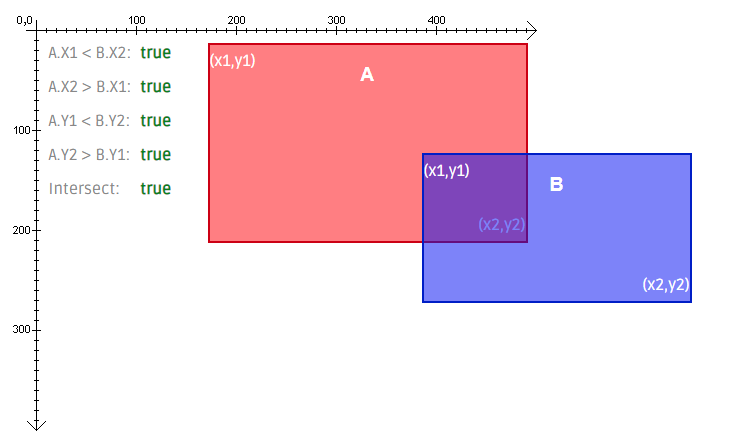

# JavaScript solution with visualisation

**Author:** RinatRezyapov
**Votes:** 7
**Link:** [https://leetcode.com/problems/rectangle-overlap/solutions/1754616/](https://leetcode.com/problems/rectangle-overlap/solutions/1754616/)

---

```
var isRectangleOverlap = function(rec1, rec2) {
    const [aX1, aY1, aX2, aY2] = rec1;
    const [bX1, bY1, bX2, bY2] = rec2;
    
    return aX1 < bX2 && aX2 > bX1 && aY1 < bY2 && aY2 > bY1;
};
```


