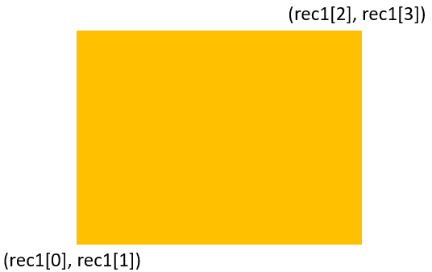
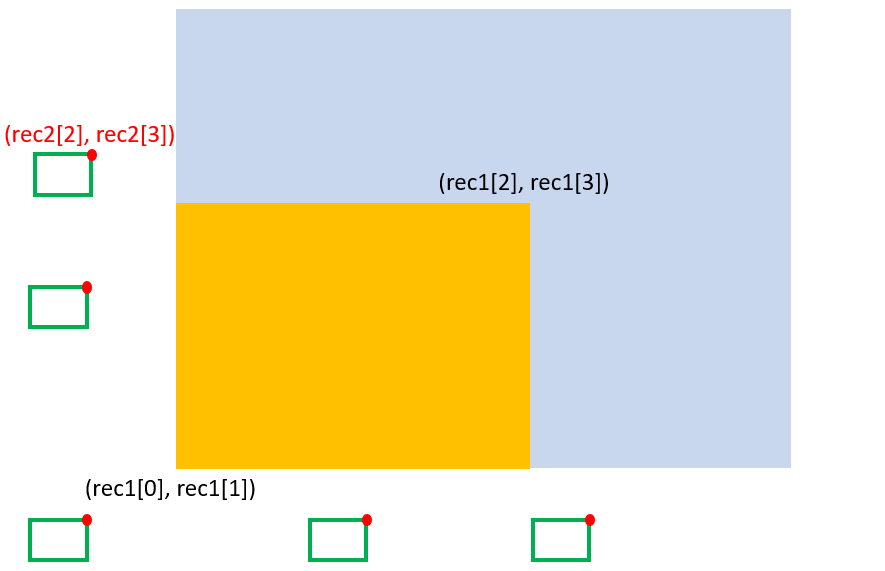
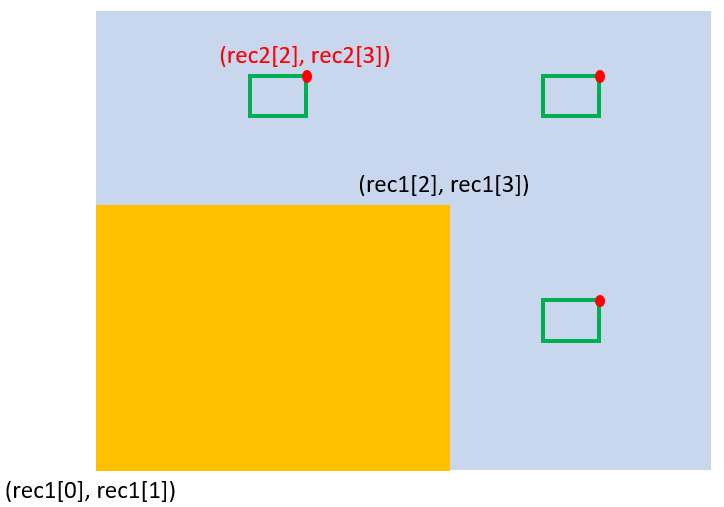
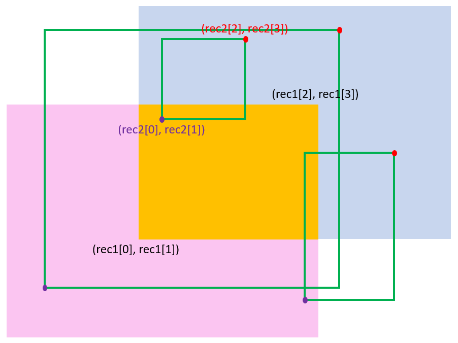

# Intuitive Graphical Explanations

**Author:** Sibo-Ding
**Votes:** 8
**Link:** [https://leetcode.com/problems/rectangle-overlap/solutions/4647191/](https://leetcode.com/problems/rectangle-overlap/solutions/4647191/)

---

# Intuition
<!-- Describe your first thoughts on how to solve this problem. -->
1. Let's fixed `rec1` and think about the conditions of `rec2` that will overlap with `rec1`. See the graph below.


2. The top-right corner of `rec2` must be on the top and right of the bottom-left corner of `rec1`. Graphically, if we use a red dot to represent the top-right corner of `rec2`, it must fall in the blue area (exclude boundaries).
In programming language: `rec1[0] < rec2[2] and rec1[1] < rec2[3]`
If the red dot is not in the blue area, there will be no overlap. Five situations are shown in green rectangles.



3. However, the above condition is not sufficient. If we don't control the bottom-left corner of `rec2`, `rec2` can be small enough to not overlap with `rec1`. See the graph below.



4. The additional condition has the same intuition as the previous one. That is, the bottom-left corner of `rec2` must be on the bottom and left of the top-right corner of `rec1`. Graphically, if we use a purple dot to represent the bottom-left corner of `rec2`, it must fall in the pink area (exclude boundaries as well).
In programming language: `rec1[2] > rec2[0] and rec1[3] > rec2[1]`


5. Use `and` to combine the above two conditions.

# Code
```
class Solution:
    def isRectangleOverlap(self, rec1: List[int], rec2: List[int]) -> bool:
        return rec1[0] < rec2[2] and rec1[1] < rec2[3] and rec1[2] > rec2[0] and rec1[3] > rec2[1]
```