# Image Explanation🏆- [Complete Intuition - Maths, Probability, DP, Sliding Window] - C++/Java/Python

**Author:** aryan_0077
**Votes:** 60
**Link:** [https://leetcode.com/problems/new-21-game/solutions/3560518/](https://leetcode.com/problems/new-21-game/solutions/3560518/)

---

# Video Solution (`Aryan Mittal`) - Link in LeetCode Profile
`New 21 Game` by `Aryan Mittal`


# Approach & Intution
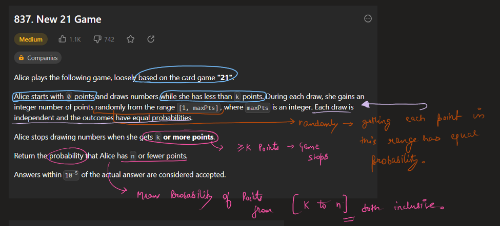
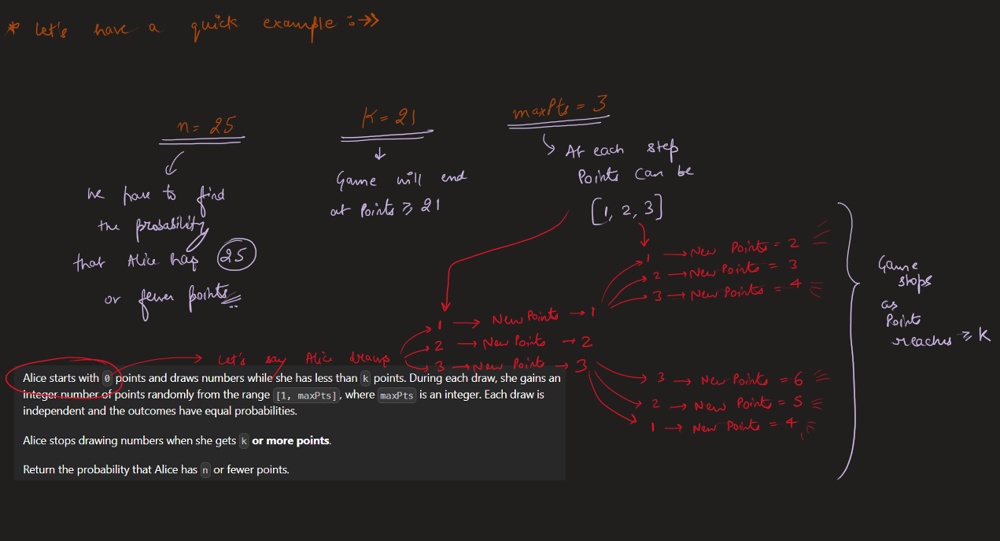
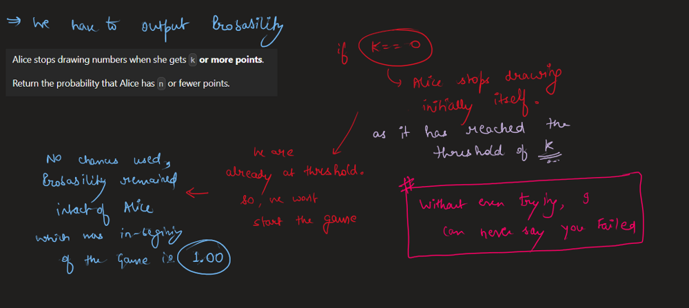
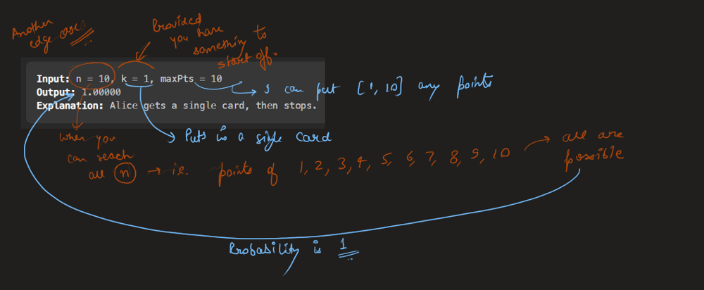
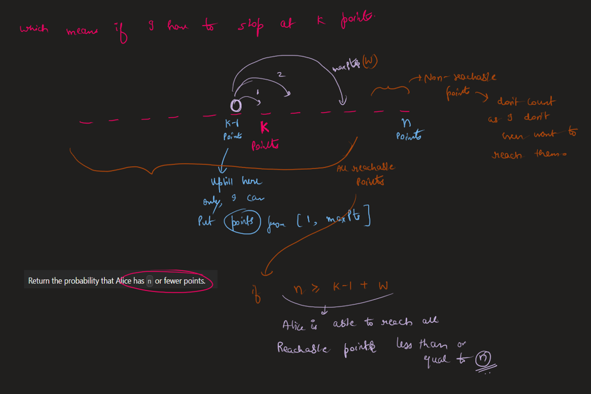
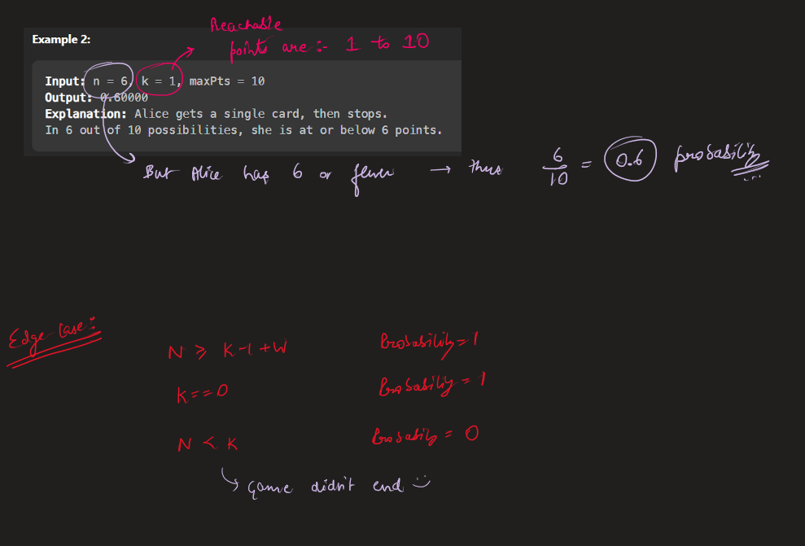
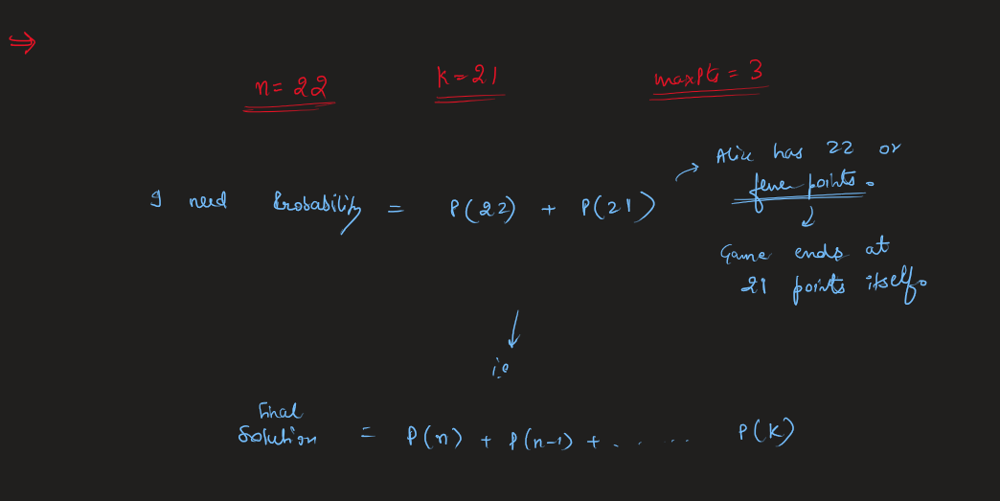
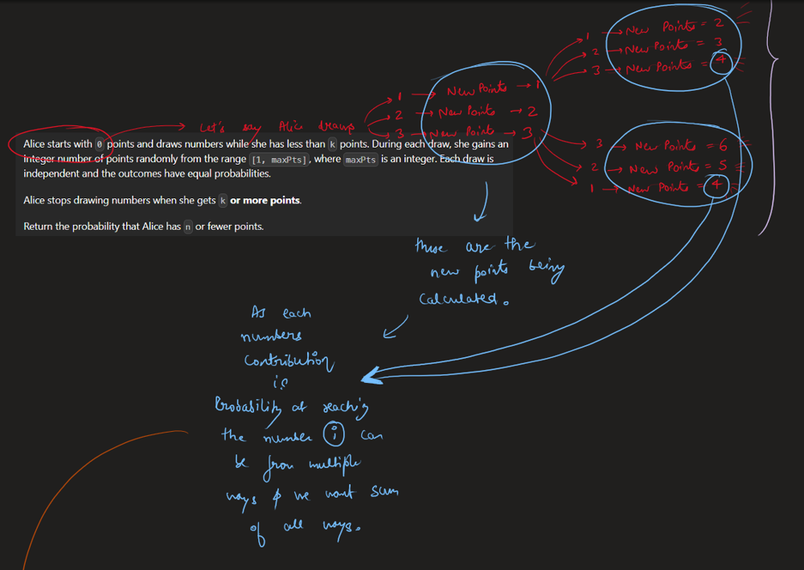
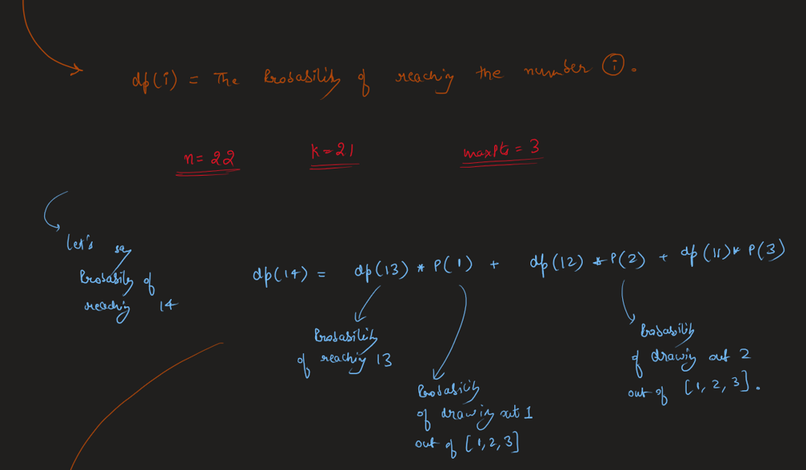
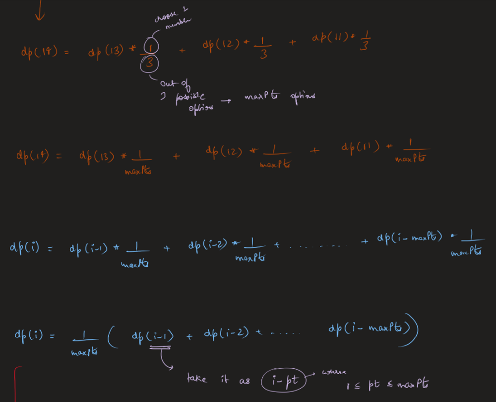
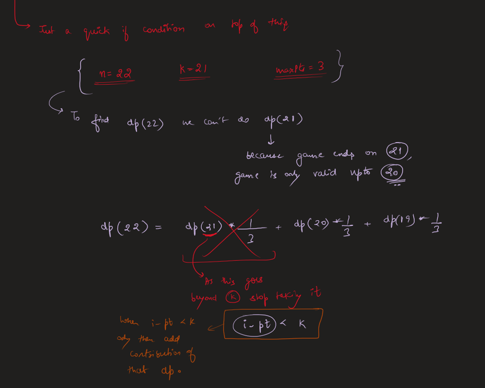
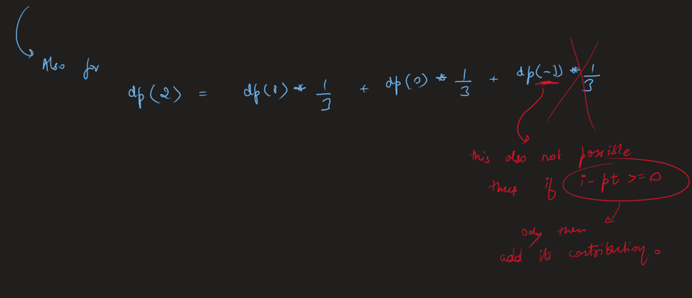
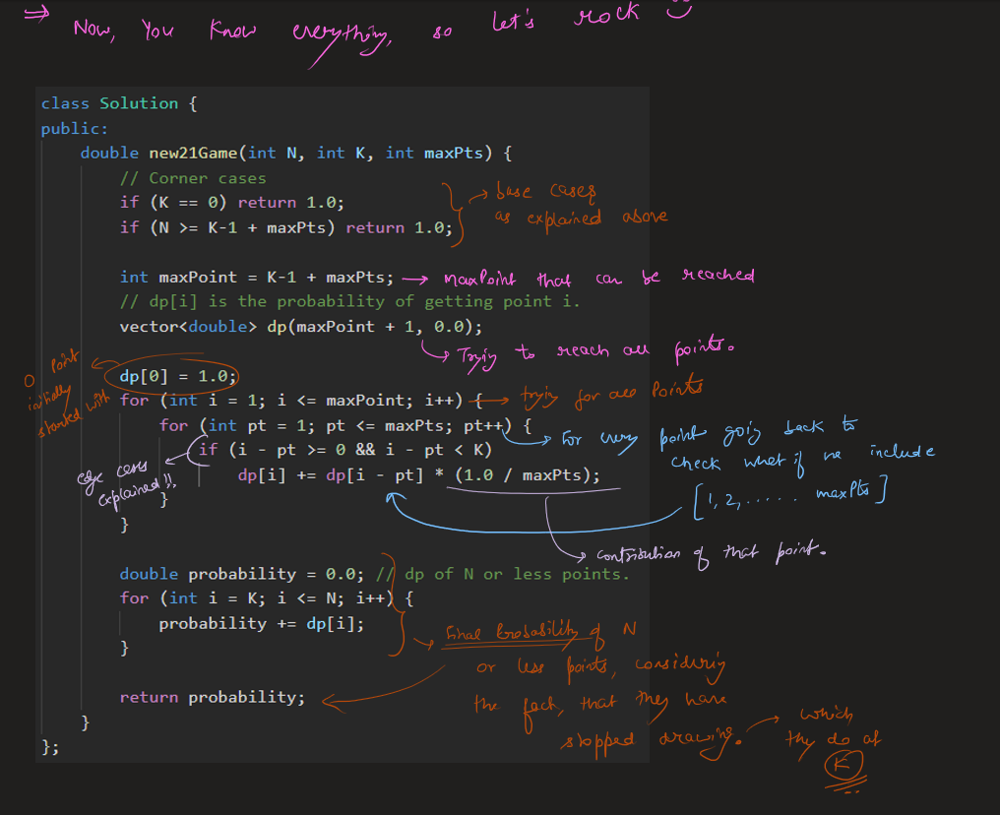
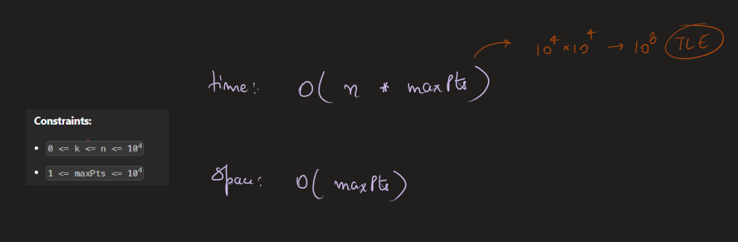
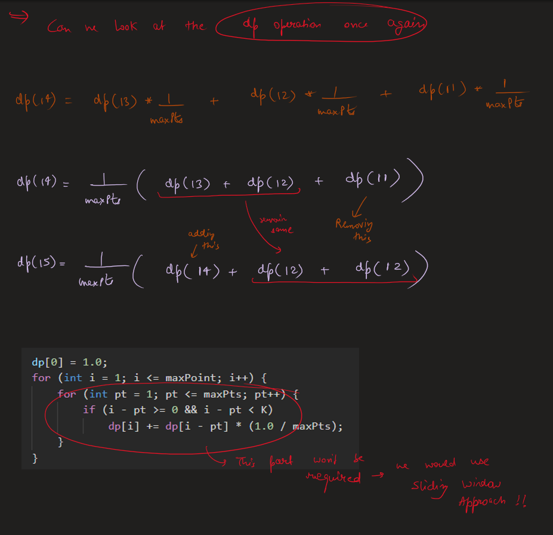
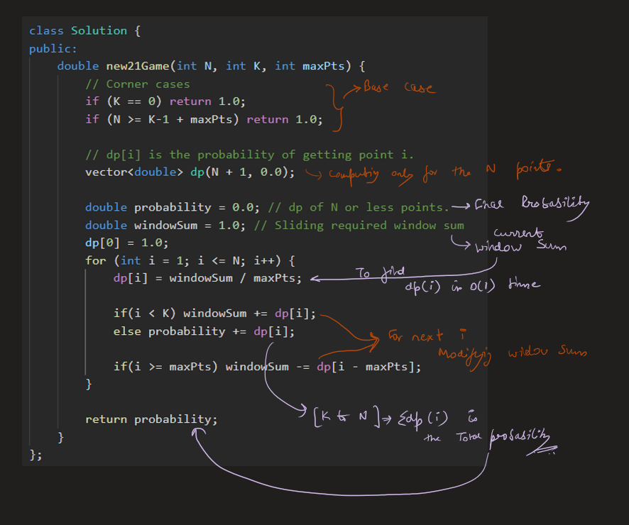


# Code
```C++ []
class Solution {
public:
    double new21Game(int N, int K, int maxPts) {
        // Corner cases
        if (K == 0) return 1.0;
        if (N >= K-1 + maxPts) return 1.0;

        // dp[i] is the probability of getting point i.
        vector<double> dp(N + 1, 0.0);

        double probability = 0.0; // dp of N or less points.
        double windowSum = 1.0; // Sliding required window sum
        dp[0] = 1.0;
        for (int i = 1; i <= N; i++) {
            dp[i] = windowSum / maxPts;

            if(i < K) windowSum += dp[i];
            else probability += dp[i];
            
            if(i >= maxPts) windowSum -= dp[i - maxPts];
        }

        return probability;
    }
};
```
```Java []
class Solution {
    public double new21Game(int N, int K, int maxPts) {
        // Corner cases
        if (K == 0) return 1.0;
        if (N >= K - 1 + maxPts) return 1.0;

        // dp[i] is the probability of getting point i.
        double[] dp = new double[N + 1];
        Arrays.fill(dp, 0.0);

        double probability = 0.0; // dp of N or less points.
        double windowSum = 1.0; // Sliding required window sum
        dp[0] = 1.0;
        for (int i = 1; i <= N; i++) {
            dp[i] = windowSum / maxPts;

            if (i < K) windowSum += dp[i];
            else probability += dp[i];

            if (i >= maxPts) windowSum -= dp[i - maxPts];
        }

        return probability;
    }
}
```
```Python []
class Solution:
    def new21Game(self, N, K, maxPts):
        # Corner cases
        if K == 0:
            return 1.0
        if N >= K - 1 + maxPts:
            return 1.0

        # dp[i] is the probability of getting point i.
        dp = [0.0] * (N + 1)

        probability = 0.0  # dp of N or less points.
        windowSum = 1.0  # Sliding required window sum
        dp[0] = 1.0
        for i in range(1, N + 1):
            dp[i] = windowSum / maxPts

            if i < K:
                windowSum += dp[i]
            else:
                probability += dp[i]

            if i >= maxPts:
                windowSum -= dp[i - maxPts]

        return probability
```