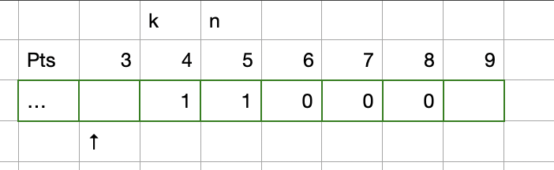
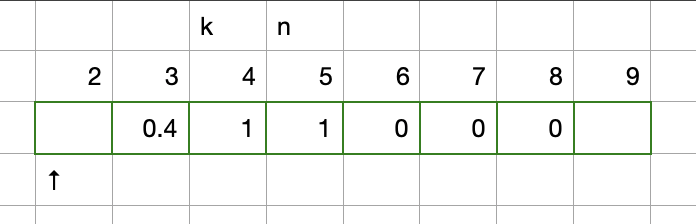
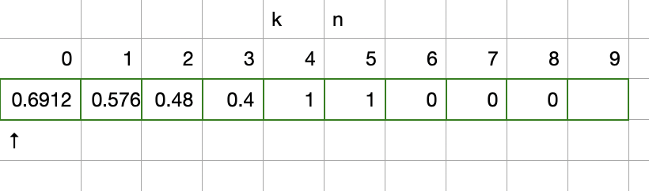

# [Ruby] Reverse solution, with image examplanation step by step

**Author:** Hegwin
**Votes:** 2
**Link:** [https://leetcode.com/problems/new-21-game/solutions/3055487/](https://leetcode.com/problems/new-21-game/solutions/3055487/)

---

# Intuition

Supposing $n = 5, k = 4, maxPts = 5$.

we use an array `result[]` to represent:

```
  result[x] := The probability that we finally have less or equal than n points 
    when we currently have x points in hand
      and we draw cards till we have k points
```

By that definition:
  1. When we have $4$ points, we can not draw any more, and the probability having less or equal than $5$ points is $1.0$
  2. When we have $5$ points, we can not draw any more, and the probability having less or equal than $5$ points is $1.0$
  3. When we have $6$ points, we can not draw any more, and the probability having less or equal than $5$ points is $0.0$
  4. ...

Let's puts this in the image below:




What will happen when we have 3 points in hand?

1. We have $1/5$ probability to get 1 point and reach $4$;
2. We have $1/5$ probability to get 2 points and reach $5$;
3. We have $1/5$ probability to get `3/4/5` points and reach `6/7/8`, but already goes over 5;

By this we get:

$$
result[3] = \\frac{1}{5} \	imes result[4] + \\frac{1}{5} \	imes result[5] + ... + \\frac{1}{5} \	imes result[8]

= \\frac{1}{5} \	imes (result[4]+result[5]+ result[6] + result[7] + result[8])
$$

```
result[3] = 0.4
```



Then let's have look at `result[2]`:

1. We have `1/5` chance to to 3 (calculated in previous step);
2. We have `1/5` chance to go to either 4 or 5 (got by definition);
3. We have `1/5` chance to go to either 6 or 7 (got by definition);

$$
result[2] = \\frac{1}{5} \	imes (result[3]+result[4]+ result[5] + result[6] + result[7])
$$

```
result[2] = 0.48
```

And loop until we get to result[0]:



As we've defined, `result[0]` represents *the probability we will have less than or equal to n points when we have 0 points in hand, we continue drawing until we have at least k points*.

That's the answer.


# Complexity
- Time complexity: $$O(k+n)$$

- Space complexity: $$O(k+maxPts)$$

# Code
```
# @param {Integer} n
# @param {Integer} k
# @param {Integer} max_pts
# @return {Float}
def new21_game(n, k, max_pts)
  return 1 if k - 1 + max_pts <= n # We can never reach n when we stop at k

  result = Array.new(k + max_pts, 0.0)

  k.upto(n) do |i|
    result[i] = 1
  end

  sum = result[k...(k+max_pts)].sum

  (k-1).downto(0) do |i|
    result[i] = sum / max_pts
    sum += result[i] - result[i+max_pts]
  end

  result[0]
end
```