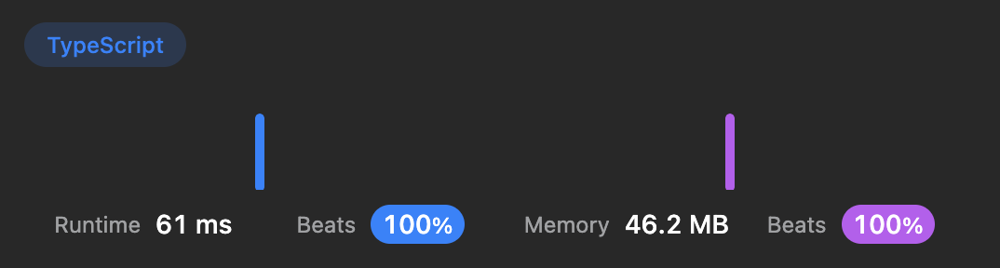

# 🚀 61ms, 100% Beats Runtime. TypeScript, JavaScript

**Author:** ArtMe
**Votes:** 0
**Link:** [https://leetcode.com/problems/new-21-game/solutions/3562953/](https://leetcode.com/problems/new-21-game/solutions/3562953/)

---

# Code
``` typescript []
function new21Game(n: number, k: number, maxPts: number): number {
    if (k + maxPts <= n || k === 0) {
        return 1;
    }
    let dp: number[] = new Array(n + 1);
    dp[0] = 1;
    let s = k > 0 ? 1 : 0;
    for (let i = 1; i <= n; i++) {
        dp[i] = s / maxPts;
        if (i < k) {
            s += dp[i];
        }
        if (i - maxPts >= 0 && i - maxPts < k) {
            s -= dp[i - maxPts];
        }
    }
    let ans = 0;
    for (let i = k; i <= n; i++) {
        ans += dp[i];
    }
    return ans;
};
```
``` javascript []
function new21Game(n: number, k: number, maxPts: number): number {
    if (k + maxPts <= n || k === 0) {
        return 1;
    }
    let dp = new Array(n + 1);
    dp[0] = 1;
    let s = k > 0 ? 1 : 0;
    for (let i = 1; i <= n; i++) {
        dp[i] = s / maxPts;
        if (i < k) {
            s += dp[i];
        }
        if (i - maxPts >= 0 && i - maxPts < k) {
            s -= dp[i - maxPts];
        }
    }
    let ans = 0;
    for (let i = k; i <= n; i++) {
        ans += dp[i];
    }
    return ans;
};
```

