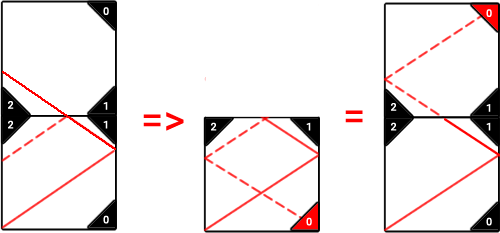
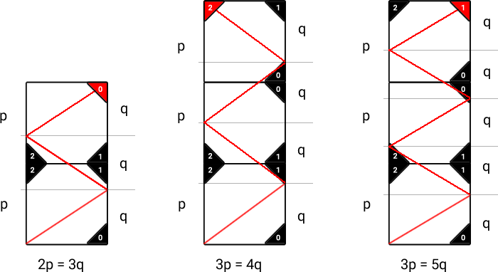
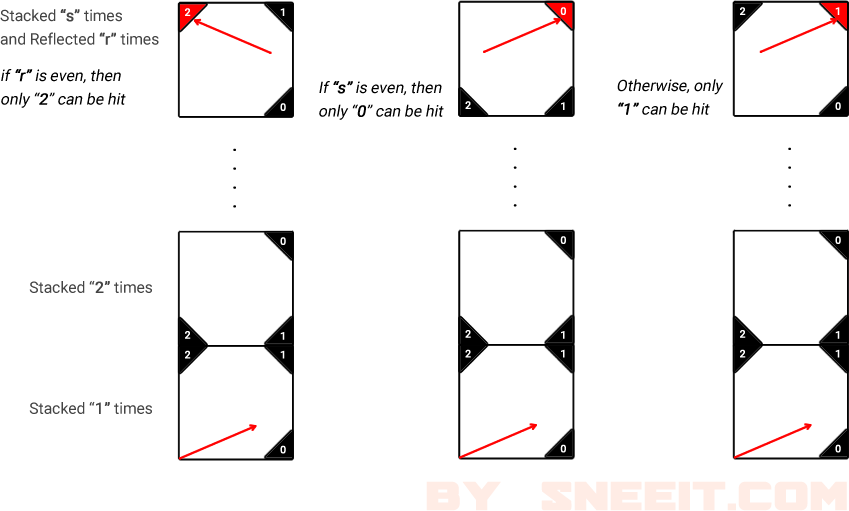

# ✔️ Pseudocode - Explain Why Odd and Even Matter

**Author:** timcodex
**Votes:** 107
**Link:** [https://leetcode.com/problems/mirror-reflection/solutions/2377070/](https://leetcode.com/problems/mirror-reflection/solutions/2377070/)

---

Imagine that after the ray goes over the top edge, it will not reflect back but continue going through another box that stacked on the previous box. 
**And this current box is a flipped version of the previous box.**

...



...


Because the ray will hit one of the corners eventually so the total height the ray traveled equals to the total height of stacked boxes. We have this equation:
```
s*p = r*q
// s = number of stacked boxes
// r = number of reflecting times
```
...

...

If `p` and `q` are both even, they are the multiples of 2, so we can divide `p` and `q` by 2 to reduce our equation.
```
// For example
s*p = r*q 
=> s*2*2*x = r*2*2*y
=> s*x = r*y

// or
s*p = r*q 
=> s*2*2*x = r*2*2*2*y
=> s*x = r*2*y
```

Eventually, only `p` or `q` will be even or both are odd.

* If `p` is even then `q` is odd, and because `s*p = r*q` then `r` should be even
=> **numer of reflecting times is even** means the ray ends at the **top-left corner** which could be only the corner `2`

* Else, the ray ends at the **top-right corner** of a box. 
	* If `q` is even then `p` is odd, and because `s*p = r*q` then `s` should be even 
	=> **the number of stacked boxes is even** means the current box is **the flipped version** of the original box so the top-right corner should be only `0`
	
	* Otherwise, neither `2` or `0` then the ray eventually hits `1`

......
......




```
// pseudo code
function mirrorReflection(p,q) {
	// reduce 2 from the equation
	while (p%2==0 && q%2==0) {
		p = p / 2
		q = q / 2
	}
	
	// conclusion
	if (p%2 == 0)
		return 2
	
	if (q%2 == 0)
		return 0
	
	return 1
}
```

* Space Complexity is obviously `O(1)`
* Time Complexity is `O(min(log(p), log(q))` but because q <= p so the worst case is only : `O(log(q))`