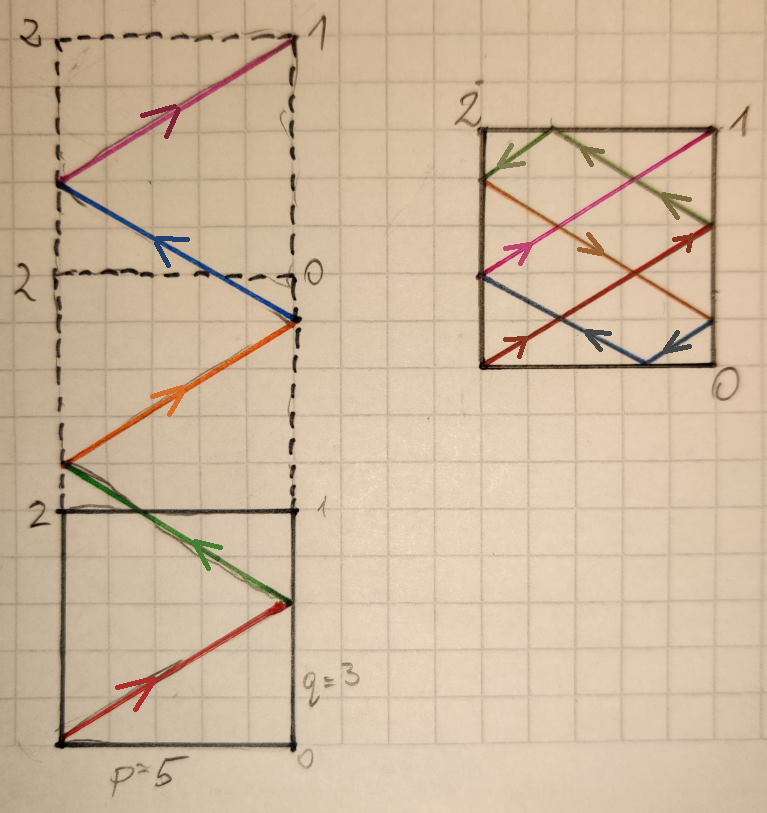

# C# faster than 100% with very simple explanation

**Author:** pawel753
**Votes:** 10
**Link:** [https://leetcode.com/problems/mirror-reflection/solutions/939379/](https://leetcode.com/problems/mirror-reflection/solutions/939379/)

---

### Idea overview
Instead of calculating all reflections we just need to continously `sum` input `q` until we reach value that *divides* `p`, i.e. `sum % p == 0`. To better understand let's visualise the reflections on on multiple squares instead of one sqare:




After we reach the edge condition we need to check are the following: **Have we finished on the *right* or *left* band (side)?**
1. If we finish on the **left** band it's simple because it's only corner `2` on the left side. 
2. Otherwise - if we finish on the **right** side - we need to figure out which corner we hit. In order to do this we count the number of additionally created squares (dotted lines on the attached photo)

```
public class Solution
{
	public int MirrorReflection(int p, int q)
	{
		if (p == q)
			return 1;
		if (q == 0)
			return 0;

		bool rightSide = true;
		int sum = q;
		int overflow = 0;
		while (sum != 0)
		{
			sum += q;
			if (sum >= p)
			{
				sum %= p;
				overflow++;
			}
			rightSide = !rightSide;
		}

		if (!rightSide)
			return 2;

		return overflow % 2 == 1 ? 1 : 0;
	}
}
```

Runtime: 36 ms, faster than 100.00% of C# online submissions for Mirror Reflection.
Memory Usage: 15.2 MB, less than 66.67% of C# online submissions for Mirror Reflection.