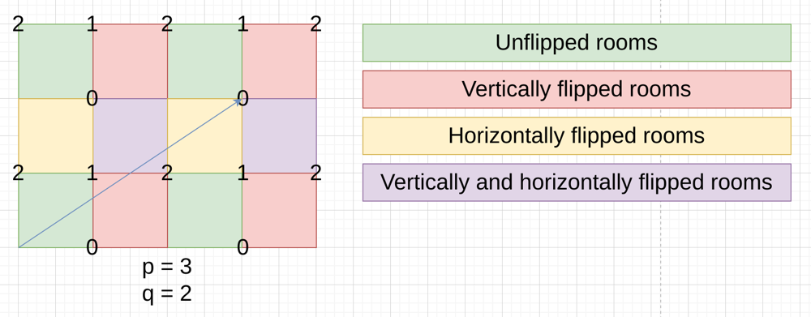

# Elixir - GCD & Parity Analysis

**Author:** Aetherus
**Votes:** 0
**Link:** [https://leetcode.com/problems/mirror-reflection/solutions/2376444/](https://leetcode.com/problems/mirror-reflection/solutions/2376444/)

---

```elixir
defmodule Solution do
  import Integer, only: [is_odd: 1, is_even: 1]

  @spec mirror_reflection(p :: integer, q :: integer) :: integer
  def mirror_reflection(p, q) do
    {p, q} = cancel(p, q)
    
    cond do
      is_even(p) and is_odd(q) ->
        2
      is_odd(p) and is_even(q) ->
        0
      is_odd(p) and is_odd(q) ->
        1
    end
  end
  
  defp gcd(a, b) when rem(a, b) == 0, do: b
  defp gcd(a, b), do: gcd(b, rem(a, b))
                   
  defp cancel(a, b) do
    factor = gcd(a, b)
    {div(a, factor), div(b, factor)}
  end
end
```

**Explanation**

Just imagine that the beam can go thru the walls. We don't need to do the physics. Just flip and tile the room infinitely, let the beam go straight, and see which receptor it hits first.



So why GCD?

Well, there are many perspectives. Mine is that you can always use a unit of length to make p and q coprime.

For example, if the room is 6 feet wide (p = 6), and the first reflection point is 4 feet above ground (q = 4), then you can create a new length unit, say "bifoot", 1 bifoot = 2 feet, then the room is 3 bifeet wide, and the first reflection point is 2 bifeet.
