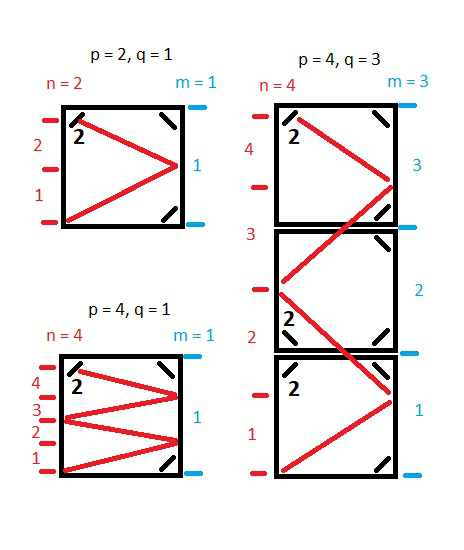
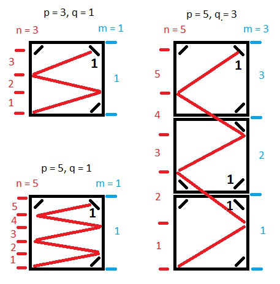
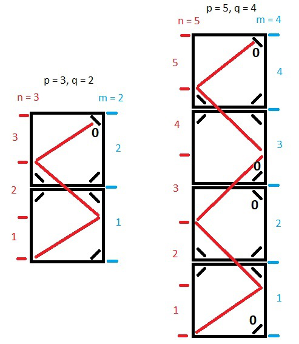

# [PHP] Easy solution with explanations and pictures!

**Author:** rozinko
**Votes:** 4
**Link:** [https://leetcode.com/problems/mirror-reflection/solutions/939466/](https://leetcode.com/problems/mirror-reflection/solutions/939466/)

---

**Hello! This solution in two steps.**

**Step 1.** We are looking for the point where the line will be in the corner. Looking for `n` and `m` so that `q * n = p * m` is correct.

**Step 2.** Return the result based on the values of `n` and `m`.

**if `n` is even, then result will be 2.**


**if `n` is odd and `m` is odd, then result will be 1.**


**if `n` is odd and `m` is even, then result will be 0.**


**And code:**
```
function mirrorReflection($p, $q)
    {
        $n = $m = 1;
        while ($q * $n != $p * $m) {
            $n++;
            if ($p * $m < $q * $n) $m++;
        }
        return $n % 2 ? $m % 2 : 2;
    }
```

If you like this solution and explanations, please **Upvote**!