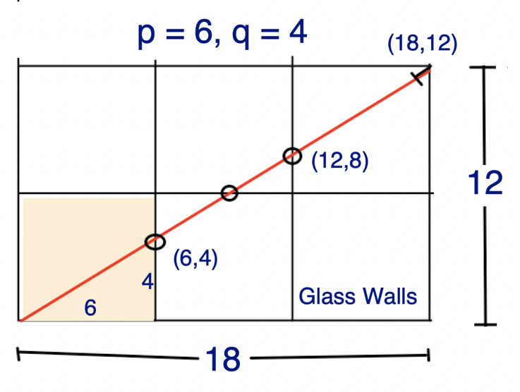
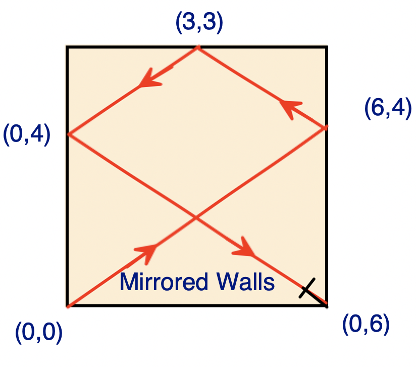

# Python3     ||  2 lines, geometry, w/ explanation    ||    T/S: 98%/ 97%

**Author:** Spaulding_
**Votes:** 86
**Link:** [https://leetcode.com/problems/mirror-reflection/solutions/2376355/](https://leetcode.com/problems/mirror-reflection/solutions/2376355/)

---

Instead of imagining one room with mirrored walls, imagine an  infinite cluster of rooms with glass walls; the light passes through to the next room and on and on until it evenually hits a corner. 

   Suppose for example:  p = 6, q = 4, which is demonstrated in the figure below.
	  


The least common multiple of 4 and 6 is 12, and 3x4 = 12, so the light will have to pass thru three walls before a multiple of 4 and a multiple   of 6 coincide. In the mirrored room, the light would reflect off of three walls before hitting a corner, and three bounces bring us to  receptor zero in the bottom right corner


There's still some similar triangles and some other geometry to wrestle with, but the algorithm emerges eventually.

Here's my code:

```
class Solution:
    def mirrorReflection(self, p: int, q: int) -> int:

        L = lcm(p,q)

        return 2 if (L//q)%2 == 0  else (L//p)%2
```
[https://leetcode.com/problems/mirror-reflection/submissions/1265163038/](https://leetcode.com/problems/mirror-reflection/submissions/1265163038/)

I could be wrong, but I think that time complexity is *O*(log(min(*P*,*Q*) (due to `lcm`) and space complexity is *O*(1), in which *P*, *Q* ~ `p`,`q`. 
```
```
Here's another version using the identity lcm(p,q) x gcd(p,q) == p x q:
```
class Solution:
    def mirrorReflection(self, p: int, q: int) -> int:
        # L*G = p*q  <=> L/q = p/G <=> L/p = q/G

        G = gcd(p,q)
        p//= G
        q//= G
        
        return 2 if p%2 == 0 else q%2