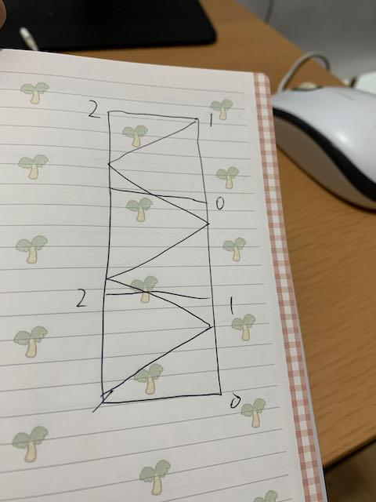

# Swift Easy Solution with Picture Explanation

**Author:** machinemxy
**Votes:** 1
**Link:** [https://leetcode.com/problems/mirror-reflection/solutions/2376344/](https://leetcode.com/problems/mirror-reflection/solutions/2376344/)

---


Image the room height is infinity, so every time it reach side wall, the vertical distance will increase q. And once the vertical distance mod p == 0, it means it reaches a certain receptor.
```
class Solution {
	func mirrorReflection(_ p: Int, _ q: Int) -> Int {
		var verticalDistance = 0
		for i in 1...Int.max {
			verticalDistance += q
			if verticalDistance % p == 0 {
				if i % 2 == 0 {
					return 2
				} else if verticalDistance / p % 2 == 0 {
					return 0
				} else {
					return 1
				}
			}
		}
		return 0 // won't really reach here
	}
}
```