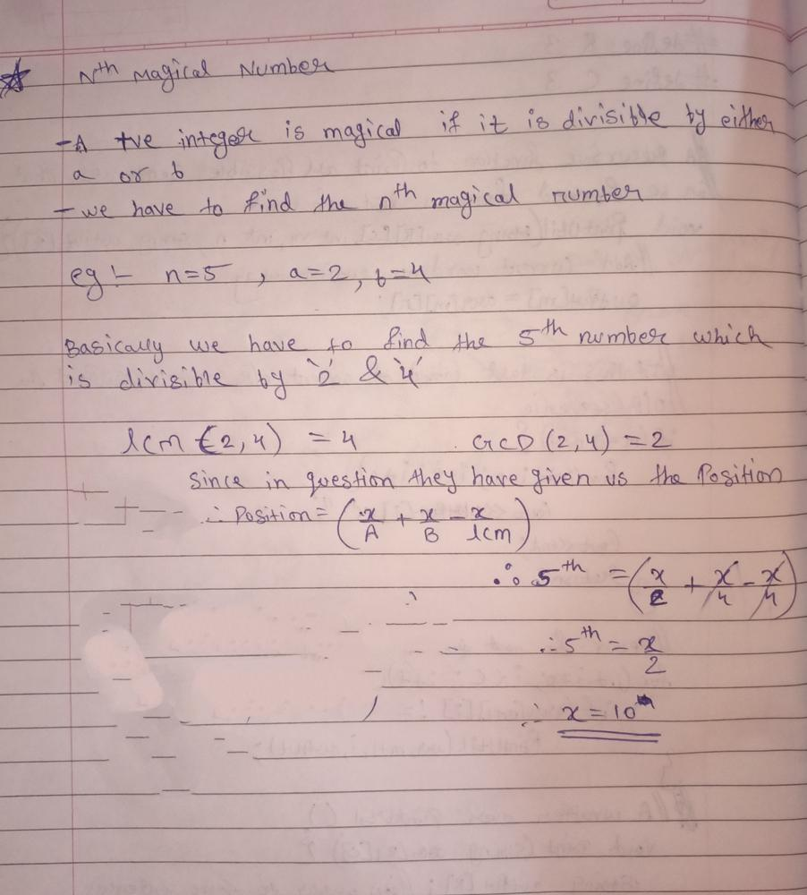

# C++ EASY TO SOLVE || Beginner Friendly detailed explanation with dry run || Image based Explanation

**Author:** Cosmic_Phantom
**Votes:** 29
**Link:** [https://leetcode.com/problems/nth-magical-number/solutions/1622417/](https://leetcode.com/problems/nth-magical-number/solutions/1622417/)

---

# **Magical Doge Approach with Doginary  search || Nth magical number using binary search and math**

**Intuition:-**
After reading the question we get the gist that we have to  find the `nth magical number` which is divisible by `a` and `b` .The intuition we all got are either nothing or those who did a liitle math got the intuition of using lcm and gcd . Ok, so those who got nothing don't worry this type of patterns are standard in a question . So after solving this you will get correct future intuition in similar problems. So let's teleport our doge to the aproach section :))

**Algorithm:-**
1. Firstly, we have to find lcm so the formula for lcm is `LCM = (a*b)/__gcd(a,b)`
2. After finding the lcm we will be using the LCM in inclusion exclusion principle whose formula is given by `position_check = mid/b + mid/a - mid/LCM`  
3. The above principle helps us finds out the position of certain `x` number in the series. But in the question they have given us the position so we need to find x thus we need to check continuously whether the `x` and `position of x` are satisfying the condition or not.
3. All this checking and reinitializing happens in binary search algo .we will be using this for the reasons of  low time complexity :)
4. So the left and right boundary's will be `left=min(a,b) , right=n*1LL*min(a,b)` we can also use left and right boundary as 2 and 10^18 [given]
5. KABOOOM .That's it we are done with our hard problem,

**Before starting the code let's take a dry run[Recomended for better grasp and understanding ]**

The below dry run is the third example from description of our problem. Now let's enjoy the show:)




**Code:-**
```
//Upvote and Comment

class Solution {
public:
    #define mod 1000000007    //REMEMBER TO ADD THIS
    
    int nthMagicalNumber(int n, int a, int b) {
        //Initialize the LCM fromula  
        int lcm = (a*b)/__gcd(a,b);
        //Initializing the left and right boundary
        long long int left=min(a,b) , right=n*1LL*min(a,b);
        //our ans 
        long long int ans = 0;
        //binary search algo implementation
        while(left<=right){
            //Middle position 
            long long int mid = (left + (right-left)/2);
            //inclusion exclusion principle for position_check
            long long int position_check = mid/b + mid/a - mid/lcm ;
            //if position is low ,increment left pointer
            if(position_check < n) left = mid +1 ;
            //else our ans and decrement the right pointer
            else {
             ans=mid%mod;
             right=mid-1;
         }
        }
        return ans;
    }  
};
```


**Time Complexity:O(log(n\u2217min(a,b)))
Space Complexity: O(1)**.

