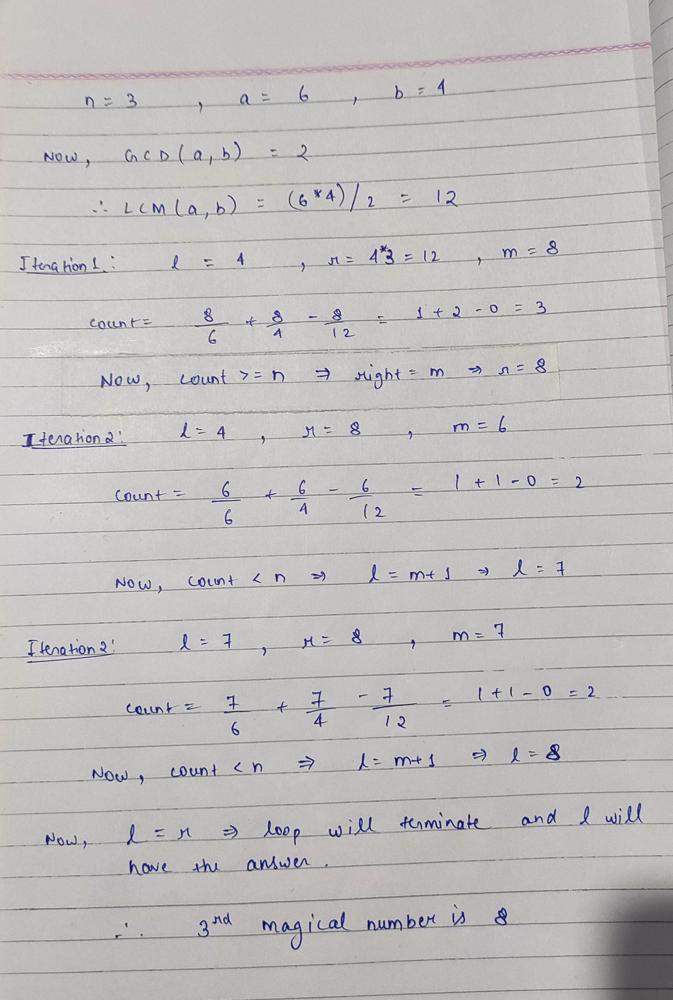

# JAVA | Binary Search | Detailed Explanation Using Image

**Author:** Chaitanya1706
**Votes:** 82
**Link:** [https://leetcode.com/problems/nth-magical-number/solutions/1622336/](https://leetcode.com/problems/nth-magical-number/solutions/1622336/)

---

**Intution:** Before solving this problem lets first understand some of the concepts:
**1.)** If you have to tell how many numbers less than x are divisible by n, then you do x/n to calculate. For example if x = 14 and n = 3 then x/n = 4 that means there are 4 numbers less than 14 which are divisible by 3 (i.e., 3, 6, 9, 12).
**2.)** So in case you are given 2 numbers n1 and n2 then you have to check for both the numbers similarly. For example, x = 25, n1 = 3, n2 = 4, then x/n1 = 8 (3, 6, 9, 12,15,18,21,24)  and x/n2 = 6 (4, 8, 12,16,20,24),  so the answer should be 8+6 = 14. But if u see then we have 12 and 24 repeated for n1 and n2 and these are nothing but the multiples of LCM of n1 and n2. And this is obvious also, the common multiples will repeat in both the cases, so we need to subtract common multiples.
**3.)** So now total will be **x/n1 + x/n2 - x/LCM(a,b)** = 25/3 + 25/4 - 25/12 = 8 + 6 - 2 = 12. And this is the maths for this question.
**4.)** Now to find LCM we know that **n1 * n2 = LCM(n1,n2) * GCD(n1,n2)**
**5.)** Now we just need to binary search between lowest and highest range. 
**6.)** Lower limit will be min(n1,n2) and higher limit n * min(n1,n2) 

**Time Complexity: O(log(n*min(n1,n2))**
**Explanation:**


```
class Solution {
    public int nthMagicalNumber(int n, int a, int b) {
        
        long A = a, B = b;
        long mod = (long)(Math.pow(10,9)+7);
        
        
        long left = Math.min(a,b), right = (long)n*Math.min(a,b);
        
		// Finding GCD
        while (B > 0) {
            long tmp = A;
            A = B;
            B = tmp % B;
        }
		
        long lcm = (a*b)/A;     //(n1*n2)/GCD
		
        while (left < right) {
            long m = left+(right-left)/2;
			
            if ((m / a) + (m / b) - (m / lcm) < n) left = m + 1;   
			
            else right = m;
        }
        return (int)(left % mod);
    }
}
```
Thanks for reading!!