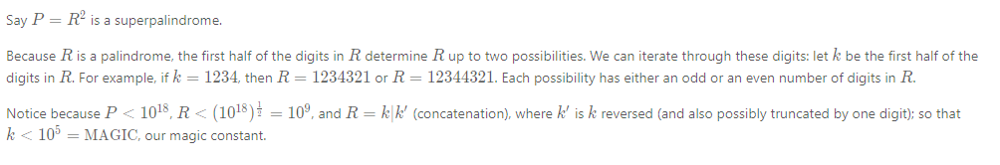

# [C++] Easy Solution with Explaination

**Author:** yadvendrak01
**Votes:** 5
**Link:** [https://leetcode.com/problems/super-palindromes/solutions/1197598/](https://leetcode.com/problems/super-palindromes/solutions/1197598/)

---

*Note.: Solution is created by taking help from leetcode Solution*
**Intution :**

*Below is the Explanation from leetcode solution:*



```
class Solution {
public:
    int superpalindromesInRange(string left, string right) {
        long L = stol(left) , R = stol(right);
        
        int magic = 100000 , ans = 0;
        string s = "";
        //count odd length;
        for(int k = 1 ; k  < magic ; k++){
            s = to_string(k);
            for(int i = s.length() - 2 ; i >= 0; i--){
                s += s.at(i);
            }
            long v = stol(s);
            v *= v;
            if(v > R) break;
            if(v >= L && isPalindrome(v)) ans++;
        }
        
        //count even length;
        for(int k = 1 ; k < magic ; k++){
            s = to_string(k);
            for(int i = s.length() - 1 ; i >= 0 ; i--){
                s += s.at(i);
            }
            long v = stol(s);
            v *= v;
            if(v > R) break;
            if(v >= L && isPalindrome(v)) ans++;
        }
        return ans;
    }
    
    bool isPalindrome(long x){
        return x == reverse(x);
    }
    
    long reverse(long x ){
        long ans = 0;
        while(x > 0){
            ans = 10 * ans + x % 10;
            x /= 10;
        }
        return ans;
    }
};
```


****