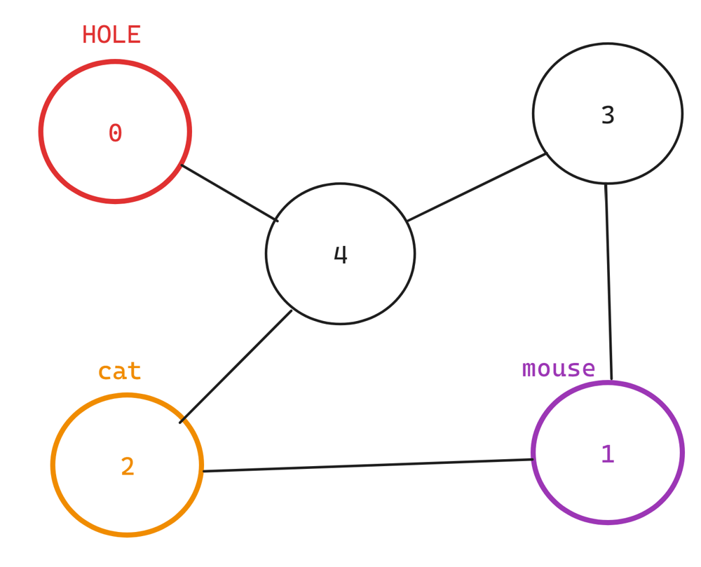
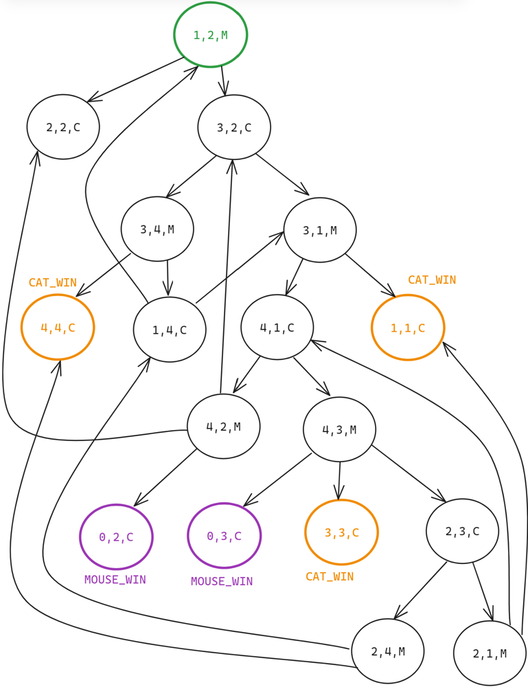

# [Python] BFS solution with detailed explanation, TC: O(N^3), SC: O(N^2)

**Author:** alwayssmile99
**Votes:** 8
**Link:** [https://leetcode.com/problems/cat-and-mouse/solutions/5256599/](https://leetcode.com/problems/cat-and-mouse/solutions/5256599/)

---

# Approach
- In this problem, we are modeling the positions of a cat and a mouse on a graph and determining the outcome of their game given optimal play by both. The game's state can be represented as a tuple **`(mouse_position, cat_position, turn)`**, where turn indicates whose move it is. 
- The initial state is **`(1, 2, MOUSE)`**, meaning the mouse starts at position 1, the cat starts at position 2, and it is the mouse's turn to move.
- Base cases:
   1. If **`mouse_position = 0`**, the mouse wins, i.e. 
    **`result(mouse_position=0, cat_position=any, turn=any) = MOUSE_WIN`**
   2. If **`mouse_position = cat_position`**, the cat wins, i.e. 
    **`result(mouse_position=i, cat_position=i, turn=any) = CAT_WIN`** (i >= 1)

**E.g.** Graph $$G$$
{:style='width:300px'}


Corresponding game-state graph of $$G$$             

{:style='width:400px'}


- Our task is to find the result of the initial state **`(1, 2, MOUSE)`**. Given that both the cat and the mouse play optimally to minimize their chances of losing, we can use a brute-force approach to visualize their optimal strategy. The strategy involves exploring all possible moves and outcomes recursively. Here's a brute-force pseudo-code to illustrate the optimal strategy of both players:
    ```
    def result(mouse_pos, cat_pos, turn):
        if mouse_pos == 0:
            return MOUSE_WIN
        if mouse_pos == cat_pos:
            return CAT_WIN
        if (mouse_pos, cat_pos, turn) in visited: //there is a cycle
            return DRAW
        
        try:
            visited.add((mouse_pos, cat_pos, turn))
            if turn == MOUSE:
                next_mouse_positions = get_next_possible_positions(mouse_pos)
                for next_mouse_pos in next_mouse_positions:
                    if result(next_mouse_pos, cat_pos, turn=CAT) == MOUSE_WIN:
                        return MOUSE_WIN
                for next_mouse_pos in next_mouse_positions:
                    if result(next_mouse_pos, cat_pos, turn=CAT) == DRAW:
                        return DRAW
                return CAT_WIN

            else if turn == CAT:
                next_cat_positions = get_next_possible_positions(cat_pos)
                for next_cat_pos in next_cat_positions:
                    if result(mouse_pos, next_cat_pos, turn=MOUSE) == CAT_WIN:
                        return CAT_WIN
                for next_cat_pos in next_cat_positions:
                    if result(mouse_pos, next_cat_pos, turn=MOUSE) == DRAW:
                        return DRAW
                return MOUSE_WIN
        finally:
            visited.remove((mouse_pos, cat_pos, turn))
    ```
- Obviously, the brute-force approach has exponential time complexity, we need a more optimal approach.
Since the state graph is a directed **cyclic** graph, DFS with memoization (DP top-down) is not suitable for finding the answer. 
Instead, we'll use a **topology-like** algorithm based on **multi-source BFS** to find the shortest path from the **`CAT_WIN`** and **`MOUSE_WIN`** states to the initial state.

# Implementation
Here is the python implementation of the solution using BFS:
```python
#turns
MOUSE = 0
CAT = 1 
#states
MOUSE_WIN = 1 
CAT_WIN = 2
DRAW = 0
class Solution:
    def catMouseGame(self, graph: List[List[int]]) -> int:
        n = len(graph)

        # Initialize result map with terminal states (MOUSE_WIN/CAT_WIN)
        results = {} #map (mouse_pos, cat_pos, turn) -> result
        for i in range(1, n):
            results[0, i, CAT] = results[0, i, MOUSE] = MOUSE_WIN
            results[i, i, CAT] = results[i, i, MOUSE] = CAT_WIN 

        #Compute outdegree for all possible states 
        degree = {} #map (mouse_pos, cat_pos, turn) -> number of next states
        for mouse in range(1, n):
            for cat in range(1, n):
                degree[mouse, cat, MOUSE] = len(graph[mouse]) 
                degree[mouse, cat, CAT] = len(graph[cat]) - int(0 in graph[cat])
        
        # Initialize the queue with terminal states
        q = deque([state for state in results.keys()])
        #BFS
        while q: 
            mouse, cat, turn = q.popleft()
            curResult = results[mouse, cat, turn]

            # Determine previous states based on the current turn
            prevStates = [] 
            if turn == MOUSE:
                prevStates = [(mouse, prevCat, CAT) for prevCat in graph[cat]]
            else:
                prevStates = [(prevMouse, cat, MOUSE) for prevMouse in graph[mouse]]

            # Update previous states based on the current state's result
            for prevState in prevStates:
                if prevState in results:
                    continue
                prevMouse, prevCat, prevTurn = prevState
                if prevCat == 0: #impossible state
                    continue 
                
                degree[prevState] -= 1
                isMoverWinner = ((curResult == MOUSE_WIN and prevTurn == MOUSE) or
                                 (curResult == CAT_WIN   and prevTurn == CAT))
                if isMoverWinner or degree[prevState] == 0:
                    results[prevState] = curResult 
                    q.append(prevState)
            
        return results.get((1, 2, MOUSE), DRAW)
```

# Explanation

1. We initialize the results dictionary to store the outcome for each state. The base cases are set where the mouse wins if it reaches the hole (position 0) and the cat wins if it catches the mouse.
We also initialize the degree dictionary to store the number of possible moves from each state.
2. We use a deque to perform BFS. We start from all known winning states (**`MOUSE_WIN`** and **`CAT_WIN`**).
   - For each state, we determine the previous states that could lead to the current state.
   - We update the results for these previous states based on the current state's result.
   - If a previous state is determined to be a winning state for the current mover or has no more moves left, we update its result and add it to the queue.
3. After processing all states, we return the result for the initial state **`(1, 2, MOUSE)`**. If no result is found, it means there are no guaranteed winning paths for either the mouse or the cat from this state, we return **`DRAW`**.
By propagating results backward from known winning states, we ensure that the mouse and cat play optimally, minimizing their chances of losing.

# Complexity
- Time complexity: $$O(n^3)$$
<!-- Add your time complexity here, e.g. $$O(n)$$ -->

- Space complexity: $$O(n^2)$$
<!-- Add your space complexity here, e.g. $$O(n)$$ -->