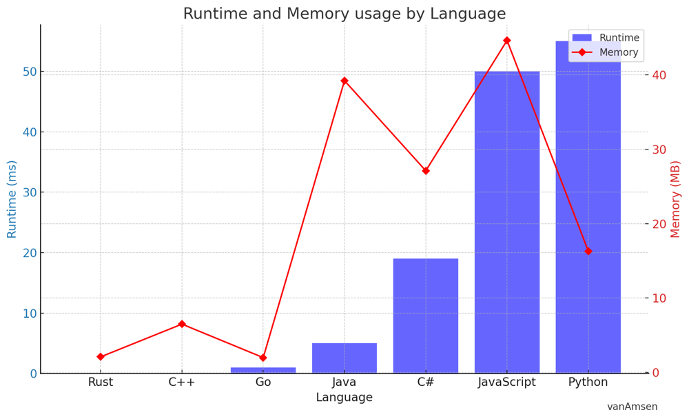

# ✅ 100% Dynamic Programming [VIDEO] Creating Unique Music Playlists

**Author:** vanAmsen
**Votes:** 71
**Link:** [https://leetcode.com/problems/number-of-music-playlists/solutions/3869510/](https://leetcode.com/problems/number-of-music-playlists/solutions/3869510/)

---

# Intuition
The task is to create a music playlist with `n` different songs and a total of `goal` songs, where each song must be played at least once, and a song can only be played again if `k` other songs have been played. The challenge is to calculate the total number of possible playlists.

At first glance, this might seem daunting. However, by using dynamic programming, we can break the problem down into manageable parts. We start by recognizing that the number of playlists of length `i` with `j` unique songs depends on the number of playlists of length `i-1` with `j-1` and `j` unique songs. This leads us to a dynamic programming solution.

# Live Coding + Explenation
https://youtu.be/EbBSwGM-NnU

# Approach

1. **Understanding the Problem**: The problem involves creating a playlist with `n` different songs, such that each song is played at least once, and a song can only be played again if `k` other songs have been played. We are required to find the number of possible playlists that can be created.

2. **Identify the Approach**: We recognize this as a problem that can be solved using dynamic programming, a technique that breaks down a complex problem into simpler subproblems and avoids redundant computation by storing the results of these subproblems.

3. **Initialization**: We initialize a 2D dynamic programming table, `dp`, with two rows and `n+1` columns. Each cell `dp[i][j]` represents the number of playlists of length `i` with `j` unique songs. 

   - **Why only two rows in our DP table?** You might be wondering why we're using `i%2` and `(i - 1)%2` in our `dp` table. This is a memory optimization technique called "rolling array" or "sliding window". Since our current state only depends on the previous state, we don't need to store all the states. We only need a 2-row `dp` table: one row for the current state `i` and one row for the previous state `i - 1`. By using `i%2`, we ensure that `i` is always mapped to either `0` or `1`, effectively keeping our `dp` table within 2 rows.

4. **Populating the DP Table**: We start populating the DP table from the first song to the goal. For each song, we consider two cases - adding a new song or adding an old song.

   - **Adding a New Song**: If we add a new song, it has to be one of the songs that have not yet been included in the playlist. Hence, the number of ways to do this is the number of ways to create a playlist of length `i - 1` with `j - 1` unique songs, times the number of new songs available, which is `n - (j - 1)`.
   
   - **Adding an Old Song**: If we add an old song, it has to be one of the songs that were not among the last `k` songs played. Hence, the number of ways to do this is the number of ways to create a playlist of length `i - 1` with `j` unique songs, times the number of old songs available, which is `j - k`.

5. **Modulo Operation**: Since the number of ways can be very large, we take the modulo of the count of ways by `10^9 + 7` after each step to prevent overflow.

6. **Return the Result**: Finally, the number of playlists that meet all conditions is represented by `dp[goal%2][n]`, and we return this as our answer.

# Complexity
- Time complexity: $$O(n \	imes \	ext{{goal}})$$, as we need to calculate a result for each combination of playlist lengths and song quantities.
- Space complexity: $$O(n)$$, as we only maintain two rows of the `dp` table at any point in time, significantly optimizing our space usage.

# Performance


| Language | Runtime (ms) | Beats (%) | Memory (MB) | Beats (%) |
|----------|--------------|-----------|-------------|-----------|
| Rust     | 0            | 100.00    | 2.1         | 100.00    |
| C++      | 0            | 100.00    | 6.5         | 58.11     |
| Go       | 1            | 50.00     | 2.0         | 100.00    |
| Java     | 5            | 82.42     | 39.2        | 97.80     |
| C#       | 19           | 100.00    | 27.1        | 100.00    |
| JavaScript| 50          | 100.00    | 44.6        | 100.00    |
| Python   | 55           | 83.46     | 16.3        | 90.98     |





# Code
``` Python []
class Solution:
    def numMusicPlaylists(self, n: int, goal: int, k: int) -> int:
        MOD = 10**9 + 7
        dp = [[0 for _ in range(n + 1)] for _ in range(2)]
        dp[0][0] = 1

        for i in range(1, goal + 1):
            dp[i%2][0] = 0
            for j in range(1, min(i, n) + 1):
                dp[i%2][j] = dp[(i - 1)%2][j - 1] * (n - (j - 1)) % MOD
                if j > k:
                    dp[i%2][j] = (dp[i%2][j] + dp[(i - 1)%2][j] * (j - k)) % MOD

        return dp[goal%2][n]
```
``` C++ []
class Solution {
public:
    int numMusicPlaylists(int n, int goal, int k) {
        const int MOD = 1e9 + 7;
        vector<vector<long long>> dp(2, vector<long long>(n+1, 0));
        dp[0][0] = 1;

        for (int i = 1; i <= goal; i++) {
            dp[i%2][0] = 0;
            for (int j = 1; j <= min(i, n); j++) {
                dp[i%2][j] = dp[(i - 1)%2][j - 1] * (n - (j - 1)) % MOD;
                if (j > k)
                    dp[i%2][j] = (dp[i%2][j] + dp[(i - 1)%2][j] * (j - k)) % MOD;
            }
        }

        return dp[goal%2][n];
    }
};
```
``` Java []
class Solution {
    public int numMusicPlaylists(int n, int goal, int k) {
        final int MOD = (int)1e9 + 7;
        long[][] dp = new long[2][n+1];
        dp[0][0] = 1;

        for (int i = 1; i <= goal; i++) {
            dp[i%2][0] = 0;
            for (int j = 1; j <= Math.min(i, n); j++) {
                dp[i%2][j] = dp[(i - 1)%2][j - 1] * (n - (j - 1)) % MOD;
                if (j > k)
                    dp[i%2][j] = (dp[i%2][j] + dp[(i - 1)%2][j] * (j - k)) % MOD;
            }
        }

        return (int)dp[goal%2][n];
    }
}
```
``` JavaScript []
/**
 * @param {number} n
 * @param {number} goal
 * @param {number} k
 * @return {number}
 */
var numMusicPlaylists = function(n, goal, k) {
    const MOD = 1e9 + 7;
    let dp = Array.from({length: 2}, () => new Array(n + 1).fill(0));
    dp[0][0] = 1;

    for (let i = 1; i <= goal; i++) {
        dp[i%2][0] = 0;
        for (let j = 1; j <= Math.min(i, n); j++) {
            dp[i%2][j] = dp[(i - 1)%2][j - 1] * (n - (j - 1)) % MOD;
            if (j > k)
                dp[i%2][j] = (dp[i%2][j] + dp[(i - 1)%2][j] * (j - k)) % MOD;
        }
    }

    return dp[goal%2][n];
};
```
``` C# []
public class Solution {
    public int NumMusicPlaylists(int n, int goal, int k) {
        int MOD = (int)1e9 + 7;
        long[][] dp = new long[2][];
        for (int i = 0; i < 2; i++)
            dp[i] = new long[n + 1];
        dp[0][0] = 1;

        for (int i = 1; i <= goal; i++) {
            dp[i%2][0] = 0;
            for (int j = 1; j <= Math.Min(i, n); j++) {
                dp[i%2][j] = dp[(i - 1)%2][j - 1] * (n - (j - 1)) % MOD;
                if (j > k)
                    dp[i%2][j] = (dp[i%2][j] + dp[(i - 1)%2][j] * (j - k)) % MOD;
            }
        }

        return (int)dp[goal%2][n];
    }
}
```
``` Go []
func numMusicPlaylists(n int, goal int, k int) int {
    const MOD int = 1e9 + 7
    dp := make([][]int, 2)
    for i := range dp {
        dp[i] = make([]int, n + 1)
    }
    dp[0][0] = 1

    for i := 1; i <= goal; i++ {
        dp[i%2][0] = 0
        for j := 1; j <= min(i, n); j++ {
            dp[i%2][j] = dp[(i - 1)%2][j - 1] * (n - (j - 1)) % MOD
            if j > k {
                dp[i%2][j] = (dp[i%2][j] + dp[(i - 1)%2][j] * (j - k)) % MOD
            }
        }
    }

    return dp[goal%2][n]
}

func min(a, b int) int {
    if a < b {
        return a
    }
    return b
}
```
``` Rust []
impl Solution {
    pub fn num_music_playlists(n: i32, goal: i32, k: i32) -> i32 {
        const MOD: i64 = 1e9 as i64 + 7;
        let mut dp = vec![vec![0; n as usize + 1]; 2];
        dp[0][0] = 1;

        for i in 1..=goal {
            dp[i as usize % 2][0] = 0;
            for j in 1..=std::cmp::min(i, n) {
                dp[i as usize % 2][j as usize] = dp[(i - 1) as usize % 2][(j - 1) as usize] * (n - (j - 1)) as i64 % MOD;
                if j > k {
                    dp[i as usize % 2][j as usize] = (dp[i as usize % 2][j as usize] + dp[(i - 1) as usize % 2][j as usize] * (j - k) as i64) % MOD;
                }
            }
        }

        dp[goal as usize % 2][n as usize] as i32
    }
}
```

I hope you find this solution helpful in understanding how to generate all possible music playlists under the given constraints. If you have any further questions or need additional clarifications, please don't hesitate to ask. If you understood the solution and found it beneficial, please consider giving it an upvote. Happy coding, and may your coding journey be filled with success and satisfaction! \uD83D\uDE80\uD83D\uDC68\u200D\uD83D\uDCBB\uD83D\uDC69\u200D\uD83D\uDCBB