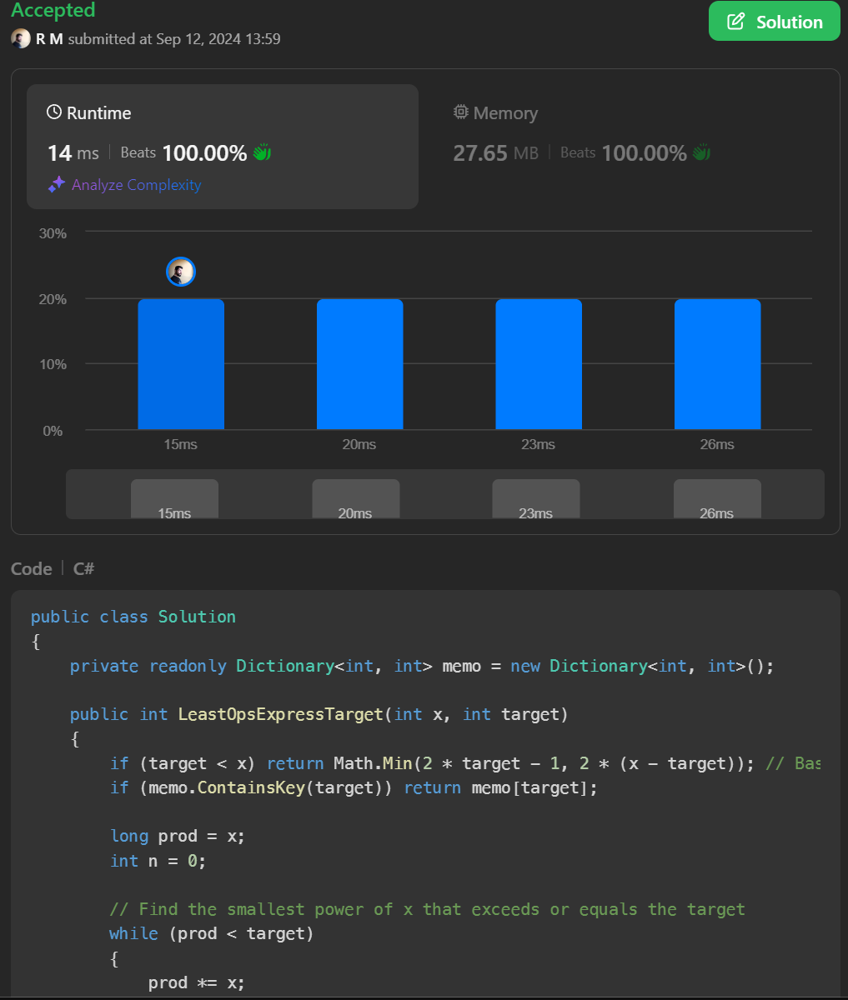

# 💥 C# | Beats 100% on runtime and memory [EXPLAINED]

**Author:** r9n
**Votes:** 10
**Link:** [https://leetcode.com/problems/least-operators-to-express-number/solutions/5777686/](https://leetcode.com/problems/least-operators-to-express-number/solutions/5777686/)

---




# Intuition
I want to express the target using the fewest operations with the number x. I\u2019ll use powers of x (like x^1, x^2, etc.) to get close to the target, then decide whether to add or subtract to hit the exact number with fewer steps.

# Approach
Find powers of x until I pass the target.

Try subtracting from the nearest smaller power and adding to the larger one.

Recursively choose the option with fewer steps, and store results to avoid repeating work.

# Complexity
- Time complexity:
O(log(target)) \u2014 We divide the target by x at each step.

- Space complexity:
O(log(target)) \u2014 For recursion and memoization.

# Code
```csharp []
public class Solution
{
    private readonly Dictionary<int, int> memo = new Dictionary<int, int>();

    public int LeastOpsExpressTarget(int x, int target)
    {
        if (target < x) return Math.Min(2 * target - 1, 2 * (x - target)); // Base case for small targets
        if (memo.ContainsKey(target)) return memo[target];

        long prod = x;
        int n = 0;

        // Find the smallest power of x that exceeds or equals the target
        while (prod < target)
        {
            prod *= x;
            n++;
        }

        // If target is exactly a power of x, we need n operators (multiplications)
        if (prod == target)
        {
            memo[target] = n;
            return n;
        }

        // Try subtracting the nearest lower power of x
        int subtractOption = LeastOpsExpressTarget(x, target - (int)(prod / x)) + n;

        // Try adding to the nearest higher power of x
        int addOption = int.MaxValue;
        if (prod - target < target)
        {
            addOption = LeastOpsExpressTarget(x, (int)(prod - target)) + n + 1;
        }

        // Memoize and return the minimum of both options
        int result = Math.Min(subtractOption, addOption);
        memo[target] = result;

        return result;
    }
}

```