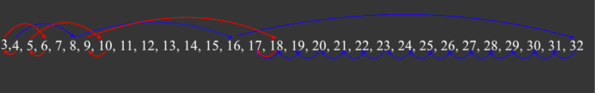

# [Python, C++] Explanation with illustration why we should work with Y not X

**Author:** dan2000kr
**Votes:** 31
**Link:** [https://leetcode.com/problems/broken-calculator/solutions/1076042/](https://leetcode.com/problems/broken-calculator/solutions/1076042/)

---

Most obvious algorithm would be to count `steps` and do `X *= 2` when `X < Y` and `X -= 1` when `X > Y`, and return `steps` when `X == Y`.
Every time when `X < Y` and we want to double `X`  we need to think, would it be better to subtract one, so when we will get `X > Y`, the difference will be smaller. Here is illustration with `X = 4, Y = 17`:
Blue \u2013 primitive way
Red \u2013 smart way



Here we see that smart logic for working with `X` not clear, we will need to calculate something ahead to decide should we actually `X -= 1` or `X *= 2` even if `X < Y`, **but** from `Y` perspective everything is quite simple:
We **always** divide `Y` by 2, if `Y > X` **and** `Y % 2 == 0` (can be divided by `2`), 
and simply add `1` if `Y < X` or if `Y > X` **but** `Y % 2 == 1`. 

Python Code:
```
class Solution:
  def brokenCalc(self, x: int, y: int) -> int:
    steps = 0
    while y > x:
      steps += 1 + y % 2 # if y not divisible do 1 extra step (add one to y)
      y += y % 2 # if y not divisible add one to y
      y //= 2
        
    return steps + (x - y)
```

C++ Code:
```
class Solution {
  public:
    int brokenCalc(int x, int y) {
      int steps = 0;
      while (y > x) {
        steps += 1 + y % 2; // if y not divisible do 1 extra step (add one to y)
        y += y % 2; // if y not divisible add one to y
        y /= 2;
      }
      return steps + (x - y);
    }
};
```