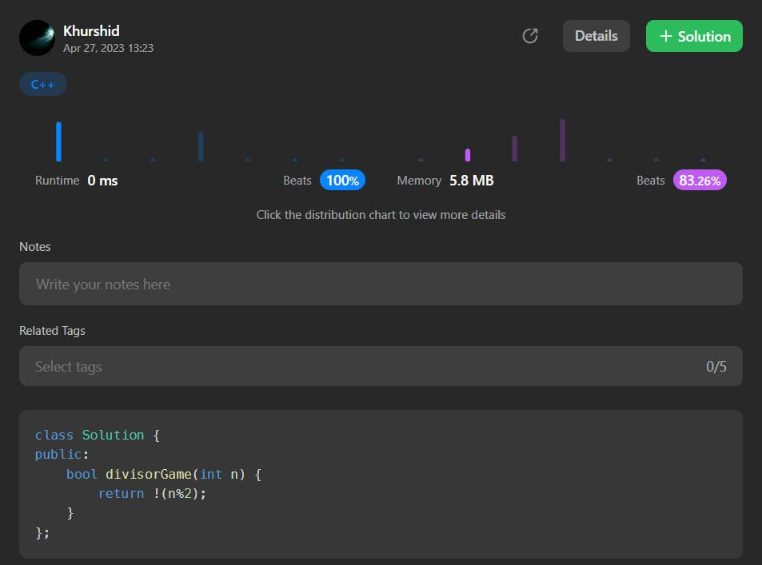

# C++ and C# .One line code with explanation.The fastest ever.

**Author:** aloneguy
**Votes:** 9
**Link:** [https://leetcode.com/problems/divisor-game/solutions/3460106/](https://leetcode.com/problems/divisor-game/solutions/3460106/)

---

# Intuition:If the given number is odd,then she can not win the game.Otherwise she win all games.
N = 1, lose directly
N = 2, will win choosing x = 1.
N = 3, must lose choosing x = 1.
N = 4, will win choosing x = 1.
<!-- Describe your first thoughts on how to solve this problem. -->




# Code C++
```
class Solution {
public:
    bool divisorGame(int n) {
        return !(n%2);
    }
};
```
# Code C#
```
public class Solution {
    public bool DivisorGame(int n) =>n%2==0;
}

```
# Code C#
```
public class Solution {
    public bool DivisorGame(int n){
       return !(n % 2 != 0);
    }
}
```

