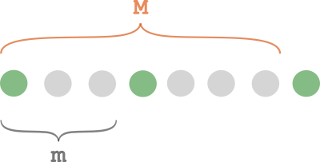

# 2-liner ^^

**Author:** andrii_khlevniuk
**Votes:** 2
**Link:** [https://leetcode.com/problems/moving-stones-until-consecutive/solutions/908953/](https://leetcode.com/problems/moving-stones-until-consecutive/solutions/908953/)

---



```
vector<int> numMovesStones(int a, int b, int c)
{
    auto [m, M] = minmax({abs(b-a), abs(c-b), abs(c-a)});
    return {(m>2) + (M>m+1), M-2};
}
```