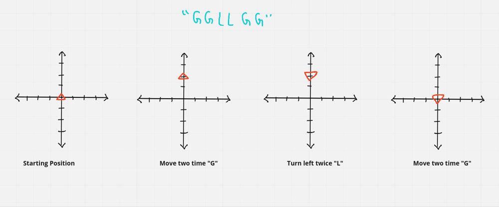
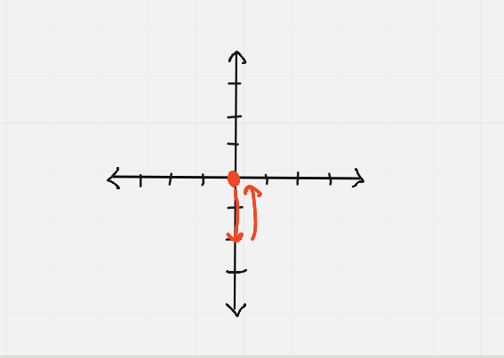

# 🚀 Well Detailed Explaination [JAVA , C++] || Easy for mind to Accept it

**Author:** hi-malik
**Votes:** 191
**Link:** [https://leetcode.com/problems/robot-bounded-in-circle/solutions/1676710/](https://leetcode.com/problems/robot-bounded-in-circle/solutions/1676710/)

---

Guy's if you find this solution helpful \uD83D\uDE0A, PLEASE do UPVOTE. By doing that it motivate's me to create more better post like this \u270D\uFE0F
```
													# IMPORTANT TIP FOR YOU
```
If, you are preperaing for `AMAZON interview` or will prepare. Then according to `LeetCode premium` it is no.1 most asked Question by **Amazon** as per now

*`So, Ladies n Gentlemen without any further due, let's start:`*
**Intution:**
The robot can face in at most four directions in the 2dimensional plane, such as "North", "South", "East", "West".

If the robot's position is bounded in a fix circular radius, the robot must eventually return to its starting position after a fixed number of instruction's.

**Approach Explained :**

So, suppose we have a **2 dimensional grid** we have. WIth an instruction of **"GGLLGG"**. which states **go-go | turn to left 90 degree-turn to left 90 degree | go-go**. If we gonna repeat forever, we will get **stuck in an infinite loop** for now.. 
1. Let's kind of simulate it 1st, we intially **start at the origin**. And let's have our direction facing **North** intially we are facing north, we gonna move **twice** and still facing **North** so, what happen is we move by 1, then move by 2 we gonna be in this position **still facing North.**
2. And then we **turn left twice**. So, if we turn left 1 90 degree we will be facing Left, if we do twice then we are **facing Down**.
3. Then, we **go-go.** Go, down 1 - Go down 2 and we start back at the **origin**. The only difference is now, **instead of facing North** we are **facing South**. But, obviously we get back to start.

`Let me show you in a diagram:`


**Now you can ask, can we go for an another loop**. Just as we did before? My answer is **YES**, this path is some kind of a **Vector** on this 2 dimensional grid. So, in the above case the **vector was Up by 2** & then went **staright down by 2**. So, in **total the vector was a net difference of "0"** So, basically it started where it's end.

Even though, **first we facing North**, now we **facing South**, it's gonna **follow that same path**. It's gonna move by 2 and go back in same direction it's came from. Because **this Vector is a "0" vector doesn't move any where**.


So, with this atleast yes, we gonna **return True**. Because this robot stuck in an infinite loop and we only end, if we see a **circlular path**

*Now, let's code it up:*
`Code each line explained : Similar for C++ & Java`
* Step1:
```
// we know that robot can move in 4 direction's
        // Up, left, down, right
        int dir[][] = {{0,1}, {-1, 0}, {0, -1}, {1,0}};
        int i = 0; // we have to keep tracking those cases where it's not rotating.
        // if in the end of execution, we see it's not rotating we will gonna return false;
       
        // it's origin
        int x = 0;
        int y = 0;
```
* Step2:
```
// let's write an for loop & iterate through the instructions. So, we keep 1 instructions at a time. 
// And we will keep checking the position of the robot after executing particular instruction.
        for(int s = 0; s < instructions.length(); s++){
            // Now, we are checking is it a rotation
            if(instructions.charAt(s) == 'L'){ // If it's left then update it's head rotation
                i = (i + 1) % 4; // since we are increment "i". To avoid array out of bound exception, we are moduling by 4
            }
            else if(instructions.charAt(s) == 'R'){ // If it's right then update it's head rotation
                i = (i + 3) % 4;
            }
            // We are checking it's direction
            else{
                x = x + dir[i][0];
                y = y + dir[i][1];
            }
        }
```
* Final Step:
```
// LAST EDIT : for (x == 0 && y == 0) We are checking is our intial position from where we started and end position where we are finishing both are same! 
// If so,  return true;

// If the robot perform 1 rotation, it means  "i != 0" then it will gauranteed perform a circle & after certain rotation it will come back to the origin.
        // But if "i is  0" , it mean's robot is moving straight, hence there is no cycle. It will never come back to origin. 
        return x == 0 && y == 0 || i != 0;
```
**Complete Code :**

**Java**
```
class Solution {
    public boolean isRobotBounded(String instructions) {
        int dir[][] = {{0,1}, {-1, 0}, {0, -1}, {1,0}};
        int i = 0;
        int x = 0;
        int y = 0;
       
        for(int s = 0; s < instructions.length(); s++){
            if(instructions.charAt(s) == 'L'){
                i = (i + 1) % 4;
            }
            else if(instructions.charAt(s) == 'R'){
                i = (i + 3) % 4;
            }
            else{
                x = x + dir[i][0];
                y = y + dir[i][1];
            }
        }
        return x == 0 && y == 0 || i != 0;
    }
}
```
C++
```
class Solution {
public:
    bool isRobotBounded(string instructions) {
        vector<vector<int>> dir = {{0,1}, {-1, 0}, {0, -1}, {1,0}};
        int i = 0;
        int x = 0;
        int y = 0;
       
        for(int s = 0; s < instructions.size(); s++){
            if(instructions.at(s) == 'L'){
                i = (i + 1) % 4;
            }
            else if(instructions.at(s) == 'R'){
                i = (i + 3) % 4;
            }
            else{
                x = x + dir[i][0];
                y = y + dir[i][1];
            }
        }
        return x == 0 && y == 0 || i != 0;
    }
};
```
ANALYSIS :-
* **Time Complexity :-** BigO(N)

* **Space Complexity :-** BigO(1)

If you have some \uD83E\uDD14 doubts feel free to bug me anytime or If you understood than don't forget to upvote \uD83D\uDC4D