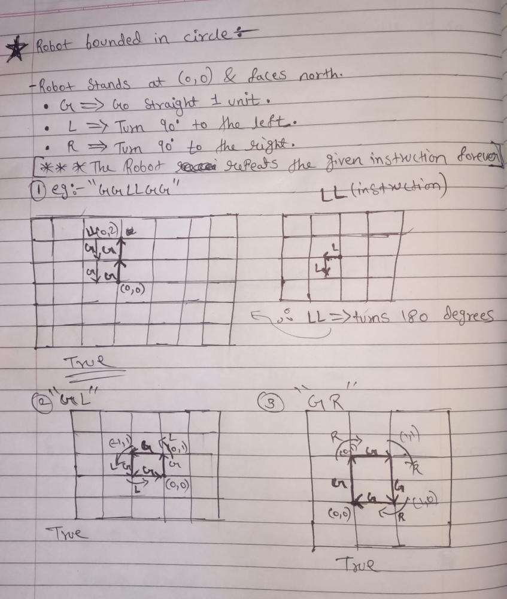
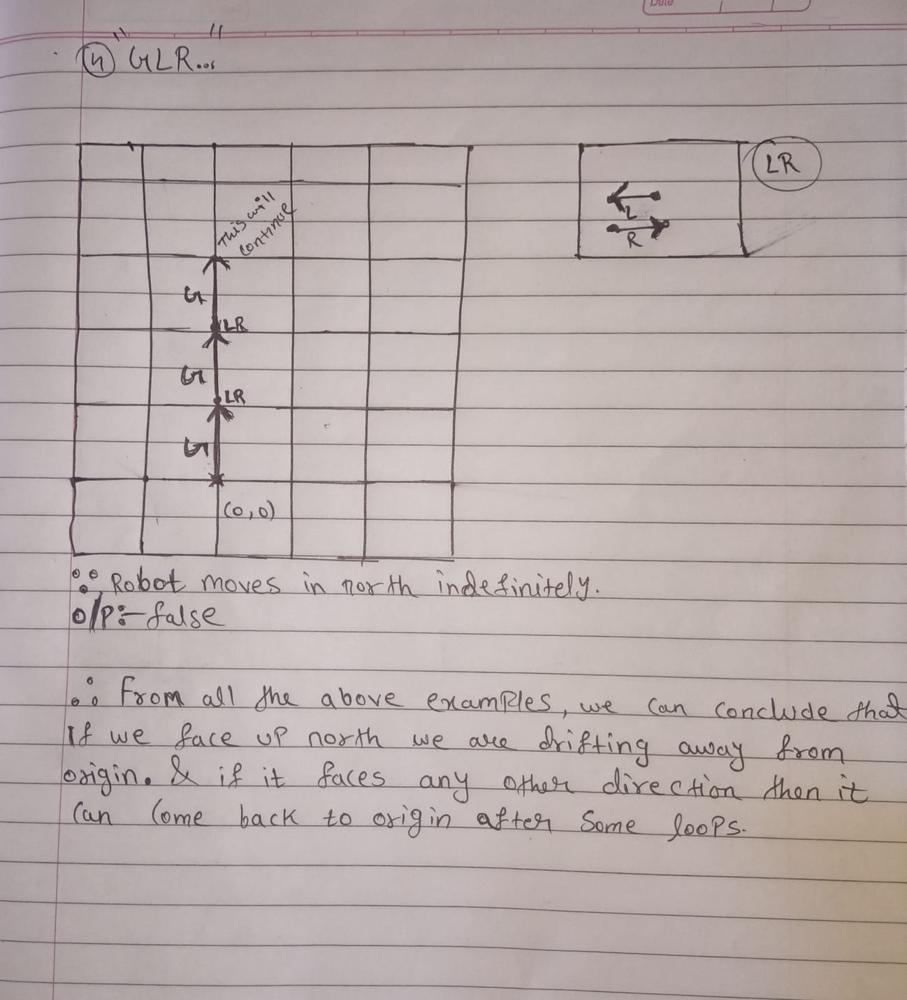

# C++ EASY TO SOLVE || Beginner Friendly with detailed explanation and dry run

**Author:** Cosmic_Phantom
**Votes:** 77
**Link:** [https://leetcode.com/problems/robot-bounded-in-circle/solutions/1677199/](https://leetcode.com/problems/robot-bounded-in-circle/solutions/1677199/)

---

**Reframing of question :-**
There is a robo who stands at (0,0) and faces north . The robo has three functionalities 
1. "G" =>go straight 1 unit.
2. "L" =>turn 90 degrees to left.
3. "R"=>turn 90 degrees to right.

**@@A very imp note:-** *The robot performs the instructions given in order, and repeats them forever.*
Return true if the robo comes back to his original position after executing the instructions else return false .
***
**Intuition:-**
The intuition we can get from question is that if the robo comes back to origin we return true and if not than return false . Let's understand more from the below examples :)
***

**Now let's take some example dry runs :-**
Sorry for the bad drawing btw you should also try this dry runs it will help you a lot .



*From the above dry runs we can conclude that:-*
* If the robo comes back to origin the answer is true.
* If the robo is facing NORTH direction the answer is always false since we are drifting away from origin.
* If the robo is facing any direction except north the answer will be  true since it will became a loop and come back to origin
***
**Algorithm:-**
1. Let `x` and `y` be the co-ordinate points and the ongoing direction that robo depicts be as `current_dir` . Let the 4 directions be North `N`, South `S`, West `W`, EAST `E` . Let current instruction char be depicted by `incoming` .
2. After initialization we will create a `originVerifier`  function to chek whether the co-ordinates are origin or not
3. We need to loop the `instructions` . During the treaversing of string `instructions ` we have two cases 
* **1st case:-** If we get `G` as instuction than we need to go straight 1 unit in that current direction
* **2nd case:-** In this case there is a chance that we will face directions  `N`, `S`, `W`, `E`. Once we find any of this direction just replace the currrent direction with this direction . 
4. Now if the robo is at origin or the current direction is not north than return trueor else reutn false [Discussed during dry run
***
**Code:-**
```
class Solution {
public:
    //returns true if the co-ordinates are at origin
    bool originVerifier(int x,int y){
        if(x == 0 && y == 0)
			return true;
		return false;
    }
	
    bool isRobotBounded(string instructions) {
        //given
        char current_dir = 'N';
        //co-ordinate points
        int x = 0, y= 0;
        for(int i=0;i<instructions.length();i++){ 
            //Case1: If 'G' is in the instruction string
            if(instructions[i] == 'G'){
                y += current_dir =='N' ? 1 : 0;
				y += current_dir =='S' ? -1 : 0;
				x += current_dir == 'E' ? 1 : 0;
				x += current_dir == 'W' ? -1 : 0;
            }
            //case2: If we found 'directions'
            else{
                char incoming = instructions[i];
                if(current_dir == 'N'){
                    current_dir = incoming == 'L' ? 'W' : 'E';
                }
                else if(current_dir == 'W'){
                    current_dir = incoming == 'L' ? 'S' : 'N';
                }
                else if(current_dir == 'S'){
                    current_dir = incoming == 'L' ? 'E' : 'W';
                }
                else{
                    current_dir = incoming == 'L' ? 'N' : 'S';
                }
            } 
            
        }
        //if the robo is at origin or the current direction is not north than return true
        if(originVerifier(x,y) || current_dir!='N')
            return true;
        
        return false;
    }
};
```
***
Actually there is one more way to solve this and while i was trying to figure out a good explanation for that, came across this beautiful post so linking his post is the best way to give him credits ;)
**2nd Well optimized approach by @SVishal19 :-**
https://leetcode.com/problems/robot-bounded-in-circle/discuss/1680010/detailed-explanation-cpp-thought-process
***
