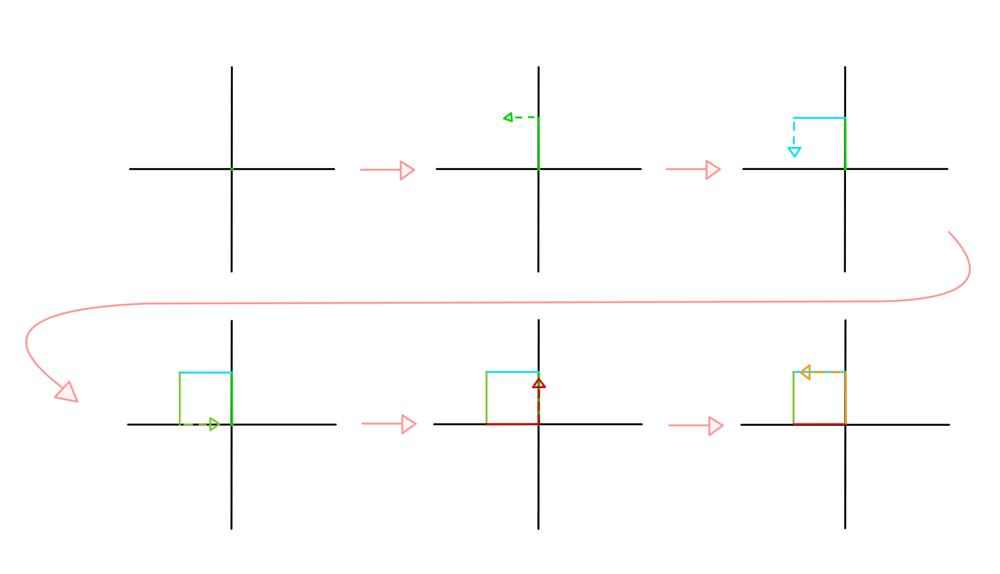
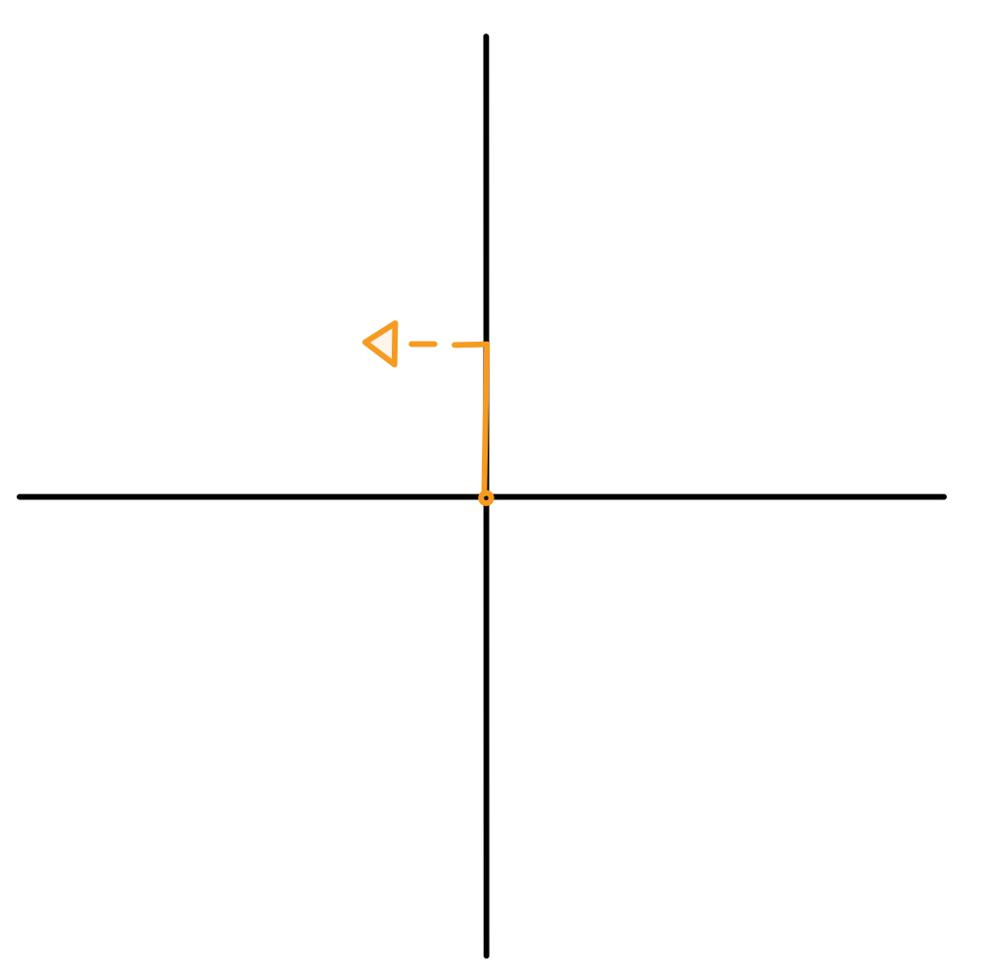

# Golang faster than 100% solution with explanation and images

**Author:** nathannaveen
**Votes:** 7
**Link:** [https://leetcode.com/problems/robot-bounded-in-circle/solutions/1112624/](https://leetcode.com/problems/robot-bounded-in-circle/solutions/1112624/)

---

**What the problem is asking:**

The problem says that it will give a string with the letters ` "L", "R"` and `"G"` to command a robot. `"L"` means to turn left 90 degrees, `"R"` means to turn right 90 degrees, and `"G"` means to go forward one unit. The problem says to return `true` if the robot can continue in that pattern forever and keep going in a circle. This can be shown with the following example:

```
input := "GL"
expected output := true
```

I have depicted how this example works with the following picture:




> * In the first image, we start off at the point `(0, 0)`
> * In the second image, we do the input `"GL"`, we go up one unit and then turn left, *(I have put a dotted line with an arrow to signify that we are going left in the next move)*
> * In the following image, we do the `"GL"` again.
> * In the fourth image, we do `"GL"` again.
> * In the fifth image, we have finished the circle by doing `"GL"` again.
> * And in the sixth image, we can see that this keeps on repeating.
>
> I have not added anymore because I think it is pretty self-explanatory

**What my code is doing:**

We use the variables `x, y' and `degree`. `x` and `y` signify where the current position is. And `degree` is what angle you are pointing at. We use `4` numbers to signify this:

* `degree = 0` means pointing up
* `degree = 1` means pointing right
* `degree = 2` means pointing down
* `degree = 3` means pointing left

Next, we have to know when to add and subtract from `x` and `y'.

* If `degree == 0 && letter == 'G'` then add one to `y`
* If `degree == 1 && letter == 'G'` then add one to `x`
* If `degree == 2 && letter == 'G'` then subtract one to `y`
* If `degree == 3 && letter == 'G'` then subtract one to `x`

Then to check whether `return true || return false`. We can see that if the robot returns to the origin at its last move, it has to be going in a circle, and if it is not facing `up` we know that it will make a circle after some time. If you don't understand the part of not facing up, look at the image below.




> This is the same example as the example above `input := "GL"`, when we go through the string we get the image above, as we saw in the last instance, if we continue to make this pattern, we get a circle so as return `true` for this. 
>
> You can try this with an example. It will be `true` for any degree that is not facing up.


**The Code:**

``` go
func isRobotBounded(instructions string) bool {
    x, y, degree := 0, 0, 0

    for _, i := range instructions {
        if i == 'R' {
            degree = (degree + 1) % 4
            continue
        } else if i == 'L' {
            degree = (degree + 3) % 4
            continue
        } 

        switch degree {
        case 0:
            y++
        case 1:
            x++
        case 2:
            y--
        case 3:
            x--
        }
    }
    return x == 0 && y == 0 || degree != 0
}
```

**We can take out the switch case and make the code:**

``` go
func isRobotBounded(instructions string) bool {
    x, y, degree := 0, 0, 0
    addSubtractXAndY := []int{1, 1, -1, -1}

    for _, i := range instructions {
        if i == 'R' {
            degree = (degree + 1) % 4
        } else if i == 'L' {
            degree = (degree + 3) % 4
        } else {
            if degree == 0 || degree == 2 {
                y += addSubtractXAndY[degree]
            } else {
                x += addSubtractXAndY[degree]
            }
        }
    }
    return x == 0 && y == 0 || degree != 0
}
```