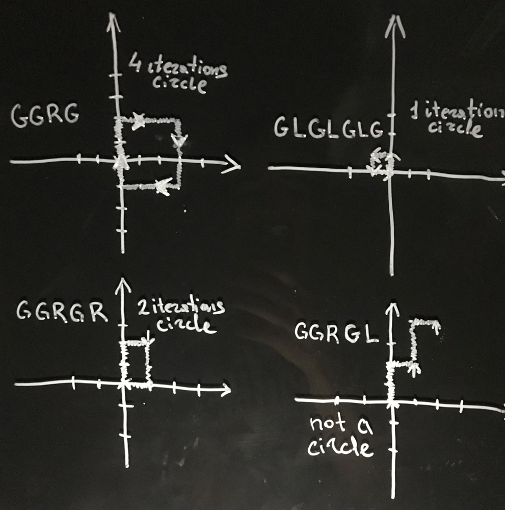

# 🔥Well Explained Linear Solution | 1 Loop [Javascript, Python, TypeScript] O(N) Time, O(1) Space

**Author:** pivacik
**Votes:** 17
**Link:** [https://leetcode.com/problems/robot-bounded-in-circle/solutions/1678306/](https://leetcode.com/problems/robot-bounded-in-circle/solutions/1678306/)

---

There are only two ways the robot can come back to its original location:
 1. The robot completed all the provided operations and made a loop in one iteration.
 2. The robot is not on the origin spot, but heading to any direction different from its initial direction (North). 
  ***It can complete 1 or 3 additional iterations over the provided operations to make a loop.***

	Let's look at some examples to make it clear.
	I drew some paths the robot could face with and:
	* can make a loop in 4 iterations `"GGRG"`
	* can make a loop in 1 iteration (gets back to the origin) `"GLGLGLG"`
	  *You might see it heads to a different direction and will go through a different path on the next iteration, but it's still a loop*
	 * can make a loop in 2 iterations `"GGRGR"`
	 * can't make a loop `"GGRGL"`


	

	**Explanation**
	
	`x, y` is a set of coordinates
	`dirs` for all possible direction
	`[[0, 1], [1, 0], [0, -1], [-1, 0]]`
	` --^up  ---^right --^down --  ^left `

	**We can change the direction by using mod operaor:**
	
	*On the left turn:*
	`currentDirectionIndex	= (4 + currentDirectionIndex - 1)  %  4`
	*On the right turn:*
	`currentDirectionIndex	= (4 + currentDirectionIndex + 1)  %  4`
	
	**Note that we have to add 4 to get a positive value (but we can simply omit this addition in python language)**
	where 4 is the lenght of all possible directions array
	currentDirectionIndex has a default direction 0 (Up) and might take a value of 0, 1 ,2 or 3 (Up, Right, Down, Left respectively)
	
	**Complexity** 
	
	Time `O(N)`
	Space `O(1)`
	


	### 	If you have any doubts feel free to reach me down in the comments section or If you liked my explanation don't forget to *upvote* \uD83C\uDF7B

	
	**JavaScript**
	```
	function isRobotBounded(instructions) {
		const dirs = [[0, 1], [1, 0], [0, -1], [-1, 0]];
		let head = 0;
		let x = 0;
		let y = 0;
		
		for (const instruction of instructions) { 
			if (instruction === 'G') {
				x = x + dirs[head][0];
				y = y + dirs[head][1];
			} else if (instruction === 'L') {
				head = (4 + head - 1) % 4;
			} else {
				head = (4 + head + 1) % 4;
			}
		}
		const isAtOrigin = (x === 0 && y === 0);
		const isHeadingNorth = head === 0

		return isAtOrigin || (! isHeadingNorth);
	};
	```
	
	**Python**
	```
	def isRobotBounded(self, instructions):
        dirs = ((0, 1), (1, 0), (0, -1), (-1, 0))
        x, y = 0,0
		head = 0
        for instruction in instructions:
            if instruction == 'G':
                x, y = x + dirs[head][0], y + dirs[head][1]
            elif instruction == 'L':
                head =  (4 + head - 1) % 4
            else:
				head =  (4 + head + 1) % 4
				
		isHeadingNorth = head == 0
		isAtOrigin = (x == 0 and y == 0)
            
        return isAtOrigin or (not isHeadingNorth)
	```
	
	**TypeScript**
	```
	function isRobotBounded(instructions: string): boolean {
		const dirs = [[0, 1], [1, 0], [0, -1], [-1, 0]];
		let head = 0;
		let x = 0;
		let y = 0;
		
		for (const instruction of instructions) { 
			if (instruction === 'G') {
				x = x + dirs[head][0];
				y = y + dirs[head][1];
			} else if (instruction === 'L') {
				head = (4 + head - 1) % 4;
			} else {
				head = (4 + head + 1) % 4;
			}
		}
		const isAtOrigin = (x === 0 && y === 0);
		const isHeadingNorth = head === 0

		return isAtOrigin || (! isHeadingNorth);
	};
	```
	

