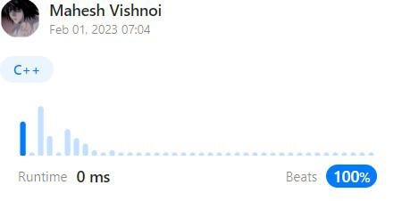

# ✅ [C++]|one line|BEATS 100% Runtime||Explanation✅

**Author:** vishnoi29
**Votes:** 1658
**Link:** [https://leetcode.com/problems/greatest-common-divisor-of-strings/solutions/3124940/](https://leetcode.com/problems/greatest-common-divisor-of-strings/solutions/3124940/)

---

Let's Connect on ****[LINKDIN](https://www.linkedin.com/in/mahesh-vishnoi-a4a47a193)****
# Approach

 - str1+str2 == str2+str1 if and only if str1 and str2 have a gcd . 
- E.g. str1=abcabc, str2=abc, then str1+str2 = abcabcabc = str2+str1
This(str1+str2==str2+str1) is a requirement for the strings to **have a gcd**. If one of them is NOT a common part then  gcd is "".It means we will return **empty string**
**Proof**:-`str1 = mGCD, str2 = nGCD, str1 + str2 = (m + n)GCD = str2 + str1`
- Both the strings are made of same substring added multiple times.
- Since they are multiples, next step is simply to find the gcd of the lengths of 2 strings e.g. gcd(6,3) = 3, (we can use gcd function to find that)and get the substring of length 3 from either str1 or str2.
In c++ it will be **str1.substr(0, gcd)**


# Code
```
class Solution {
public:
    string gcdOfStrings(string str1, string str2) {
        return (str1 + str2 == str2 + str1)? 
        str1.substr(0, gcd(size(str1),size(str2))): "";
    }
};
```
If you really found my solution helpful **please upvote it**, as it motivates me to post such kind of codes.
**Let me know in comment if i can do better.**
Let's Connect on **[LINKDIN](https://www.linkedin.com/in/mahesh-vishnoi-a4a47a193)**


