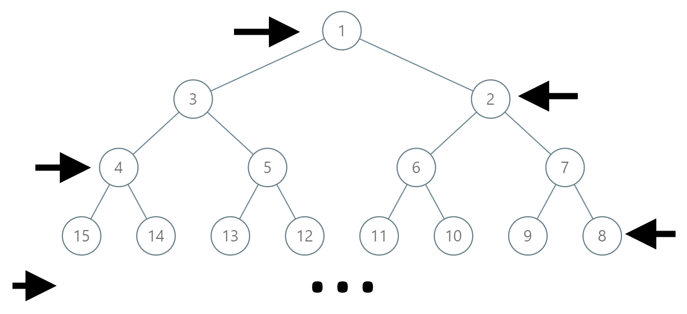

# [1104. Path In Zigzag Labelled Binary Tree](https://leetcode.com/problems/path-in-zigzag-labelled-binary-tree/)

| Category | Difficulty | Likes | Dislikes |
| :------: | :--------: | :---: | :------: |
| Algorithms | Medium | 1540 | 329 |

**Tags:** [`math`](https://leetcode.com/tag/math), [`tree`](https://leetcode.com/tag/tree), [`binary-tree`](https://leetcode.com/tag/binary-tree)

**Companies:** `bloomberg`

## Description

In an infinite binary tree where every node has two children, the nodes are labelled in row order.

In the odd numbered rows (ie., the first, third, fifth,...), the labelling is left to right, while in the even numbered rows (second, fourth, sixth,...), the labelling is right to left.



Given the `label` of a node in this tree, return the labels in the path from the root of the tree to the node with that `label`.

 

**Example 1:**

```

Input: label = 14
Output: [1,3,4,14]

```

**Example 2:**

```

Input: label = 26
Output: [1,2,6,10,26]

```

 

**Constraints:**

	- `1 <= label <= 10^6`

---

**Links:** [Submissions](https://leetcode.com/problems/path-in-zigzag-labelled-binary-tree/) | [Solutions](https://leetcode.com/problems/path-in-zigzag-labelled-binary-tree/)
