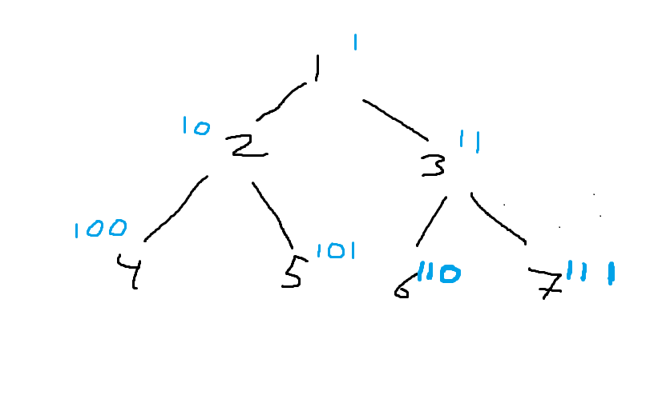

# [Python3] XOR Solution

**Author:** rt500
**Votes:** 3
**Link:** [https://leetcode.com/problems/path-in-zigzag-labelled-binary-tree/solutions/2683563/](https://leetcode.com/problems/path-in-zigzag-labelled-binary-tree/solutions/2683563/)

---

Recently I learned about an interesting way to label complete binary trees. Where the nodes are labelled with bits where going left you append a '0' and if you go right, you append a '1'. Normally you can get the path (from leaf to root) by just bitshifting to the right each step. But since the even rows are flipped, you need to get the "mirror image" of some nodes in the path. To do that you can notice that to get the "mirror image" of a number on a certain level, you flip every bit except the leading 1.  To "flip the bits", you can use XOR




```
class Solution:
    def pathInZigZagTree(self, label: int) -> List[int]:
        
        x = label
        mask = 0 
        while x > 1:
            x >>= 1
            mask <<= 1
            mask |= 1
            
        x = label
        res = deque()
        while x:
            res.appendleft(x)
            x >>= 1
            mask >>= 1
            x ^= mask
        return res
```