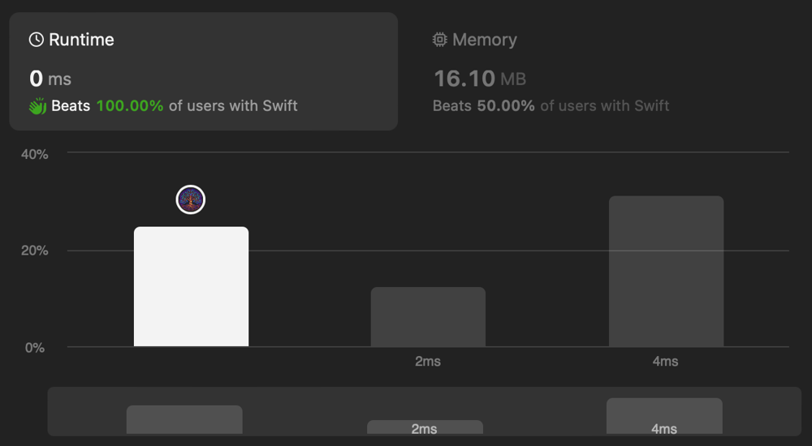

# ✅ O(n) Runtime & O(1) Space Swifty Solution | DP | String Index Manipulation

**Author:** eleev
**Votes:** 0
**Link:** [https://leetcode.com/problems/count-substrings-with-only-one-distinct-letter/solutions/4747588/](https://leetcode.com/problems/count-substrings-with-only-one-distinct-letter/solutions/4747588/)

---


<!-- Describe your first thoughts on how to solve this problem. -->

# Solution
```swift
final class Solution {
    @_optimize(speed)
    func countLetters(_ s: String) -> Int {
        var (total, count) = (1, 1)
        var current = s.index(after: s.startIndex)
        
        while current < s.endIndex {
            count += s[s.index(before: current)] == s[current] ? 1 : 1 - count
            total += count
            current = s.index(after: current)
        }
        return total
    }
}
```