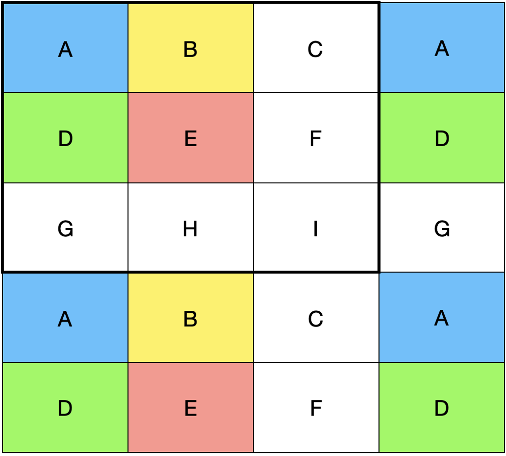

# C++ simple solution with image

**Author:** intervalrain
**Votes:** 0
**Link:** [https://leetcode.com/problems/maximum-number-of-ones/solutions/3977089/](https://leetcode.com/problems/maximum-number-of-ones/solutions/3977089/)

---


For the case in the picture, 
The first square with 9 characters has `x` **ones**,
the next square must have the same quantities of **ones**.
That means the next square comes with new row (ABC) as thw first row of first square(ABC)

So, we can try to calculate the summation of each character.
Let `s` be the sideLength, `w` be the width, and `h` be the height.
And we create a vector[s\\*s] to record the summation of each character.
`arr [ (i % s) * s + (j % s) ]++`

Now, we now the array would be like: `{4, 2, 2, 4, 2, 2, 2, 1, 1}`.
And if we want to put more Ones in the squares, we could try to select `x` characters with bigger summation.
So, we need to sort the array descendly, and pick the first `x` number and sum them up.
And it would be the answer.

Enjoy.
Code:
```
class Soluction {
public:
	int maximumNumberOfOnes(int w, int h, int s, int o) {
		vector<int> v(s*s, 0);
		for (int i = 0; i < w; i++) {
			for (int j = 0; j < h; j++) {
				v[(i%s)*s + (j%s)]++;
			}
		}
		sort(v.rbegin(), v.rend());
		return accumulate(v.begin(), v.begin()+o, 0);
	}
};
```