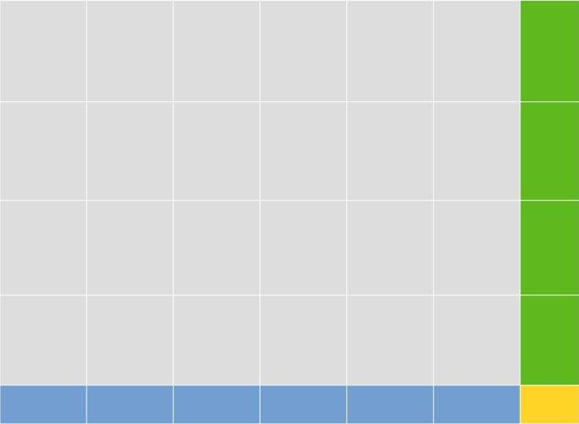

# 0ms beats 100% C++ O(1) Solution with detailed explanation

**Author:** Lipox
**Votes:** 1
**Link:** [https://leetcode.com/problems/maximum-number-of-ones/solutions/3974233/](https://leetcode.com/problems/maximum-number-of-ones/solutions/3974233/)

---

# Intuition
<!-- Describe your first thoughts on how to solve this problem. -->
First divide the matrix into 4 parts.

4 colors stands for 4 parts respectively.

R1: the gray region [nonOverlappingWidth\\*nonOverlappingHeight sub-matrix of size sideLength\\*sideLength]
R2: the blue region [nonOverlappingWidth sub-matrix of size sideLength\\*heightRemain]
R3: the green region [nonOverlappingHeight sub-matrix of size sideLength\\*widthRemain]
R4: the yellow region [a submatrix widthRemain\\*heightRemain]

Next I'll give a intuition, that is, if all the non-overlapping sub-matrix of size sideLength\\*sideLength is of the same pattern (which means they are exactly the same: same ones and same position of ones in the sub-matrix), then we do not need to consider other sub-matrix which overlaps with current non-overlapping sub-matrix. In other words, any other sub-matrix which overlaps with current non-overlapping submatrix will have at most "maxOnes" ones.

This intuition can be easily proved.

However, its a little harder to prove that all the non-overlapping sub-matrix having the same pattern can give us the best result of this problem (maximizes the ones the whole matrix contains). A possible thought is that if a non-overlapping sub-matrice M1 do not have the same pattern as before, it will decrease the total ones by creating conflict with its nearby non-overlapping sub-matrix (by creating conflict, I mean that some sub-matrix overlapping with M1 and its nearby matrix may contains ones more than maxOnes)

In the following approach, we'll use the conclusion above and let all the non-overlapping sub-matrix have the same pattern and each contains "maxOnes" ones.

# Approach
<!-- Describe your approach to solving the problem. -->
1.Consider R1:
The ones in R1 is easy to calculate, it contains [nonOverlappingWidth\\*nonOverlappingHeight sub-matrix of size sideLength\\*sideLength]
so the total ones of R1 is nonOverlappingWidth\\*nonOverlappingHeight\\*maxOnes.

2.Consider R2,R3,R4:
In part 1, we do not care about the specific pattern of sub-matrix, but in this part, we should modify the pattern to maximize the total ones.
The intuition here is to add ones to the regions having most copies, if there are still ones left, we add ones to the regions having second most copies, if there are still ones left, we add ones to the regions having third most copies.

Here, R4 has most copies in R2,R3,R4. 
R2 contains [nonOverlappingWidth] copies of R4,
R3 contains [nonOverlappingHeight] copies of R4,
R4 contains [1] copies of R4,

so we first try to fill R4. The ones we need to fill R4 is [widthRemain\\*heightRemain], if maxOnes if smaller than this, we just use all ones to fill R4 and problem solved.

If we have maxOnes>widthRemain\\*heightRemain, then after fill all the space in R4, we should use maxOnes to fill other regions.

First we compare [nonOverlappingWidth] with [nonOverlappingHeight], if [nonOverlappingWidth > nonOverlappingHeight] we should fill R2 first. If we still have ones left when we fill all the space in R4 and R2, then we try our best to fill the space in R3.
if [nonOverlappingHeight > nonOverlappingWidth] we should fill R3 first. If we still have ones left when we fill all the space in R4 and R3, then we try our best to fill the space in R2.

Finally, we add the spaces calculated in part 2 to the base space calculated in part 1 and return the answer.

# Complexity
- Time complexity:$$O(1)$$
<!-- Add your time complexity here, e.g. $$O(n)$$ -->

- Space complexity:$$O(1)$$
<!-- Add your space complexity here, e.g. $$O(n)$$ -->

# Code
```
class Solution {
public:
    int maximumNumberOfOnes(int width, int height, int sideLength, int maxOnes) {
        int nonOverlappingWidth=width/sideLength;
        int nonOverlappingHeight=height/sideLength;
        //we divide the whole matrix to [nonOverlappingWidth*nonOverlappingHeight sub-matrix of size sideLength*sideLength] + [nonOverlappingWidth sub-matrix of size sideLength*heightRemain] + [nonOverlappingHeight sub-matrix of size sideLength*widthRemain] + [a submatrix widthRemain*heightRemain]
        int base=nonOverlappingWidth*nonOverlappingHeight*maxOnes;
        //calculate the base number of ones, the answer must be larger or equal to base.
        int widthRemain=width-nonOverlappingWidth*sideLength;
        // widthRemain=width%sideLength;
        int heightRemain=height-nonOverlappingHeight*sideLength;
        // widthRemain=height%sideLength;

        //Now we only consider the remaining part.
        //we should first fill the space which can contribute both to the HeightRemain part and WidthRemain part
        if(widthRemain*heightRemain>=maxOnes)//maxOnes is not enough to fill all the space, we use all ones to fill the specific space
        {
            base+=(nonOverlappingHeight+nonOverlappingWidth+1)*maxOnes;
            //there are (nonOverlappingHeight+nonOverlappingWidth+1) copies of that specific space:
            // nonOverlappingHeight copies in [nonOverlappingHeight sub-matrix of size sideLength*widthRemain]
            // nonOverlappingWidth copies in [nonOverlappingWidth sub-matrix of size sideLength*heightRemain]
            // 1 copies in [a submatrix widthRemain*heightRemain]
            return base;
        }
        else //we fill the space mentioned above and there are still ones left.
        {
            if(maxOnes>=(widthRemain*(sideLength-heightRemain)+heightRemain*(sideLength)))
            {
                //If there are enough ones to fill all the space in [nonOverlappingWidth sub-matrix of size sideLength*heightRemain] + [nonOverlappingHeight sub-matrix of size sideLength*widthRemain] + [a submatrix widthRemain*heightRemain](that is the whole matrix except the nonOverlapping part [nonOverlappingWidth*nonOverlappingHeight sub-matrix of size sideLength*sideLength]), we just fill all the space with ones.
                base+=(widthRemain*nonOverlappingHeight+heightRemain*nonOverlappingWidth)*sideLength+widthRemain*heightRemain;
                return base;
            }
            else
            {
                //not enough ones, we should first fill the space with appears the most in the remaining part.
                if(nonOverlappingHeight>=nonOverlappingWidth)
                {
                    //there are more copies in [nonOverlappingHeight sub-matrix of size sideLength*widthRemain], so we first fill this part
                    if((widthRemain*sideLength)>=maxOnes)
                    {
                        //not enough ones to fill [nonOverlappingHeight sub-matrix of size sideLength*widthRemain], so we use all the ones to fill this part.
                        base+=maxOnes*nonOverlappingHeight+(nonOverlappingWidth+1)*widthRemain*heightRemain;
                    }
                    else
                    {
                        //enough ones to fill [nonOverlappingHeight sub-matrix of size sideLength*widthRemain], so we use the ones left to fill [nonOverlappingWidth sub-matrix of size sideLength*heightRemain].
                        base+=widthRemain*sideLength*nonOverlappingHeight+(nonOverlappingWidth+1)*widthRemain*heightRemain+nonOverlappingWidth*min((maxOnes-widthRemain*sideLength),heightRemain*(sideLength-widthRemain));
                    }
                    return base;
                }
                else
                {
                    //same situation as before but reverse height and width
                    if((heightRemain*sideLength)>=maxOnes)
                    {
                        base+=maxOnes*nonOverlappingWidth+(nonOverlappingHeight+1)*widthRemain*heightRemain;
                    }
                    else
                    {
                        base+=heightRemain*sideLength*nonOverlappingWidth+(nonOverlappingHeight+1)*widthRemain*heightRemain+nonOverlappingHeight*min((maxOnes-heightRemain*sideLength),widthRemain*(sideLength-heightRemain));
                    }
                    return base;
                }
            }
        }
        return -1;
    }
};
```