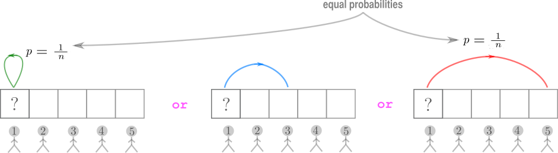
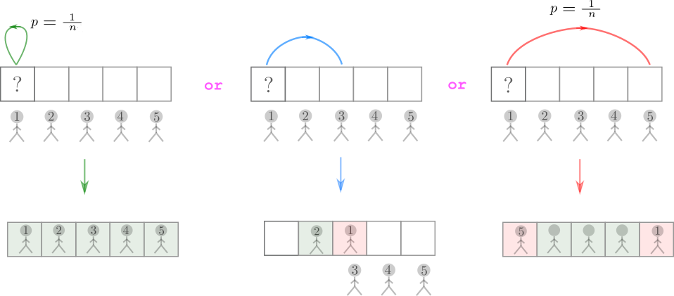
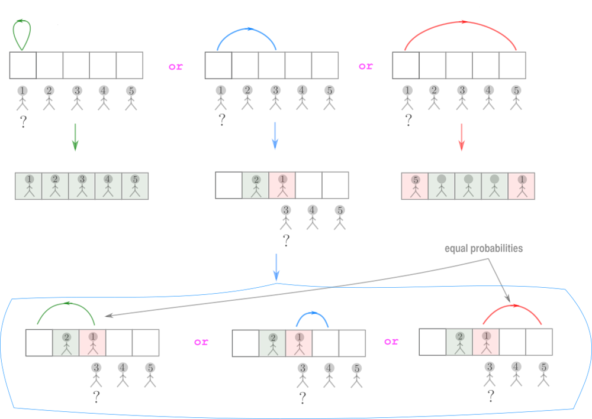
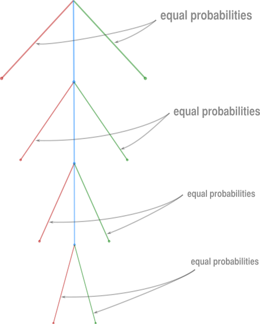

# explanation ✈ ^^

**Author:** andrii_khlevniuk
**Votes:** 9
**Link:** [https://leetcode.com/problems/airplane-seat-assignment-probability/solutions/1179019/](https://leetcode.com/problems/airplane-seat-assignment-probability/solutions/1179019/)

---

**Algo**
```
double nthPersonGetsNthSeat(int n)
{
	return n==1 ? 1.0 : 0.5;
}
```
**Explanation**
<br>
If `n==1` it's clear that the probability of the first (and the last) passenger picking his "own" seat equals to `1`.
Now, 
> We want to prove that if `n>1` the probabilities of the `n`-th passenger to take or not to take his seat are **equal**. We are going to prove that by proving that on each step of the boarding process these probabilities are equal.

Let's explore how the boarding process unfolds.
The first passenger picks either the first seat **or** any of the "middle" seats **or** the `n`-th seat.
* If he takes the first seat this will provoke the chain reaction of all other passengers (including the `n`-th one) taking their own seats.
* If he takes one of the "middle" seats we need to look into the process further as the outcome may go either way.
* If he takes the `n`-th seat then the `n`-th passenger will **not** be able to take it.
Probabilities of the first and third scenarios are equal (`1/n = 1/5`)
<br>

<br>

Now let's proceed with the boarding in the middle branch. Let the first passenger pick the "middle" seat (say the third).
<br>

<br>
Than the second passenger will take his place and the third one has to choose either the first seat **or** the "middle" one **or** the `n`-th seat.
<br>

<br>
As we can see at this stage the probabilities of the `n`-th passenger of **taking** and **not taking** (as direct concequence of the actions of the third passenger) his place are equal again. Third passenger has three seats to choose from, so the probability equals `1/3`.
On the last step the forth passenger has no "middle" seats to choose from, that makes him choose either the `1`-st or the `n`-th seat.
Again these two choises have equal probabilities (now it's `1/2`).
Let's generalize our findings with the decision tree.
<br>

<br>
As we can see the red leaf nodes of the tree denote boardings when the `n`-th passenger **doesn't** get his seat and the green ones - those when he **does**. Their probabilities are equal on each level and hence are equal in total. Moreover as these events are mutually exclusive their probabilies must equal to `0.5`.

Thanks for following this lengthy explanation.


