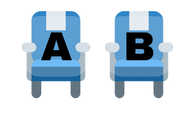
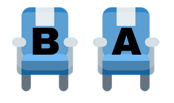
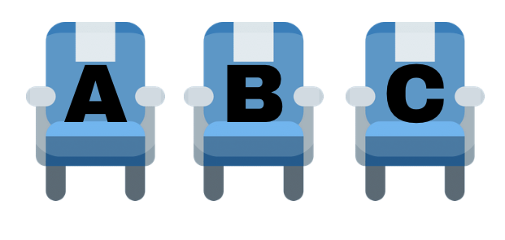
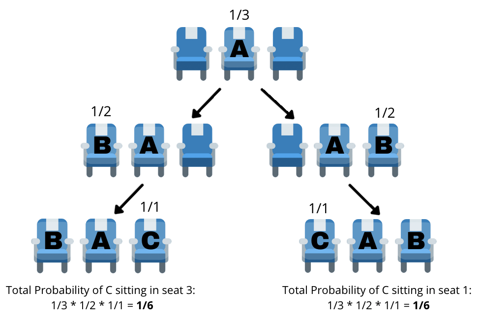
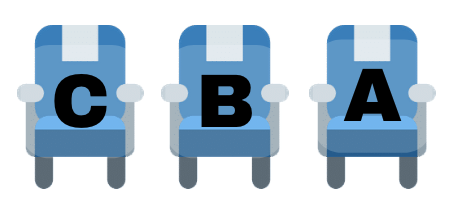

# In depth explanation with diagrams and mathematical proof

**Author:** spec_he123
**Votes:** 21
**Link:** [https://leetcode.com/problems/airplane-seat-assignment-probability/solutions/1874330/](https://leetcode.com/problems/airplane-seat-assignment-probability/solutions/1874330/)

---

### In depth explanation with diagrams and mathematical proof
To best understand this solution I\u2019m going to go through 4 examples of this problem before generalizing the solution to n people.

For this explanation each person will be referred to with capital letters (A, B, C \u2026) and the seats will be represented with numbers (1, 2, 3 \u2026). Simultaneously the mapping for the seats are going to be A\u21921 B\u21922 C\u21923 and so on.

##### Example 1 (n=1):
In this condition there exists only one seat and one person, therefore the person only has one option. Therefore there's a 100% probability A sits in the correct seat.


##### Example 2 (n=2)
**Case i)** 
A sits in their correct seat, which automatically means B will sit in the correct spot as well. Let's calculate the probability of this: A has to choose from two seats: \xBD. Since in this case A chose the correct seat B goes to its correct seat as well which has a probability of 1. Combining the two: \xBD * 1 = \xBD 


**Case ii)**
A sits in B\u2019s seat, therefore there is no way B ends up sitting in their original seat. B has to sit in the only available seat which is seat 1. A has a \xBD probability to pick a seat and B has only one option giving it a probability of 1, giving a final probability of \xBD (\xBD * 1).


The final answer would only consider the condition in *case i* where B was able to sit in its correct seat. The final answer is therefore **\xBD or a probability of 50%**.

##### Example 3 (n=3)
When we have 3 people we can split the problem into three cases.

**Case i)**
A sits in the correct seat, this automatically means that everyone else will also sit in the correct seat. This is something to be observed in all of the cases, the condition where A sits in the correct place also means that the nth person sits in the correct place, giving a probability of \u2153 in this case but more generally 1/n.



**Case ii)**
A sits in the position of B (\u2153). 
This gives B two options, either sit in seat 1 or seat 3. The only valid option is for B to sit in seat 1 such that C gets its correct seat. This relationship can best be visualized with a tree:


In the second level B\u2019s seat is taken hence B needs to sit in a random spot. Another way to think about this is that B is actually the first passenger who lost their ticket and now B has to pick between two seats. This is essentially a recursive relationship.
The probability \u2159 that we have identified also be described as:
1/n * f(n-1)
In this cases since n=3:
\u2153 * f(3-1)
It is established that f(2) = \xBD
The f(2) represents B choosing randomly from the 2 remaining seats
\u2153 * \xBD = \u2159 

**Case iii)**
In this case A sits in seat 3, meaning C never gets their correct seat. Probability of \u2153.


Given these 3 cases we get the probability of C sitting in their correct seat is:
(A sits in their correct position) + (A sit\u2019s in B\u2019s position but B ends up sitting in A\u2019s position)
\u2153 + \u2159 = \xBD 
Another way to represented this is:
1/n (This always exists for when A sits in the correct seat)
1/n * f(n-1) (This is when A sits in B\u2019s spot but B ends up sitting in A\u2019s spot)

In this case we get: **\u2153 + \u2153 * f(2) = \xBD**

Let\u2019s see this relationship with *4 people*. The cases we get for person D to sit in the correct seat are:

**Case i)** Person A sits in the correct seat (1/n = \xBC )
**Case ii)** Person A sits in B\u2019s seat (1/n * f(n-1) = \xBC * f(3) = \xBC * \xBD = \u215B)
**Case iii)** Person A sits in C\u2019s seat (1/n * f(n-2) = \xBC * f(2) = \xBC * \xBD = \u215B)

Total probability of D sitting in the correct seat: **\xBC + \u215B + \u215B = \xBD**

Now finally to generalize this we get:
```
f(n) = (1/n) + (1/n) * f(n-1) + (1/n) * f(n-2) + (1/n) * f(n-3) + \u2026 + (1/n) * f(2)
```
Where n >= 3 (This is because our recursive relation ends at f(2) thus we only refer to the values past that)

This relationship can be directly coded or we can further solve this:
Simplifying the right hand side (rhs) and multiplying both sides by n:
```
--> f(n) = (1/n) + (1/n) * [f(n-1) + f(n-2) + f(n-3) + \u2026 + f(2)]
--> n * f(n) = 1 +f(n-1) + f(n-2) + f(n-3) + \u2026 + f(2)
```
Taking n = n + 1
```
--> (n+1) * f(n+1) = 1 +f(n+1-1) + f(n+1-2) + f(n+1-3) + \u2026 + f(2)
--> (n+1) * f(n+1) = 1 +f(n) + f(n-1) + f(n-2) + \u2026 + f(2)
```
From the above solved part we know: ```n * f(n) = 1 +f(n-1) + f(n-2) + f(n-3) + \u2026 + f(2)```
We can take this and replace ```1 +f(n-1) + f(n-2) + f(n-3) + \u2026 + f(2)``` with ```n * f(n)``` giving:
```
--> (n+1) * f(n+1) = f(n) + n * f(n)
```
Simplifying the right hand side and dividing each side ny (n+1)
```
--> (n+1) * f(n+1) = f(n) * (n+1)
--> f(n+1) = f(n)
```

Based on the above relationship we get:
```
f(n) = f(n+1) = f(n+2) = f(n+3) and so on
```
And likewise:
```
f(n) = f(n-1) = f(n-2) = f(n-3) and so on
```

This relationship will be used to solve ```f(n) = (1/n) + (1/n) * [f(n-1) + f(n-2) + f(n-3) + \u2026 + f(2)]```:
```
--> f(n) = (1/n) + (1/n) * [f(n) + f(n) + f(n) + \u2026 + f(n)]
```
Simplifying right hand side since we know that n occurs exactly (n-2) times
```
--> f(n) = (1/n) + (1/n) * [(n-2)*f(n)]
--> n * f(n) = 1 + (n-2) * f(n)
```
Dividing both sides by f(n) and simplifying the equation:
```
--> n = 1/f(n) + (n-2)
--> n - (n-2) = 1/f(n)
--> 2 = 1/f(n)
--> f(n) = \xBD 
```

This tells us the probability that the nth person will ALWAYS sit in the correct seat is \xBD for n >= 3. This also applies for n=2 but the only time this is not true is when n=1 when the probability of this happening would be 1.

After understanding the solution the code is very straight forward:
```
class Solution:
    def nthPersonGetsNthSeat(self, n: int) -> float:
        return 0.5 if n!=1 else 1
```

##### Time and Space Complexity
After finding and solving the recursive equation we know the answer is a constant and is always \xBD except for when n = 1 the probability is 1 therefore both the time and space complexity is constant:
```
Space Complexity O(1)
Time Complexity O(1)
```