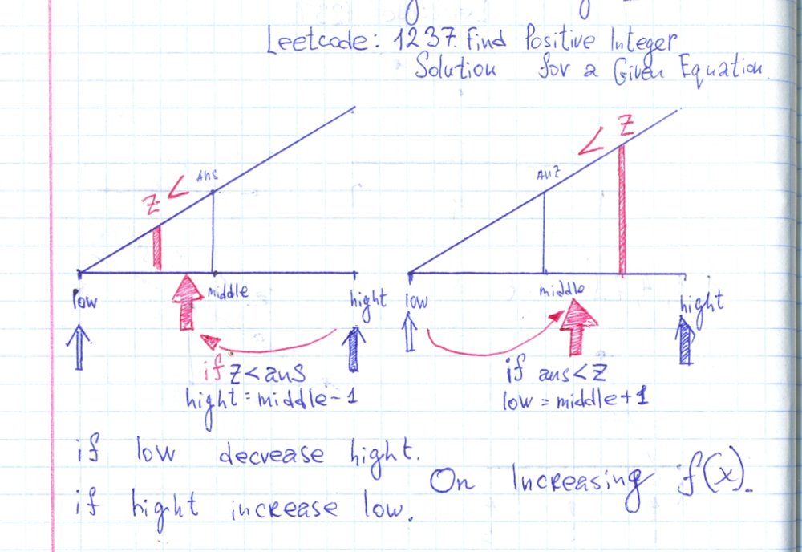

# Ruby. O(NLogN).

**Author:** user9697N
**Votes:** 2
**Link:** [https://leetcode.com/problems/find-positive-integer-solution-for-a-given-equation/solutions/640883/](https://leetcode.com/problems/find-positive-integer-solution-for-a-given-equation/solutions/640883/)

---

##### Leetcode: 1237. Find Positive Integer Solution for a Given Equation.

In loop iterate all over the `x` values from 1 to 1000. On each `x` value check o `z` in bounds `f(x,1) <= z <= f(x,1000)`.
If z in bounds.  Make a binary search on function `g(y) = f(x,y)` where `x` is a constant for current iteration.




```Ruby
# Leetcode: 1237. Find Positive Integer Solution for a Given Equation.
# https://leetcode.com/problems/find-positive-integer-solution-for-a-given-equation/
# Runtime: 56 ms, faster than 50.00% of Ruby online submissions for Find Positive Integer Solution for a Given Equation.
# Memory Usage: 9.1 MB, less than 100.00% of Ruby online submissions for Find Positive Integer Solution for a Given Equation.
# 	This is the custom function interface.
#	You should not implement it, or speculate about its implementation
#	class CustomFunction:
#		def f(self, x, y):
# 			Returns f(x, y) for any given positive integers x and y.
# 			Note that f(x, y) is increasing with respect to both x and y.
# 			i.e. f(x, y) < f(x + 1, y), f(x, y) < f(x, y + 1)
# 		end
# 	end
# 

# @param {CustomFunction} customfunction
# @param {Integer} z
# @return {List[List[Integer]]}
def findSolution(f, z)
    answer = []
    (1..1000).each do |x|
        bottom, top = f.f(x,1), f.f(x,1000)
        has_answer = z.between?(bottom,top)
        next if ! has_answer
        l = 1
        h = 1000
        while l <= h
            mid = (l+h)/2
            y = mid
            ans = f.f(x,y)
            if z == ans
                answer.push([x,y])
                break
            end
            if  ans < z
                l = mid + 1
            else
                h = mid - 1 
            end
        end
    end
    answer
end
```