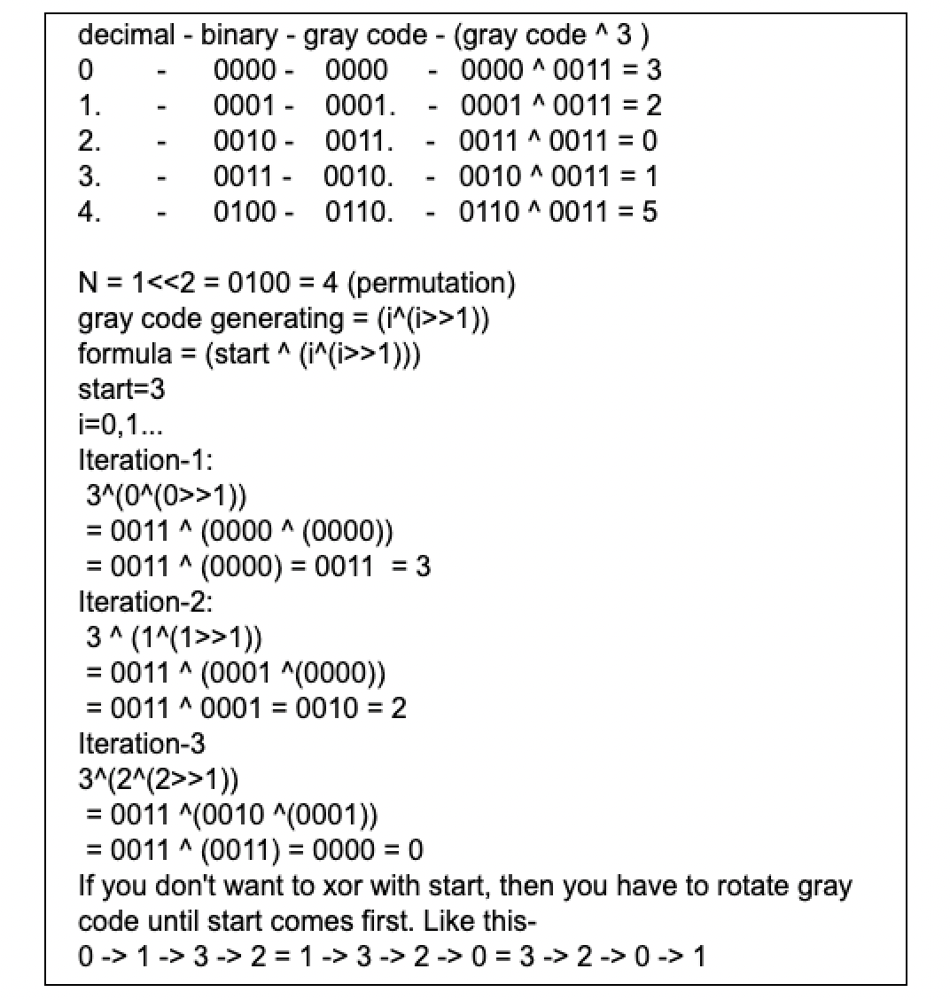

# Clean Code | Simple Solution | C++

**Author:** iamamiya
**Votes:** 8
**Link:** [https://leetcode.com/problems/circular-permutation-in-binary-representation/solutions/2406794/](https://leetcode.com/problems/circular-permutation-in-binary-representation/solutions/2406794/)

---



```
class Solution {
public:
    vector<int> circularPermutation(int n, int start) {
        int N= 1<<n;
        vector <int> ans;
        for(int i=0;i<N;i++)
            ans.push_back(start ^ (i^(i>>1)));
        return ans;
    }
};

    

```