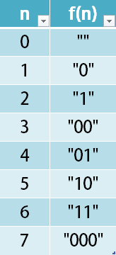

# [1256. Encode Number](https://leetcode.com/problems/encode-number/)

| Category | Difficulty | Likes | Dislikes |
| :------: | :--------: | :---: | :------: |
| Algorithms | Medium | 82 | 257 |

**Tags:** [`math`](https://leetcode.com/tag/math), [`string`](https://leetcode.com/tag/string), [`bit-manipulation`](https://leetcode.com/tag/bit-manipulation)

**Companies:** `quora`

## Description

Given a non-negative integer `num`, Return its *encoding* string.


The encoding is done by converting the integer to a string using a secret function that you should deduce from the following table:





 


**Example 1:**


```

Input: num = 23
Output: &quot;1000&quot;

```


**Example 2:**


```

Input: num = 107
Output: &quot;101100&quot;

```


 


**Constraints:**


	- `0 <= num <= 10^9`

---

**Links:** [Submissions](https://leetcode.com/problems/encode-number/) | [Solutions](https://leetcode.com/problems/encode-number/)
