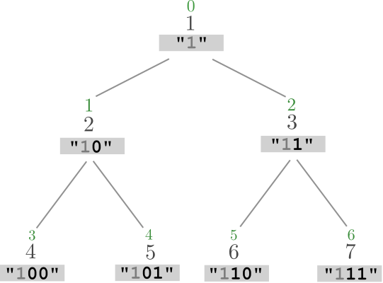

# binary tree ^^

**Author:** andrii_khlevniuk
**Votes:** 2
**Link:** [https://leetcode.com/problems/encode-number/solutions/2279054/](https://leetcode.com/problems/encode-number/solutions/2279054/)

---



```
string encode(int n) 
{
	string out;
	for(++n; n>1; n>>=1) 
		out.push_back('0'+(n&1));
	reverse(begin(out), end(out));
	return out;
}
```