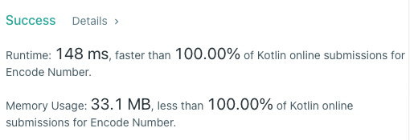

# Kotlin - 148 ms - The sequence is comprised of all possible bit vectors of increasing size

**Author:** ed-karabinus
**Votes:** 0
**Link:** [https://leetcode.com/problems/encode-number/solutions/1195671/](https://leetcode.com/problems/encode-number/solutions/1195671/)

---


```
class Solution {
    companion object {
        private val EMPTY_STRING = ""
        private val ZERO_CHAR = '0'
        private val ONE_CHAR = '1'
        private val BASE_TWO = 2
    }
    
    fun encode(num: Int): String {
        var depth = 0
        var currentNum = 0
        var powerOfTwo = 1
        while (num - currentNum >= powerOfTwo) {
            currentNum += powerOfTwo
            powerOfTwo *= BASE_TWO
            depth++
        }
        val encodingBuilder = StringBuilder(EMPTY_STRING)
        var decayingPowerOfTwo = Math.pow(BASE_TWO.toDouble(), 
                                  depth.toDouble() - 1).toInt()
        while (currentNum < num || encodingBuilder.length < depth) {
            if (num - currentNum >= decayingPowerOfTwo) {
                encodingBuilder.append(ONE_CHAR)
                currentNum += decayingPowerOfTwo
            } else {
                encodingBuilder.append(ZERO_CHAR)
            }
            decayingPowerOfTwo /= BASE_TWO
        }
        return encodingBuilder.toString()
    }
}
```