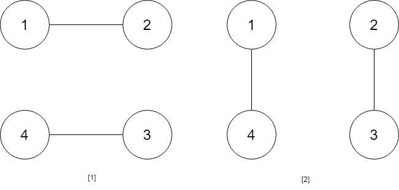
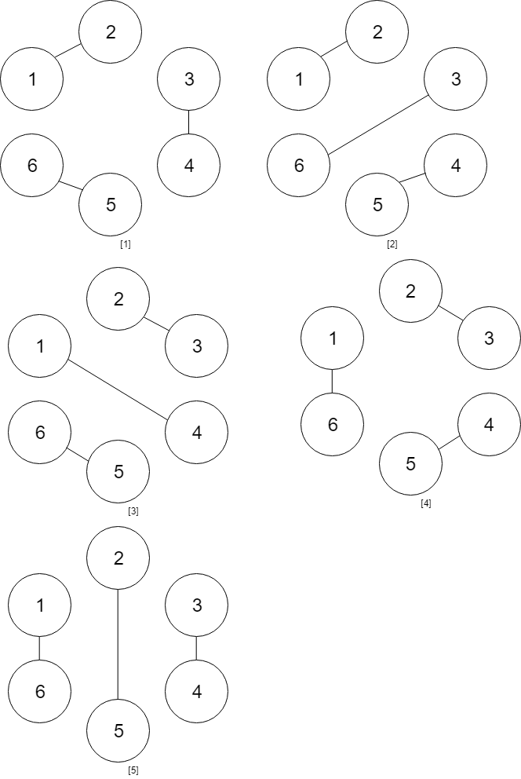

# [1259. Handshakes That Don't Cross](https://leetcode.com/problems/handshakes-that-dont-cross/)

| Category | Difficulty | Likes | Dislikes |
| :------: | :--------: | :---: | :------: |
| Algorithms | Hard | 250 | 17 |

**Tags:** [`math`](https://leetcode.com/tag/math), [`dynamic-programming`](https://leetcode.com/tag/dynamic-programming)

**Companies:** `amazon`

## Description

You are given an **even** number of people `numPeople` that stand around a circle and each person shakes hands with someone else so that there are `numPeople / 2` handshakes total.

Return *the number of ways these handshakes could occur such that none of the handshakes cross*.

Since the answer could be very large, return it **modulo** `10^9 + 7`.

 

**Example 1:**


```

Input: numPeople = 4
Output: 2
Explanation: There are two ways to do it, the first way is [(1,2),(3,4)] and the second one is [(2,3),(4,1)].

```

**Example 2:**


```

Input: numPeople = 6
Output: 5

```

 

**Constraints:**

	- `2 <= numPeople <= 1000`

	- `numPeople` is even.

---

**Links:** [Submissions](https://leetcode.com/problems/handshakes-that-dont-cross/) | [Solutions](https://leetcode.com/problems/handshakes-that-dont-cross/)
