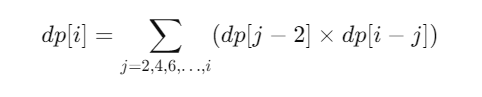

# Easy C++ solution.

**Author:** anub018
**Votes:** 0
**Link:** [https://leetcode.com/problems/handshakes-that-dont-cross/solutions/5917699/](https://leetcode.com/problems/handshakes-that-dont-cross/solutions/5917699/)

---

# Intuition
The problem can be visualized as forming pairs of people such that none of the handshakes cross. To approach this, we can think of the first person as a pivot and pair them with another person, dividing the remaining people into smaller subproblems:

1. Fix the first person (Person 1) and pair them with another person, say the second or the last person. If they shake hands, the remaining people are split into smaller groups that also need to shake hands without crossing.

1. If we fix Person 1 to shake hands with Person 2, the rest of the people (starting from Person 3 onward) form a smaller subproblem. Similarly, if we fix Person 1 to shake hands with the last person (Person N), the remaining people are divided into two independent groups: one group from Person 2 to Person N-1 and another group of people from Person 3 onward. These groups form smaller subproblems that follow the same structure.

1. We can also pair Person 1 with any other person that is not adjacent to them, effectively treating Person 1 as a pivot and exploring all non-adjacent pairings.

1. For example, consider N = 8. First, we can fix Person 1 to shake hands with Person 2, and the remaining 6 people form a smaller subproblem. Similarly, if we fix Person 1 to shake hands with Person 8, the remaining group (Persons 2 to 7) forms a subproblem. By iterating over all possible non-adjacent pairings, we divide the problem into smaller pieces.

1. The key insight is that for any valid pairing of Person 1, the problem reduces into subproblems of smaller numbers of people that also need to be paired without crossing handshakes. This recursive breakdown makes dynamic programming (or memoization) a suitable approach.
# Approach
Define a dynamic programming array dp, where dp[i] represents the number of ways to pair i people without crossing handshakes.

Base cases:

dp[0] = 1: No people, no handshakes, 1 valid way (the empty set).
dp[2] = 1: Only two people, 1 valid handshake.
For each even number of people i, we can fix Person 1 to shake hands with Person j (where j ranges from 2 to i and increments by 2). The remaining people will form two subproblems: one group between Person 2 and Person j-1 and another group from Person j+1 to Person i.

For each such pairing, the total number of ways to solve the problem is the product of the solutions to the two subproblems. We sum up these values to find the number of ways to pair all i people.

This recurrence relation computes the number of valid pairings by exploring all non-adjacent pairs.:

combining it along with the cases where we are fixing with adjacent ones.

Iterate up to the total number of people (numPeople) to compute the result, and return dp[numPeople] modulo 10^9+7.
# Complexity
- Time complexity:
O(n^2), where n is the total number of people. For each number i, we compute a sum over all possible handshakes, leading to a quadratic time complexity.
- Space complexity:
O(n), since we store the number of ways to form valid handshakes for each even number of people in the dp array.

# Code
```cpp []
int mod = 1000000007;
class Solution {
public:
    int numberOfWays(int n) {
    vector<int> dp=vector<int>(1001,0);
        dp[2]=1;
        dp[4]=2;
        dp[6]=5;
        for(int i=8;i<=n;i+=2){
             dp[i] = (2LL * dp[i - 2] % mod) % mod;
            for (int j = 4; j <= i - 2; j += 2) {
                dp[i] = (dp[i] + 1LL * dp[j - 2] * dp[i - j] % mod) % mod;
            }
        }

        return dp[n];
    }
};
```