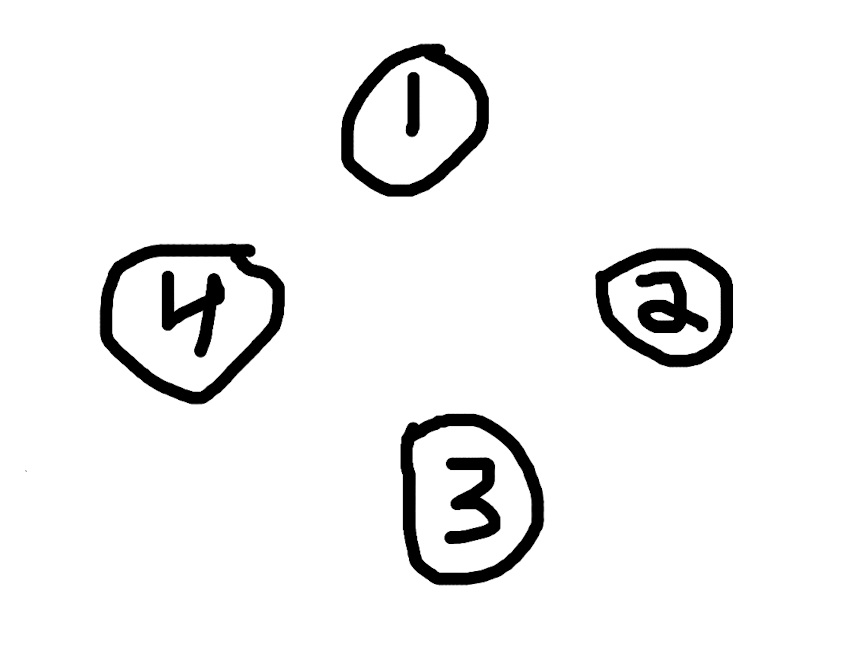
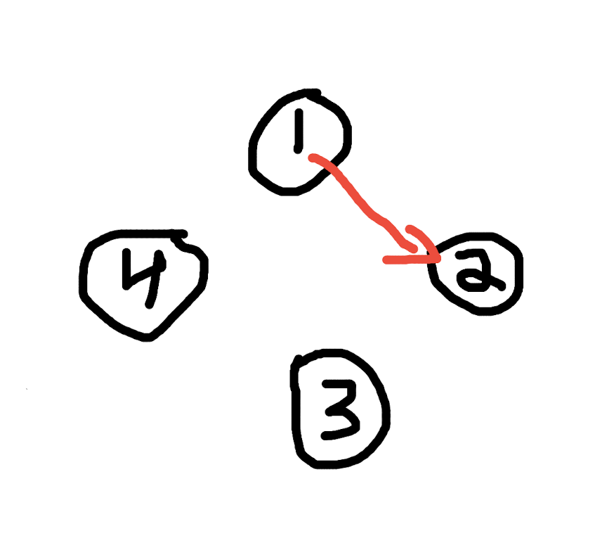
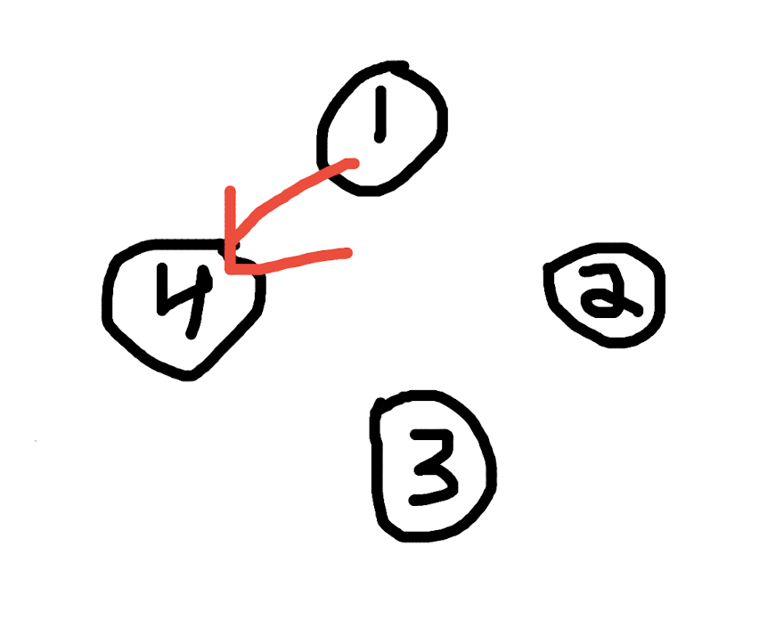
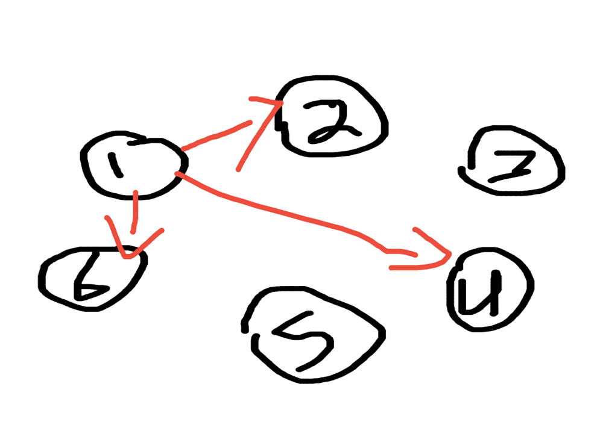

# Detailed explanation of why the dp solution works, and a similar problem to look at

**Author:** abaransy
**Votes:** 14
**Link:** [https://leetcode.com/problems/handshakes-that-dont-cross/solutions/953828/](https://leetcode.com/problems/handshakes-that-dont-cross/solutions/953828/)

---

```
const numberOfWays = n => {
    let mod = BigInt(1000000007);
    let dp = new Array((n >> 1) + 1).fill(0n); // n >> 1 is just a fancy way of dividing n by 2 
    
    dp[0] = dp[1] = 1n;

    for (let i = 2; i <= n >> 1; i++) {
        for (let j = 1; j <= i; j++) {
            dp[i] = (dp[i] + dp[j - 1] * dp[i - j]) % mod;
        }
    }
    
    return dp[dp.length - 1]; 
}
```
First, I want to point out how incredibly similar this problem is to https://leetcode.com/problems/unique-binary-search-trees/. 

The above problem states: Given n, how many structurally unique BST's (binary search trees) that store values 1 ... n? 


Here's the solution to unique-binary-search-trees: 
```
const numTrees = n => {
    let dp = new Array(n + 1).fill(0); 
    
    dp[0] = dp[1] = 1; 
    
    for (let i = 2; i <= n; i++) {
        for (let j = 1; j <= i; j++) {
            dp[i] += dp[j - 1] * dp[i - j]; 
        }
    }
    
    return dp[dp.length - 1]; 
}
```

I wanted to understand why these nearly identical procedures give correct answers to two seemingly unrelated problms. My conclusion is that the best way to understand is to map the procedure to a visual diagram. In other words, I want to know what these loops represent in terms of the people standing in the circle and their handshakes. 



In the image above, let's try to understand what's going on from the perspective of person #1. 

Person #1 has (n / 2 = 4 / 2 = 2) options as to whose hand to shake. Either he shakes #2, or #4. 
He cannot shake #3, as #2 would no longer be able to shake #4 due to crossing. 

Each location in the dp represents the solution for a given number of people. 
The first location, 0, represents the solution for 0 people. 
The second location, 1, represents the solution for 2 people. 
The third location, 2, represents the soltuion for 4 people, and so on. 

As base cases, let's say that dp[0] = dp[1] = 1. If there are zero people, there is 1 unique handshake (I know this sounds weird, but just accept it for now, you'll see why it makes sense in a bit), and if there are two people, there is also 1 unique handshake, that is, the handshake between these two people. 

Let's go back to #1's perspective, and let's see what happens when #1 decides whose hand to shake. 

n  = 4, 
dp = [1, 1, 0]; 



If #1 decides to shake #2's hand, how many people are to the left of #1? Zero. There are no people standing to the left of #1. 
How many people are to the right of #1? Two. Therefore, we can say that if #1 shakes #2's hand, there are dp[0] * dp[1] (solution for zero people * solution for two people) ways to shake hands. Ok, so let's add dp[0] * dp[1] = 1 to our dp[2].  


dp = [1, 1, 1]; 



If #1 decides to shake #4's hand, how many people are to the left of #1? Two. There are two people standing to the left of #1. 
How many people are to the right of #1? Zero. Therefore, we can say that if #1 shakes #4s hand, there are dp[1] * dp[0] (solution for two people * solution for zero people) ways to shake hands. Ok, so let's add dp[1] * dp[0] = 1 to our dp[2].  

dp = [1, 1, 2]; 

And there we go, if we have 4 people, we have dp[2] = 2 ways to shake hands. 

Now let's exand this to 6 people and see what happens. 

n = 6
dp = [1, 1, 2]

Let's assume that the outer i loop has already iterated once, thus solving the problem for 4 people and placing the answer in dp[2].

What happens when i = 3?



Again, let's think from #1's perspective. #1 can either shake #2's hand, #4's hand, or #6's hand. If he shakes #2's hand, there are zero people on the left, four people on the right (3, 4, 5, 6). So, we multiply dp[0] * dp[2] (solution for zero people * solution for four people) and add that to dp[3] .

dp = [1, 1, 2, 2]

If he shakes #4's hand, there are two people on the left (2, 3), two people on the right (5, 6). So, we multiply dp[1] * dp[1] (solution for two people * solution for two people) and add that to dp[3] .

dp = [1, 1, 2, 3]

If he shakes #6s hand, there are four people on the left (2, 3, 4, 5), zero people on the right. So, we multiply dp[2] * dp[0] (solution for four people * solution for zero people) and add that to dp[3] .

dp = [1, 1, 2, 5]

And there we go! dp[3] now contains the solution to 6 people. 

At each new iteration of i, we explore each option of dividing the circle, multiplying the solutions for the left and right side, and adding them to dp[i]. 

I strongly recommend looking at the unique binary trees problem and exploring how the dp procedure to that one relates.
