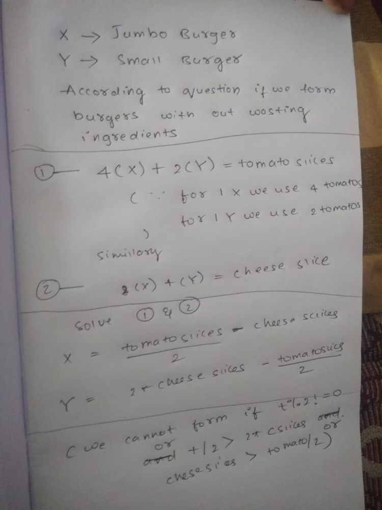

# Easy java to understand beats 100%

**Author:** vkshnlucky
**Votes:** 8
**Link:** [https://leetcode.com/problems/number-of-burgers-with-no-waste-of-ingredients/solutions/441434/](https://leetcode.com/problems/number-of-burgers-with-no-waste-of-ingredients/solutions/441434/)

---

```
class Solution {
    public List<Integer> numOfBurgers(int t, int c) {
        List<Integer> ret = new ArrayList<>();
        if(t%2!=0||((t/2)>2*c)||c>(t/2))return ret;
        ret.add((t/2-c));
        ret.add((2*c-t/2));
        return ret;
    }
}
```

