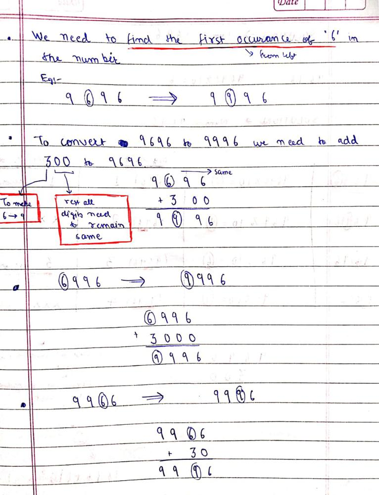
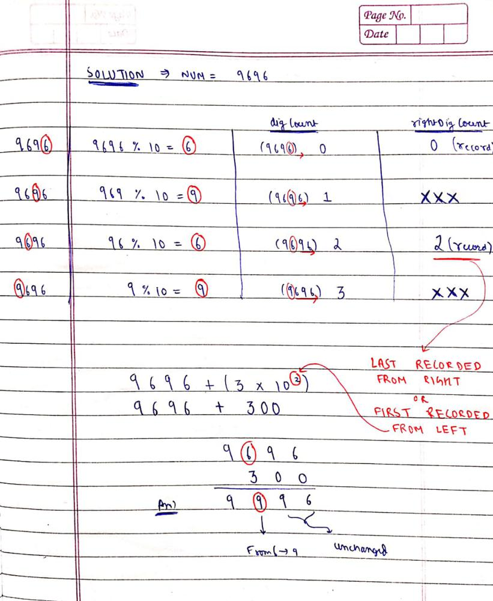

# Without String Conversion || Written Explanation || Easy to understand

**Author:** MohakHarjani
**Votes:** 73
**Link:** [https://leetcode.com/problems/maximum-69-number/solutions/2786958/](https://leetcode.com/problems/maximum-69-number/solutions/2786958/)

---




```
class Solution {
public:
    int maximum69Number (int num) 
    {
        //first encountered '6' from left = last encountered '6' from right
        
        int rightDigCount = -1; //number of digits to right of last encountered '6'
        int digCount = 0; //number of digits to right of any dig at some instance
        int temp = num; 
        //====================================================================
        while(temp > 0) //digits are being recorded from right to left of num
        {
            int dig = temp % 10;
            if (dig == 6) rightDigCount = digCount; //record the rightDigCount when a '6' is encountered
            
            digCount++;
            temp = temp / 10;
        }
        //======================================================================
        if (rightDigCount == -1) return num;
        int ans = num + (3 * pow(10, rightDigCount));
        return ans;
    }
};
```
