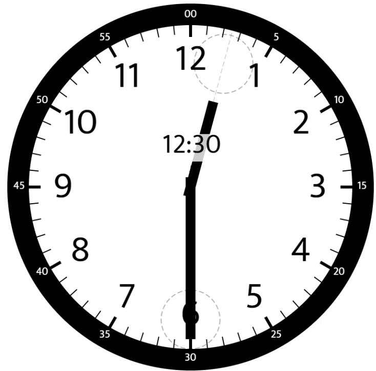
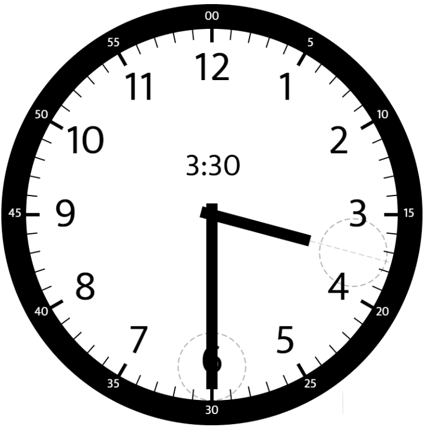

# [1344. Angle Between Hands of a Clock](https://leetcode.com/problems/angle-between-hands-of-a-clock/)

| Category | Difficulty | Likes | Dislikes |
| :------: | :--------: | :---: | :------: |
| Algorithms | Medium | 1368 | 248 |

**Tags:** [`math`](https://leetcode.com/tag/math)

**Companies:** `amazon`, `epic-systems`, `microsoft`, `facebook`, `siemens`

## Description

Given two numbers, `hour` and `minutes`, return *the smaller angle (in degrees) formed between the *`hour`* and the *`minute`* hand*.

Answers within `10^-5` of the actual value will be accepted as correct.

 

**Example 1:**


```

Input: hour = 12, minutes = 30
Output: 165

```

**Example 2:**


```

Input: hour = 3, minutes = 30
Output: 75

```

**Example 3:**


```

Input: hour = 3, minutes = 15
Output: 7.5

```

 

**Constraints:**

	- `1 <= hour <= 12`

	- `0 <= minutes <= 59`

---

**Links:** [Submissions](https://leetcode.com/problems/angle-between-hands-of-a-clock/) | [Solutions](https://leetcode.com/problems/angle-between-hands-of-a-clock/)
