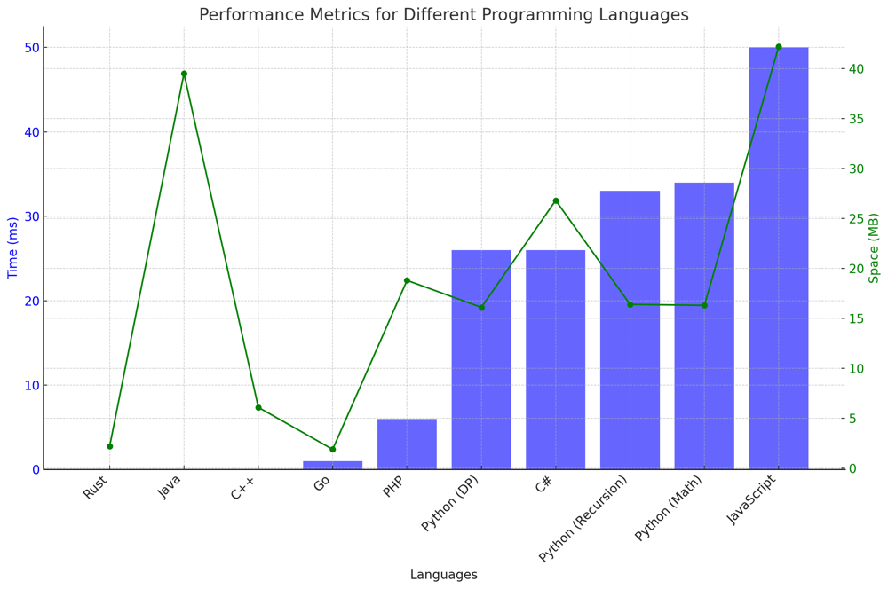

# ✅ 99.57% DP & Math & Recursion

**Author:** vanAmsen
**Votes:** 134
**Link:** [https://leetcode.com/problems/count-all-valid-pickup-and-delivery-options/solutions/4024280/](https://leetcode.com/problems/count-all-valid-pickup-and-delivery-options/solutions/4024280/)

---

# Comprehensive Guide to Solving "Count All Valid Pickup and Delivery Options": Dynamic Programming, Recursion, and Math Approaches

## Introduction & Problem Statement

Greetings, aspiring problem solvers! Today we'll unravel an intriguing combinatorial problem that revolves around orders, pickups, and deliveries\u2014aptly named **Count All Valid Pickup and Delivery Options**. The problem hands you `n` orders, each consisting of a pickup and delivery service. Your goal is to figure out the number of valid pickup and delivery sequences such that the delivery of each order `i` occurs after its corresponding pickup.

## Key Concepts and Constraints

### What Makes this Problem Unique?

1. **Pairing**:  
   Each order contains a pair of services: a pickup (P) and a delivery (D). For order `i`, the pickup is denoted as `P_i` and the delivery as `D_i`.
  
2. **Order Matters**:  
   The sequences are sensitive to the order. `(P1, D1, P2, D2)` is considered different from `(P2, D2, P1, D1)`.

3. **Constraints**:  
   - `n` ranges between 1 and 500.

---

# Strategies to Tackle the Problem: A Three-Pronged Approach

## Live Coding 3-in-1 & Explaining
https://youtu.be/wj3vBARk8-U?si=_gFWsftHvd3o_zYN

## Method 1: Dynamic Programming 

## What is Dynamic Programming (DP)?

Think of Dynamic Programming as a way to build a solution step-by-step, just like building a LEGO tower. You start with one block and then keep adding more to get the final shape. In a similar way, you start with a simple problem, solve it, and use that solution to solve more complex problems.

## Detailed Steps

### Step 1: Setting a Starting Point (Base Case)

- **Why do we start with `count = 1`?**  
  - Imagine you have just one order. This order has one pickup (P1) and one delivery (D1). The only rule is that the delivery (D1) must come after the pickup (P1). This gives you just one way to arrange this order: (P1, D1). So, you start your count at 1.

### Step 2: Building Up the Solution (Iterative Computation)

- **Why do we start the loop from 2?**  
  - You've already solved the problem for 1 order. Now you start adding more orders into the mix, one at a time, starting from the second order.

- **What's the deal with `2i - 1` and `i`?**  
  - Let's say you're at the `i-th` order. You would have `i` pickups and `i` deliveries, making it `2i` positions in total. 
  - Now, when you're adding the pickup (Pi) for the `i-th` order, you can put it anywhere except at the end. That's `2i - 1` choices for Pi.
  - For Di, you only have `i` choices, because it must come after Pi.

- **How do we update `count`?**  
  - Multiply your current count by `(2i - 1) * i` to get the new count. This gives you the total number of sequences for `i` orders.

### Step 3: The Final Answer

- **How do you get the final answer?**  
  - After you've gone through all the orders, the value in `count` will be the total number of valid sequences. Return this value.

## Time and Space Complexity

- **Time Complexity**: The solution is speedy; it only takes linear time (`O(n)`).
  
- **Space Complexity**: We don't use much extra space; just one variable (`count`). So the space complexity is `O(1)` or constant.

## Clarification for the Formula `(2i - 1) * i`

- **Why `(2i - 1) * i`?**  
  - Think of it this way: for each new order, you have a "slot" for pickup and a "slot" for delivery. The pickup can go in `2i - 1` places, and the delivery in `i` places. You can think of these as dimensions: `2i - 1` for the width and `i` for the height. The total area or number of possibilities is the width multiplied by the height, which is `(2i - 1) * i`.

# Code Dynamic Programming
``` Python []
MOD = 10**9 + 7
class Solution:
    def countOrders(self, n: int) -> int:
        count = 1 
        for i in range(2, n + 1):
            count = (count * (2 * i - 1) * i) % MOD
        return count
```
``` Go []
const MOD = 1000000007

func countOrders(n int) int {
    count := 1
    for i := 2; i <= n; i++ {
        count = (count * (2 * i - 1) * i) % MOD
    }
    return count
}
```
``` Rust []
impl Solution {
    const MOD: i64 = 1_000_000_007;
    
    pub fn count_orders(n: i32) -> i32 {
        let mut count: i64 = 1;
        for i in 2..=n {
            count = (count * ((2 * i - 1) as i64) * (i as i64)) % Self::MOD;
        }
        count as i32
    }
}
```
``` C++ []
class Solution {
const int MOD = 1e9 + 7;
public:
    int countOrders(int n) {
        long long count = 1;
        for (int i = 2; i <= n; ++i) {
            count = (count * (2 * i - 1) * i) % MOD;
        }
        return (int)count;
    }
};
```
``` Java []
public class Solution {
    private static final int MOD = 1000000007;

    public int countOrders(int n) {
        long count = 1;
        for (int i = 2; i <= n; i++) {
            count = (count * (2 * i - 1) * i) % MOD;
        }
        return (int) count;
    }
}
```
``` JavaScript []
/**
 * @param {number} n
 * @return {number}
 */
const MOD = 1e9 + 7;
var countOrders = function(n) {
    let count = 1;
    for (let i = 2; i <= n; i++) {
        count = (count * (2 * i - 1) * i) % MOD;
    }
    return count;
}
```
``` PHP []
class Solution {

    const MOD = 1000000007;

    /**
     * @param Integer $n
     * @return Integer
     */
    public function countOrders($n) {
        $count = 1;
        for ($i = 2; $i <= $n; $i++) {
            $count = ($count * (2 * $i - 1) * $i) % self::MOD;
        }
        return $count;
    }
}
```
``` C# []
public class Solution {
    private const int MOD = 1000000007;

    public int CountOrders(int n) {
        long count = 1;
        for (int i = 2; i <= n; i++) {
            count = (count * (2 * i - 1) * i) % MOD;
        }
        return (int)count;
    }

}
```

---

## Method 2: Recursion with Memoization

## The Sophistication of Memoization

Memoization is an elegant technique that enhances the efficiency of recursive algorithms by storing the results of costly function calls. Imagine having a smart notebook that instantly provides answers to questions you've already solved; that's what memoization does for your code.

## A Comprehensive Step-by-Step Guide

### Step 1: Create a Memoization Dictionary
- **Why Use a Dictionary Called `memo`?**  
  - The `memo` dictionary serves as a caching mechanism. It stores the number of valid sequences for a given `n` to avoid recalculating them repeatedly.

### Step 2: Base Case
- **Why Is the Base Case `n = 1`?**  
  - When `n = 1`, there is only a single pair of pickup and delivery. There's just one way to sequence this pair\u2014by picking up first and then delivering. Hence, for `n = 1`, there is only one valid sequence.

### Step 3: Recursive Calls Augmented with Memoization
- **What Happens During the Recursive Calls?**  
  - The function calls itself with `n - 1` as the argument.
  - Before diving deeper into recursion, it checks if the result for this `n` is already in `memo`. If so, it returns the stored result.
  - If not, it calculates the number of valid sequences for this `n` using the formula `count = countOrders(n - 1) * (2 * n - 1) * n` and then stores this result in `memo`.

### Step 4: Return the Final Answer
- **How Do We Get to the Final Answer?**  
  - The `memo` dictionary will contain the number of valid sequences for the initial `n`. You simply return this value as the final result.

## Time and Space Complexity Analysis

- **Time Complexity**: `O(n)`  
  Each unique value of `n` is calculated only once, and each calculation is done in constant time.
  
- **Space Complexity**: `O(n)`  
  The memoization dictionary stores up to `n` unique entries, making the space complexity linear.

## Code Recursion with Memoization
``` Python []
MOD = 10**9 + 7    
class Solution:
    memo = {}
    def countOrders(self, n: int) -> int:
        if n == 1:
            return 1
        if n in self.memo:
            return self.memo[n]
        
        count = (self.countOrders(n - 1) * (2 * n - 1) * n) % MOD
        self.memo[n] = count
        return count
```
``` Go []
const MOD = 1000000007

var memo = map[int]int{}

func countOrders(n int) int {
	if n == 1 {
		return 1
	}
	if val, exists := memo[n]; exists {
		return val
	}

	count := (countOrders(n-1) * (2*n - 1) * n) % MOD
	memo[n] = count
	return count
}
```

---

## Method 3: The Mathematical Approach 

## The Majesty of Mathematics

Mathematics is like a teleportation device in the world of algorithms. It can directly take you to the solution, bypassing the need for iterative calculations or recursion.

## A Thorough Step-by-Step Guide

### Step 1: Calculating Factorial and Power
- **Why Calculate `(2n)!` and `2^n`?**  
  - The number of valid sequences can be directly derived using combinatorial mathematics. The formula involves `(2n)!` as well as `2^n`.

### Step 2: Final Calculation and Return
- **How Is the Final Result Calculated?**  
  - The number of valid sequences is given by the formula `(2n)! / 2^n`. This can be calculated using modulo arithmetic to keep the numbers manageable.

## Time and Space Complexity Analysis

- **Time Complexity**: `O(n)`  
  Calculating `(2n)!` involves `O(n)` operations.
  
- **Space Complexity**: `O(1)`  
  The space complexity is constant as we only use a few variables to store intermediate and final results.

## Code Mathematical
``` Python []
MOD = 10**9 + 7    
class Solution:
    def countOrders(self, n: int) -> int:
        two_n_fact = factorial(2 * n) % MOD
        two_pow_n = pow(2, n, MOD)
        return (two_n_fact * pow(two_pow_n, -1, MOD)) % MOD
```
``` Go []
const MOD = 1000000007

func factorial(n int) int {
	result := 1
	for i := 1; i <= n; i++ {
		result = (result * i) % MOD
	}
	return result
}

func pow(base, exp, mod int) int {
	result := 1
	for exp > 0 {
		if exp%2 == 1 {
			result = (result * base) % mod
		}
		base = (base * base) % mod
		exp /= 2
	}
	return result
}

func countOrders(n int) int {
	twoNFact := factorial(2 * n) % MOD
	twoPowN := pow(2, n, MOD)
	return (twoNFact * pow(twoPowN, MOD-2, MOD)) % MOD
}
```

## Performance

| Language  | Time (ms) | Space (MB)  | Method      |
|-----------|-----------|-------------|-------------|
| Rust      | 0 ms      | 2.2 MB      | DP         |
| Java      | 0 ms      | 39.5 MB     | DP          |
| C++       | 0 ms      | 6.1 MB      | DP          |
| Go        | 1 ms      | 1.9 MB      | DP          |
| PHP       | 6 ms      | 18.8 MB     | DP          |
| Python    | 26 ms     | 16.1 MB     | DP          |
| C#        | 26 ms     | 26.8 MB     | DP          |
| Python    | 33 ms     | 16.4 MB     | Recursion   |
| Python    | 34 ms     | 16.3 MB     | Math        |
| JavaScript| 50 ms     | 42.2 MB     | DP          |



## Live Coding DP & Memo in Go
https://youtu.be/13FJ1NIyE8w?si=1y-HxMjfcD0k99ZQ

## Code Highlights and Best Practices

- All three methods\u2014Dynamic Programming, Recursion with Memoization, and the Mathematical Approach\u2014provide different lenses through which to examine the problem, enhancing your understanding and skills.
- Dynamic Programming is straightforward, building upon an initial base case.
- Recursion with Memoization avoids redundant calculations by storing past results.
- The Mathematical Approach directly computes the answer using combinatorics, reducing the algorithmic complexity.

By mastering these techniques, you'll be well-equipped to tackle similar combinatorial problems that require counting the number of possible sequences or combinations.