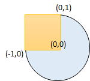

# [1401. Circle and Rectangle Overlapping](https://leetcode.com/problems/circle-and-rectangle-overlapping/)

| Category | Difficulty | Likes | Dislikes |
| :------: | :--------: | :---: | :------: |
| Algorithms | Medium | 401 | 85 |

**Tags:** [`math`](https://leetcode.com/tag/math), [`geometry`](https://leetcode.com/tag/geometry)

**Companies:** `google`

## Description

You are given a circle represented as `(radius, xCenter, yCenter)` and an axis-aligned rectangle represented as `(x1, y1, x2, y2)`, where `(x1, y1)` are the coordinates of the bottom-left corner, and `(x2, y2)` are the coordinates of the top-right corner of the rectangle.

Return `true`* if the circle and rectangle are overlapped otherwise return *`false`. In other words, check if there is **any** point `(x_i, y_i)` that belongs to the circle and the rectangle at the same time.

 

**Example 1:**


```

Input: radius = 1, xCenter = 0, yCenter = 0, x1 = 1, y1 = -1, x2 = 3, y2 = 1
Output: true
Explanation: Circle and rectangle share the point (1,0).

```

**Example 2:**

```

Input: radius = 1, xCenter = 1, yCenter = 1, x1 = 1, y1 = -3, x2 = 2, y2 = -1
Output: false

```

**Example 3:**


```

Input: radius = 1, xCenter = 0, yCenter = 0, x1 = -1, y1 = 0, x2 = 0, y2 = 1
Output: true

```

 

**Constraints:**

	- `1 <= radius <= 2000`

	- `-10^4 <= xCenter, yCenter <= 10^4`

	- `-10^4 <= x1 < x2 <= 10^4`

	- `-10^4 <= y1 < y2 <= 10^4`

---

**Links:** [Submissions](https://leetcode.com/problems/circle-and-rectangle-overlapping/) | [Solutions](https://leetcode.com/problems/circle-and-rectangle-overlapping/)
