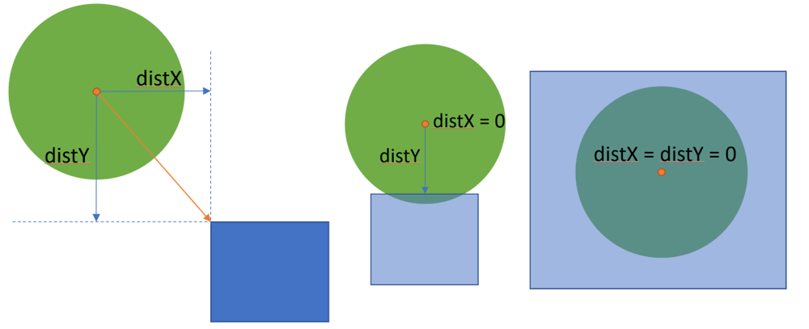

# 4 lines C++ O(1): Test shortest distance from center to rect (with pics)

**Author:** rarakasm
**Votes:** 49
**Link:** [https://leetcode.com/problems/circle-and-rectangle-overlapping/solutions/563341/](https://leetcode.com/problems/circle-and-rectangle-overlapping/solutions/563341/)

---

Find the shortest distance from the center to the rect and compare it to the radius.


```
class Solution {
public:
    bool checkOverlap(int radius, int x_center, int y_center, int x1, int y1, int x2, int y2) {
        int edgeX = (x_center < x1) ? x1 : (x_center > x2) ? x2 : x_center;
        int edgeY = (y_center < y1) ? y1 : (y_center > y2) ? y2 : y_center;
        int distX = x_center - edgeX, distY = y_center - edgeY;
        return distX * distX + distY * distY <= radius * radius;
    }
};
```