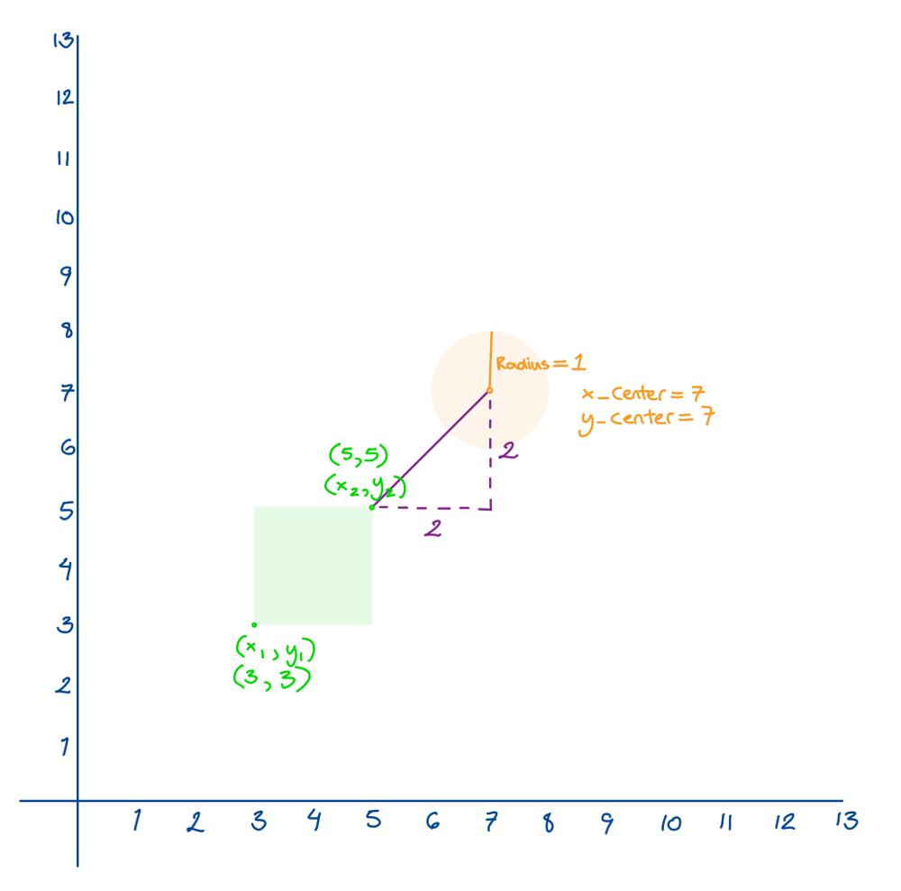

# Golang solution faster than 100% with explanation and images

**Author:** nathannaveen
**Votes:** 1
**Link:** [https://leetcode.com/problems/circle-and-rectangle-overlapping/solutions/1104674/](https://leetcode.com/problems/circle-and-rectangle-overlapping/solutions/1104674/)

---

**The Main Idea**

The idea of this solution is to find the distance from the middle of the circle to the edge of a rectangle, and if the distance is smaller than or equal to the radius, we know that the rectangle overlaps with the circle.

If you don't understand, look at the following images:




> As you can see, the circle and the rectangle do not overlap, and this can be shown by the distance between the center of the circle and the closest edge of the rectangle. The length is `\u221A8 = 2.82842712474619`, `2.82842712474619` is greater than the radius of `1`, so we know that the circle and the rectangle don't overlap.


> In the image above, we can see that the circle and the edge of the rectangle overlaps. And we can see that the distance between the closest edge of the square and the center of the circle is equal to the radius, so we can see that the rectangle and the rectangle overlap.


> In the image above, we can see that the circle and the rectangle overlap. The distance between the center of the circle and the closest point on the rectangle is `\u221A5 = 2.23606797749979` and `2.23606797749979 < radius` because `radius = 3`. Since the distance is smaller than the `radius`, we can say that the two shapes overlap.

**How It Works:**

Now that we have covered the main idea of this function, we can get into the details.

**The first part is:**

```
if x_center < x2 && x_center > x1 && y_center < y2 && y_center > y1 {
    return true
}
```

The part above is for if the circle inside the square. Such as like:


As you can see, the circle radius is smaller than the distance of the closest edge and the center of the circle. We know that the circle and the rectangle overlap, but the computer thinks that they don't overlap because the `distance from the center of the circle to the edge of the rectangle > radius`, so we have to make sure that this is counted as an overlap. We check whether this is overlap by checking whether the center of the circle is between the two x's and between the two y's.

**The next part:**

```
if ((y1 <= y_center+radius && y1 >= y_center) ||
    (y2 >= y_center-radius && y2 <= y_center)) && x_center >= x1 &&
    x_center <= x2 {
    
    return true
}
```

This can be used for something like the example below:


The main idea of:

`((y1 <= y_center+radius && y1 >= y_center) || (y2 >= y_center-radius && y2 <= y_center)) && x_center >= x1 && x_center <= x2` 

is: 

`(y1 <= y_center + radius || y2 >= y_center - radius) && x_center >= x1 && x_center <= x2`

Then after that, we can start to understand the additional parts.

First, `y1 <= y_center + radius` is for if the circle is beneath the rectangle, just like the image below.


`y1 <= y_center + radius` in this example is `6 <= 5 + 2` which equals `6 <= 7`. So for this example the `y`'s' overlap.

`y2 >= y_center - radius` is for when the circle is on top of the rectangle like in the picture below:


`y2 >= y_center - radius` in this example is `4 >= 6 - 2` which is `4 = 4`. As we can see the `y`'s' overlap. 

The next part, `x_center >= x1 && x_center <= x2` is for checking whether the center of the circle is inside the `x`'s values of the rectangle, so we can use the example above again. 

As we said before the `y` parts of the shapes overlap. And now we can see that `x_center = 8`. `8 > 5`, `x1 = 5`, and `8 < 10`, and `x2 = 8`.

We can see an example where the `y` parts overlap, but the `x`'s parts don't.


The `y` parts work, `y2 >= y_center - radius`, which equals `4 >= 5 - 2` and when simplifyed `4 >= 3`. But the `x` parts don't work because the equations are `x_center >= x1` and `x_center <= x2`, and when we put in our numbers we get `13 >= 5` but when we put in the numbers into the second equation, `13 > 10` while we want `x_center <= x2`. So we know that the shapes don't overlap.

It also checks whether `y1 >= y_center` and `y2 <= y_center` because we want to make sure that we don't `return true` for extra test cases.

**The Next Part:**

```
if y_center <= y2 && y_center >= y1 && ((x_center-radius <= x2 && 
    x_center >= x2) || (x_center+radius >= x1 && x_center <= x1)) {
    
    return true
}
```

We use this part if the part before fails. This checks whether the circle is on either side of the rectangle.

This checks whether the `y_center` is greater than or equal to `y1` and if it is smaller than or equal to `y2`. Then it checks whether the `x_center - radius` is smaller than or equal to `x2`, or `x_center - radius >= x1`. It also checks whether `x_center >= x2` and `x_center <= x1`, just like the previous part.

We can explain this with the following images:


This circle is on the right of the rectangle.

We can see that the `y_center = 4` and `4 < 7`, `y2 = 7`, and `4 > 1`, `y1 = 1`. We can see that `((x_center-radius <= x2 && x_center >= x2) || (x_center+radius >= x1 && x_center <= x1))` is true because `x_center-radius <= x2 && x_center >= x2`, since `x_center = 4`, and that `radius = 2`. `4 - 2 <= 3` and `4 > 3` so we return true.

The next image is on the left of the image:


The `y` part is the same as the last image, so we know that the `y` part overlaps. So we can see that the `y` part overlaps. We can use the formula `x_center + radius >= x1 && x_center <= x1`. `x_center = 3` and the `radius  = 2`. So when we input the numbers into the variables, `3 + 2 >= 4` when simplifyed `5 >= 4`, `x1 = 4`. The next equation is `3 <= 4`. 

As we can see `x_center+radius >= x1 && x_center <= x1` is for if the circle is on the right of the rectangle. And `x_center-radius <= x2 && x_center >= x2` is for if the circle is on the left of the rectangle.


**The last part:**

```
if powerOfTwo(x_center-x1)+powerOfTwo(y_center-y1) <= 
    powerOfTwo(radius) {
    
    return true
}
```

The idea of `powerOfTwo(x_center-x1)+powerOfTwo(y_center-y1) <= powerOfTwo(radius)` is basicly pythagoras theorem, `a^2 + b^2 = c^2`. `a^2 + b^2 = c^2`, and this is basicly `(x_center - x1)^2 + (y_center - y1)^2 = radius^2`. 

The distance formula is `d = sqrt((x1 - x2)^2 + (y1 - y2)^2)`, though for this problem we don't need the `sqrt` so we the equation can be `d = (x1 - x2)^2 + (y1 - y2)^2)`, so we can continue to use `(x_center - x1)^2 + (y_center - y1)^2 = radius^2`. 

All of the following are similar except for different points, `x1, x2, y1, y2, x_center, y_center`.

```
powerOfTwo(x_center-x1)+powerOfTwo(y_center-y2) <= powerOfTwo(radius)

powerOfTwo(x_center-x2)+powerOfTwo(y_center-y1) <= powerOfTwo(radius)

powerOfTwo(x_center-x2)+powerOfTwo(y_center-y2) <= powerOfTwo(radius)
```

## The Code:

``` go
func checkOverlap(radius int, x_center int, y_center int, x1 int, y1 int, x2 int, y2 int) bool {

    if x_center < x2 && x_center > x1 && y_center < y2 && y_center > y1 {
        // Checking whether the circle is in the middle of the square
        return true
    }

    if ((y1 <= y_center+radius && y1 >= y_center) ||
    (y2 >= y_center-radius && y2 <= y_center)) &&
        x_center >= x1 && x_center <= x2 {
        return true
    }

    if y_center <= y2 && y_center >= y1 && ((x_center-radius <= x2 && 
    x_center >= x2) || (x_center+radius >= x1 && x_center <= x1)) {
        return true
    }

    if powerOfTwo(x_center-x1)+powerOfTwo(y_center-y1) <= 
            powerOfTwo(radius) ||
        powerOfTwo(x_center-x1)+powerOfTwo(y_center-y2) <= 
            powerOfTwo(radius) ||
        powerOfTwo(x_center-x2)+powerOfTwo(y_center-y1) <= 
            powerOfTwo(radius) ||
        powerOfTwo(x_center-x2)+powerOfTwo(y_center-y2) <= 
            powerOfTwo(radius) {
        return true
    }

    return false
}

func powerOfTwo(n int) int {
    return n * n
}
```