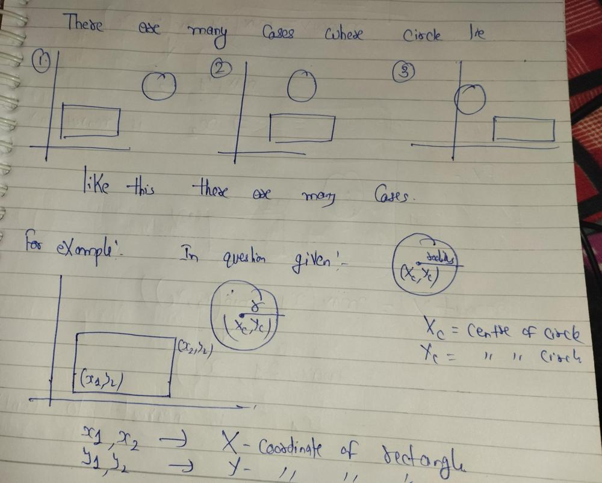
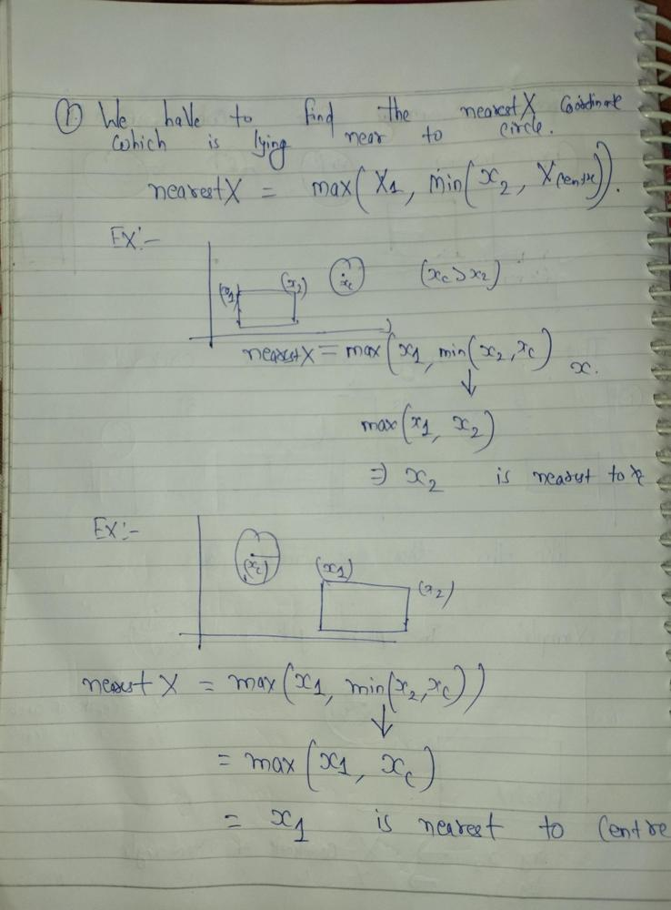
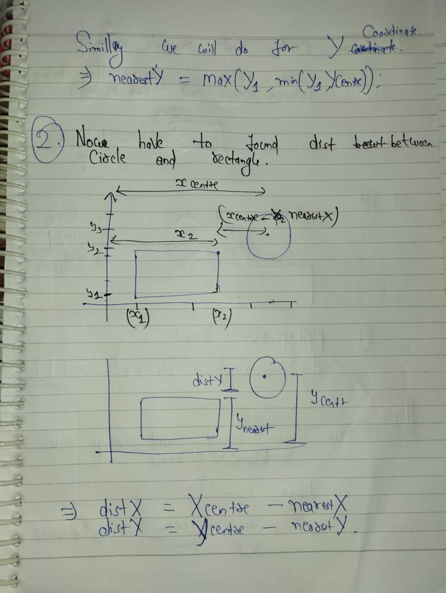
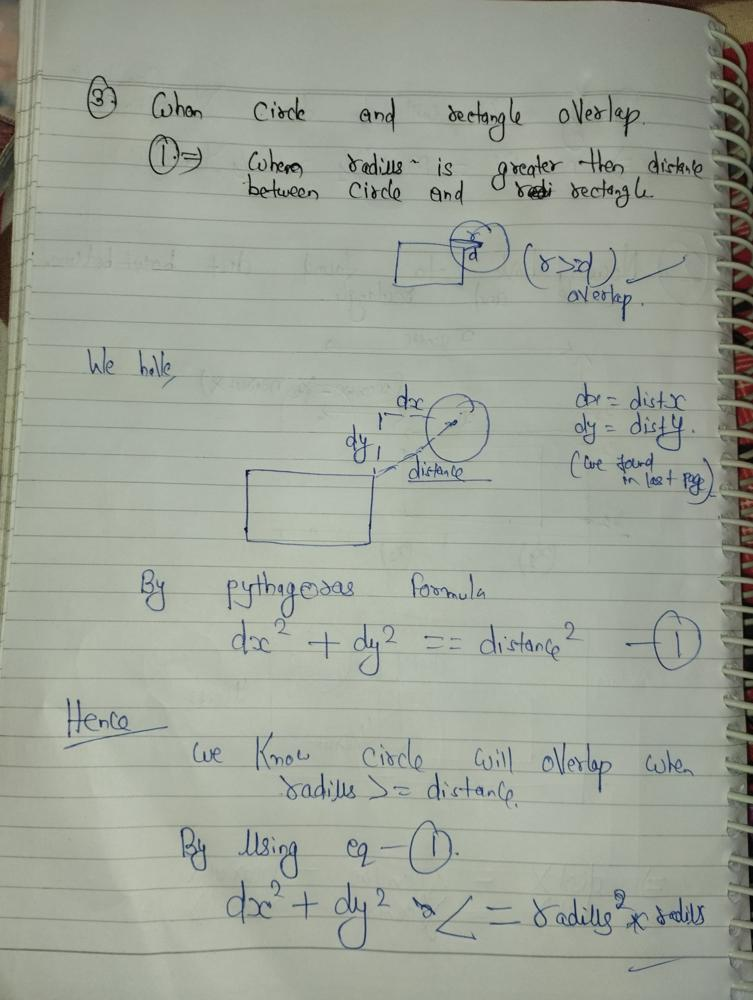

# Trying to Explain with Diagram..

**Author:** ankit1478
**Votes:** 27
**Link:** [https://leetcode.com/problems/circle-and-rectangle-overlapping/solutions/4523344/](https://leetcode.com/problems/circle-and-rectangle-overlapping/solutions/4523344/)

---







# Code
```
class Solution {
    public boolean checkOverlap(int radius, int xCenter, int yCenter, int x1, int y1, int x2, int y2) {
        int nearestX = Math.max(x1, Math.min(x2, xCenter));
        int nearestY = Math.max(y1, Math.min(y2, yCenter));

        int distX = xCenter - nearestX;
        int distY = yCenter - nearestY;
        return distX * distX + distY * distY <= radius*radius;
    }
} 
```