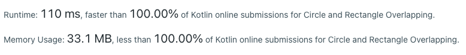

# Kotlin using maths - Runtime: faster than 100.00%,Memory Usage: less than 100.00%

**Author:** Abhimanyu14
**Votes:** 0
**Link:** [https://leetcode.com/problems/circle-and-rectangle-overlapping/solutions/4283626/](https://leetcode.com/problems/circle-and-rectangle-overlapping/solutions/4283626/)

---



```
private fun Int.square() = this * this

fun checkOverlap(radius: Int, xCenter: Int, yCenter: Int, x1: Int, y1: Int, x2: Int, y2: Int): Boolean {
    if ((yCenter >= (y1 - radius)) && (yCenter <= (y2 + radius)) && (xCenter >= x1) && (xCenter <= x2)) {
        return true
    }
    if ((xCenter >= (x1 - radius)) && (xCenter <= (x2 + radius)) && (yCenter >= y1) && (yCenter <= y2)) {
        return true
    }
    if (radius.square() >= ((xCenter - x1).square() + (yCenter - y1).square())) {
        return true
    }
    if (radius.square() >= ((xCenter - x2).square() + (yCenter - y2).square())) {
        return true
    }
    if (radius.square() >= ((xCenter - x1).square() + (yCenter - y2).square())) {
        return true
    }
    if (radius.square() >= ((xCenter - x2).square() + (yCenter - y1).square())) {
        return true
    }
    return false
}
```