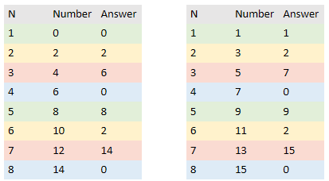
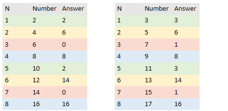

# [Visual Solution] Python | O(1) Time | O(1) Space

**Author:** Argent
**Votes:** 203
**Link:** [https://leetcode.com/problems/xor-operation-in-an-array/solutions/699141/](https://leetcode.com/problems/xor-operation-in-an-array/solutions/699141/)

---

The trivial solution to this problem is the brute force approach. 
This solution uses O(n) Time and O(n) Space

```
class Solution:
    def xorOperation(self, n: int, start: int) -> int:
        
        ans = 0
        nums = [start + n * 2 for n in range(n)]
        
        for n in nums:
            ans = ans ^ n
        return ans 
        
```

While this solution is easy let's try to find something better. Let's print some examples using the previous algorithm by adding in the following line in the for loop.

```
print(f"Nums: {n} Ans: {ans}")
```

.
**Example:**
Start  = 0 ,1 
n = 1...8 



Looking at these charts it is easy to spot a pattern for some of the rows.
The pattern repeats after every 4th number

[N % 4 == 1] Green Row: Ans = Number[N]
[N % 4 == 2] Yellow Row: Ans = 2
[N % 4 == 3] Red Row: Ans = Number[N] ^ 2
[N % 4 == 0] Blue Row: Ans = 0

.
**Next Example:**
Start  = 2 , 3
n = 1...8 



Looking at these charts it is easy to spot a pattern for some of the rows.
Here, the pattern also repeats after every 4th number.

[N % 4 == 1] Green Row: Ans = Number[1]
[N % 4 == 2] Yellow Row: Ans = Number[N] ^ Number[1]
[N % 4 == 3] Red Row: Ans = Number[1] ^ 2
[N % 4 == 0] Blue Row: Ans = Number[N] ^ Number[1] ^ 2

These patterns are a bit trickier to find. Start with the obvious one (Green). We know that each value is based on being xOr with the previous number. For yellow, just the number xOr with Green.

Red value is constant so that one is also easy to find. For blue just follow the same logic used to find yellow. 

If you were to continue this you would see that the examples would repeat themselves

.
**Code Solution:**

```
class Solution:
    def xorOperation(self, n: int, start: int) -> int:
        
        last = start + 2 * (n-1)

        if start % 4 <= 1:
            if n % 4 == 1: 
                return last
            elif n % 4 == 2: 
                return 2
            elif n % 4 == 3: 
                return 2 ^ last
            else: 
                return 0

        else:
            if n % 4 == 1: 
                return start
            elif n % 4 == 2: 
                return start ^ last
            elif n % 4 == 3: 
                return start ^ 2
            else: 
                return start ^ 2 ^ last
```
        
Argent 
Like if this helped 
